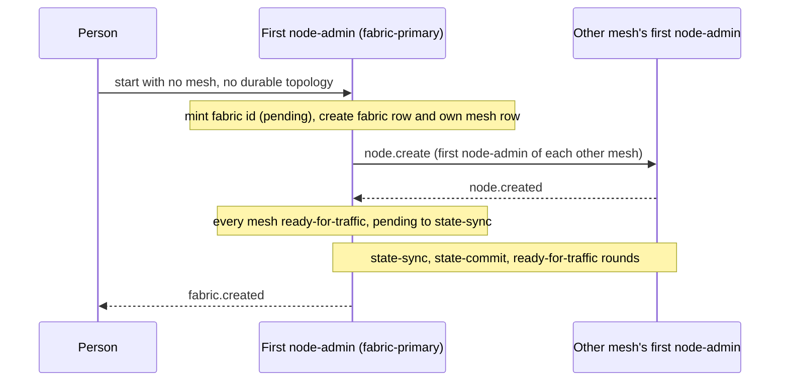

# Fabric create

[Lifecycle index](../fabric-mesh-node-lifecycles.md) · [States](states.md) · [Typed calls and wire mapping](../node-rpc-envelope.md#typed-object-contract)

`fabric.create(spec)` brings a fabric into being with its first mesh. The fabric id is minted with
status pending, each mesh's first node-admin is created, the first mesh's primary becomes the
fabric-primary, and the fabric climbs to ready-for-traffic. This page owns that sequence; the
page that owns each step is linked at the step.

## Operation contract

| Field | Contract |
|---|---|
| Caller / executor | A person starts the first node-admin with no mesh and no durable topology ([start modes](../node-admin-lifecycle.md#3-start-modes)); that node-admin is the executor and the fabric-primary |
| Entry | No fabric exists; the spec names each mesh and its first node-admin |
| Identity order | The fabric id is minted first, each mesh with that fabric id, each node with its mesh id ([identity creation order](../fabric-authority.md#11-identity-creation-order)) |
| Seats | The first node-admin is the only eligible candidate and holds both seats ([elections](../fabric-node-lifecycle-elections.md#5-day-0-preemption-restart-and-replacement)) |
| Rows | The fabric-primary creates the fabric row and its own mesh's row at Day 0, held in the scratchpad until state-commit ([fabric entity](../node-identity-and-state.md#28-a-fabric-is-an-entity-and-the-fabric-primary-owns-it)) |
| Status | pending, then the rounds state-sync, state-commit and ready-for-traffic ([States](states.md#rounds)) |
| Completion | `fabric.created` when the fabric is ready-for-traffic |
| Wire | [Typed-object mapping](../node-rpc-envelope.md#typed-object-contract); the accepted topology is carried by the [Build carrier](../node-rpc-envelope.md#build-op-0x20-rdm) |

## Numbered end-to-end sequence

1. Mint the fabric id; its status is pending.
2. [node.create](node-create.md) for each mesh's first node-admin. A mesh comes into being with
   its first node-admin ([mesh absent](node-create.md#mesh-absent)).
3. The first mesh's first node-admin is the first fabric-primary. It holds both seats, accepts the
   first Build ([ready root](../build.md#101-ready-root--deadlock-guard)),
   and creates the fabric row and its own mesh's row. Every other mesh's row is created by that
   mesh's primary.
4. The fabric leaves pending for state-sync when every mesh the accepted Build names is
   ready-for-traffic ([States](states.md#rounds)).
5. [State-sync](fabric-state-sync.md): the application's `sync_state` hook does its Day-0 work.
6. [State-commit](fabric-state-commit.md): each node writes its scratchpad rows into the store.
7. [Ready-for-traffic](fabric-ready-for-traffic.md): every node has checked in; the application is
   told once and opens client traffic.
8. Emit `fabric.created`. The call ends here.

The statuses are set only by the fabric-primary and carried down in rounds, fabric-primary to
mesh-primaries to nodes; the round checklist is [States](states.md#the-round-checklist).

## Command and completion messages

```text
fabric.create
  → mint fabric id (pending)
  → node.create for each mesh's first node-admin (every FirstStart event, node.created)
  → status rounds: state-sync, state-commit, ready-for-traffic
  ← fabric.created
```

## Mermaid sequence diagram



## Failure and receipts

Failures and stream certainty follow the
[caller execution contract](../node-rpc-envelope.md#caller-execution-and-certainty).

## Observability contract

Trace propagation, step spans and correlation follow the
[runtime spans](../node-rpc-envelope.md#runtime-spans).
