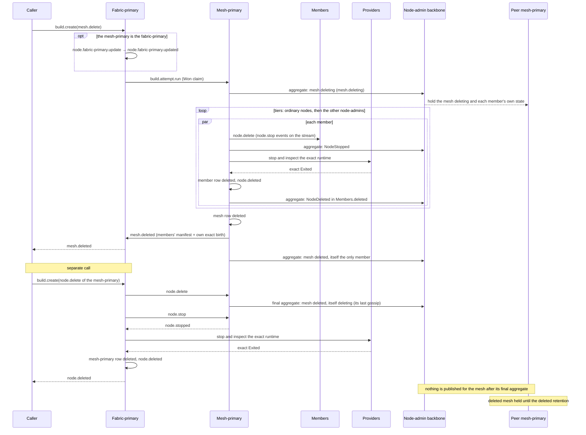

# Mesh delete

[Lifecycle index](../fabric-mesh-node-lifecycles.md) · [States](states.md) · [Typed calls and wire mapping](../node-rpc-envelope.md#typed-object-contract)

`mesh.delete` removes a mesh. The fabric-primary runs it as one Build. Every member except
the mesh-primary is deleted with [node.delete](node-delete.md), ordinary nodes first, then the
other node-admins. The mesh-primary, still alive, reports `mesh.deleted` from their node.delete receipts
and writes the mesh row deleted. The mesh-primary is not deleted inside its own mesh.delete:
someone has to report the end of the mesh, so a separate node.delete, with the fabric-primary as
executor, deletes it afterwards.

## Operation contract

| Field | Contract |
|---|---|
| Caller / driver | Typed caller; the fabric-primary runs it as one Build through the [Build carrier](../node-rpc-envelope.md#build-op-0x20-rdm) |
| Precondition | The fabric has first reached ready-for-traffic. Before then the Build is refused by name, `fabric-not-ready`, and nothing runs ([States](states.md#fabric-not-ready)) |
| Fabric-primary | If the mesh's mesh-primary is the fabric-primary, [node.fabric-primary.update](node-primary-update.md#the-fabric-primary-nodefabric-primaryupdate) runs first with this mesh excluded from the successor search; under [fabric.delete](fabric-delete.md) the fabric-primary's own mesh is deleted last and it stays fabric-primary |
| Mesh state | `mesh.deleting`: the mesh-primary publishes its mesh's status, deleting, as its [MeshStatus](../gossip.md#31-frame-catalog) frame; peers learn it only from the mesh-primary |
| Targets | Every member of the accepted roster except the mesh-primary |
| Executor | The mesh-primary, for each member's node.delete |
| Tiers | Ordinary nodes in parallel, then the other node-admins in parallel; a tier starts only when every node.delete of the tier before it is complete |
| Terminal event | `mesh.deleted`, reported by the mesh-primary, still alive, from its members' node.delete receipts |
| Rows | Each member's row deleted (its node.delete); the mesh row deleted at mesh.deleted, written by the mesh-primary |
| After | The mesh-primary keeps publishing its aggregate until a separate node.delete, with the fabric-primary as executor, deletes it; its final aggregate, the mesh deleted and itself deleting, is its last gossip, and the fabric-primary publishes nothing for the mesh or that admin (R-RX4) |
| Identity | A mesh's deleted and a node's deleted release names as [States](states.md) states; a mesh created again under the same name claims its names over the deleted mesh and node rows |
| Build step key | `mesh.delete:<mesh_id>`; each member's step is its own `node.delete:<path.name>` |
| Forbidden proof | Silence, a closed endpoint, a failed call or a timeout never proves a member exited |

## Numbered end-to-end sequence

1. The caller submits mesh.delete. The fabric-primary accepts the Build, captures the exact
   roster once and claims the attempt for the mesh-primary as executor. If the mesh holds the
   fabric-primary, [node.fabric-primary.update](node-primary-update.md#the-fabric-primary-nodefabric-primaryupdate) runs first with this
   mesh excluded from the successor search and `node.fabric-primary.updated` confirms the committed
   transfer before any member is deleted; the
   new fabric-primary drives the rest.
2. `mesh.deleting`: the mesh-primary publishes its mesh's status, deleting, as its MeshStatus frame.
   Peers apply it under the [external topology rules](../gossip.md#external-topology-when-a-mesh-is-deleted)
   and the [routing rule](states.md#routing-stop).
3. The mesh-primary runs the whole [node.delete](node-delete.md#numbered-end-to-end-sequence)
   for every ordinary node in parallel.
4. When every ordinary node's node.delete is complete, the mesh-primary runs node.delete for the
   other node-admins in parallel, the same way.
5. `mesh.deleted`: when every member has its node.delete receipt, the mesh-primary, still alive,
   writes the mesh row deleted and reports mesh.deleted to the fabric-primary with the members'
   receipt manifest and its own exact birth. The fabric-primary validates the manifest against
   the captured roster ([mesh delete pair](../node-rpc-envelope.md#mesh-delete-command-pair))
   before it accepts the report.
6. After mesh.deleted the mesh-primary keeps publishing its aggregate, itself the only member and
   the mesh deleted ([Mesh delete gossip](../gossip.md#mesh-delete)).
7. A separate [node.delete](node-delete.md) deletes the mesh-primary, the fabric-primary its
   executor. When the delete reaches the mesh-primary, its final aggregate, the mesh deleted and
   itself deleting, is its last gossip: the node.delete's NodeDeleting in aggregate form. The
   fabric-primary stops it, proves its exit and writes its row deleted as the writer of a mesh
   with no primary (R-OW1); it publishes nothing for the mesh or that admin (R-RX4). Receivers
   hold the mesh for the deleted retention from that final aggregate and then nothing
   ([Mesh delete gossip](../gossip.md#mesh-delete)).

<a id="resume-after-the-primarys-loss"></a>
### Resume after the primary's loss

The roster is captured once and never recaptured. When the mesh-primary is lost during
mesh.delete, the fabric-primary resumes the attempt in this order, each step its own durable
receipt:

1. The lost primary's node investigation verdict is recorded as its roster receipt; a verdict of
   `reached` refuses the resume by name, since the primary is not lost.
2. A named amendment, `RosterAmended { predecessor, final_primary }`, admits the new mesh-primary:
   the surviving admin of the mesh the election named or, when none survives, the one
   node-admin the fabric-primary creates for it, the only new node a deleting mesh may gain. Under an in-force fabric.delete no node-admin is created: the mesh is deleted in process at the executor holding the fabric-primary's roles (fabric-recovery.md step 4, Q160). An
   identical amendment replays `AlreadyApplied`; a second amendment for the same predecessor is
   refused by name.
3. The new mesh-primary gets a fresh claim and runs only the tiers without a terminal receipt.
   Completed member receipts stand.
4. The new mesh-primary reports mesh.deleted. Its manifest covers the captured roster plus every
   amendment, the lost primary's Exited included. A report that omits an amendment or names the
   predecessor as the reporting primary is refused by name. The new mesh-primary is then deleted
   by the separate node.delete of step 7.

A repeated loss repeats steps 1 to 3, one amendment per predecessor.

## Command, completion and gossip messages

```text
mesh.delete
  [node.fabric-primary.update → node.fabric-primary.updated, if the mesh-primary is the fabric-primary]
  ← mesh.deleting           the mesh-primary's aggregate carries the mesh deleting
  ← every member's node.delete events, tier by tier
  ← mesh.deleted            from the mesh-primary, still alive; mesh row deleted

node.delete (the mesh-primary)   a separate call; the fabric-primary is the executor
  ← the final aggregate     from the mesh-primary: the mesh deleted, itself deleting; its last gossip
  ← every node.stop event   on the delete's stream; nothing published
  ← node.deleted            from the step's receipt; nothing published
```

Decoded wire views of the two mesh-level calls, both on op `0x1B` (27); the three postcard
sections are the [envelope](../node-rpc-envelope.md#section-0-the-target)'s. The fabric-primary's
command to the mesh-primary:

```json
{
  "target": { "node_id": "adm2b7d4f9h1", "op": 27 },
  "context": {
    "caller_system": "rdm",
    "traceparent": "00-9d1e7f3a5b2c4860d1e2f3a4b5c6d7e8-4444444444444444-01",
    "tracestate": null,
    "baggage": "operation=mesh.delete%3Amsh9r3t6v2x8"
  },
  "body": {
    "DeleteMesh": {
      "mesh_id": "msh9r3t6v2x8",
      "build_id": "7c2e9a4f1b6d",
      "attempt": 1,
      "operation": "mesh.delete:msh9r3t6v2x8"
    }
  }
}
```

Its unary reply is `{ "Applied": null }`; the mesh-primary then publishes `MeshStatus` deleting.
The mesh-primary's report, after every member has its node.delete receipt, is its own call to the
fabric-primary:

```json
{
  "target": { "node_id": "adm7k2q9x4w1", "op": 27 },
  "context": {
    "caller_system": "rdm",
    "traceparent": "00-9d1e7f3a5b2c4860d1e2f3a4b5c6d7e8-5555555555555555-01",
    "tracestate": null,
    "baggage": "operation=mesh.delete%3Amsh9r3t6v2x8"
  },
  "body": {
    "MeshDeleted": {
      "mesh_id": "msh9r3t6v2x8",
      "build_id": "7c2e9a4f1b6d",
      "attempt": 1,
      "operation": "mesh.delete:msh9r3t6v2x8",
      "final_node_id": "adm2b7d4f9h1",
      "final_incarnation": "0000000000000001",
      "final_runtime": { "...": "the mesh-primary's own RuntimeFact" },
      "receipt_manifest": "<the members' exit receipts, the captured roster and every amendment>"
    }
  }
}
```

The fabric-primary validates the manifest against the captured roster and answers `Applied`; a
manifest that omits a member or an amendment, or names a predecessor as the reporting primary, is
`RejectedUnmatchedCompletion { field, expected, reported }`.

The gossip frames, in order. The mesh's status at `mesh.deleting`, from the mesh-primary:

```json
{
  "frame": "mesh-status",
  "mesh": "mesh2",
  "status": "deleting",
  "publisher": "mesh2.admin.1",
  "changed_at_rafka_ms": 1718290100000
}
```

Each member's `NodeStopped` and `NodeDeleted` are [node.delete](node-delete.md)'s, the
[catalog's examples](../gossip.md#examples). After `mesh.deleted` the mesh-primary's aggregate is
the [`Members` example](../gossip.md#examples) with `mesh2`, `digests` holding its own digest only,
`deleted` holding every member's `NodeDeleted`, and the mesh's status deleted riding its
`MeshStatus`:

```json
{
  "frame": "mesh-status",
  "mesh": "mesh2",
  "status": "deleted",
  "publisher": "mesh2.admin.1",
  "changed_at_rafka_ms": 1718290160000
}
```

The separate node.delete's last frame is `mesh2.admin.1`'s final aggregate: the same `Members` with
`mesh2.admin.1` deleting under `operation` `node.delete:mesh2.admin.1`, and the mesh's status
deleted. The fabric-primary publishes no `NodeStopped` or `NodeDeleted` for it, and no `Members`
aggregate for `mesh2` follows.

On the wire, mesh.delete rides the [Build carrier](../node-rpc-envelope.md#build-op-0x20-rdm);
the command to the mesh-primary and its mesh.deleted report use the
[DeleteMesh / MeshDeleted bodies](../node-rpc-envelope.md#mesh-delete-command-pair) on op `0x1B`.
Each member's stop and delete publish exactly what [node.stop](node-stop.md) and
[node.delete](node-delete.md) publish. The receive rules for a deleted mesh's aggregate are in
[Gossip](../gossip.md#external-topology-when-a-mesh-is-deleted).

## Mermaid sequence diagram



## Failure and receipts

A member whose node.delete has no receipt leaves its tier incomplete, and mesh.deleted is not
reported. The next attempt resumes from the receipts. The fabric-primary keeps the operation
trace and the durable receipts until the separate node.delete of the mesh-primary completes.
Failed steps and stream certainty follow the
[caller execution contract](../node-rpc-envelope.md#caller-execution-and-certainty).

## Observability contract

| Step | Actor | Span / evidence | Correlation |
|---|---|---|---|
| mesh.delete Build | fabric-primary | build.create, build.attempt.run; claim for the mesh-primary | Build, attempt, `mesh.delete:<mesh_id>` |
| Fabric-primary change | fabric-primary | [node.fabric-primary.update](node-primary-update.md#observability-contract) when the mesh-primary is the fabric-primary | same trace |
| Member delete | mesh-primary and each member | [node.delete](node-delete.md#observability-contract) per member; exact Exited receipt | outer operation plus `node.delete:<path.name>` |
| mesh.deleted | mesh-primary | manifest validated by the fabric-primary; mesh row deleted; aggregate carries the mesh deleted | outer operation; complete roster |
| Mesh-primary delete | fabric-primary | node.delete with the fabric-primary as executor; exact Exited; row deleted | its own Build and trace |
