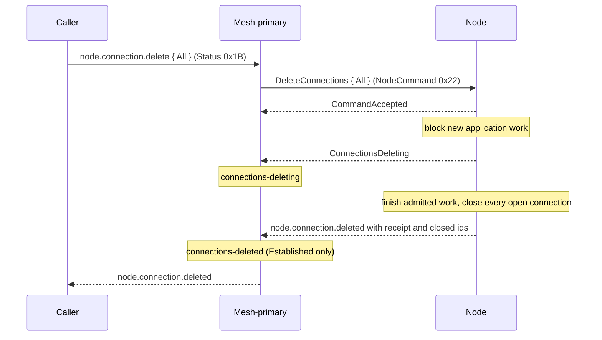

# Node connections delete

[Lifecycle index](../fabric-mesh-node-lifecycles.md) · [States](states.md) · [Typed calls and wire mapping](../node-rpc-envelope.md#typed-object-contract)

`node.connection.delete` closes a node's connections and keeps the process running. It is a node
primitive: [node.stop](node-stop.md) calls it and streams its acknowledgement and completion on the
stop's stream, so does [node.delete](node-delete.md) through the stop, a [rename](node-name-update.md) is permitted only once its `All` has completed (connections-deleted)
or the node is stopped, and a caller can call it on its own. A connection is an open Direct or Proxy
connection of the node, read from the connections open now, a connection whose row is still owed
included (Q169). Gossip neighbours and the Node RPC pool are not connections, and
neither scope touches them: a node that has had its connections deleted is still heard on gossip.

## Operation contract

| Field | Contract |
|---|---|
| Caller / executor | Typed caller / mesh-primary and exact target node |
| Request | `node.connection.delete { scope }`, where `scope` is `All` or `Connections([connection id, …])` |
| `All` | Graceful node-wide closure: close every open connection of the node. Status connections-deleting once the node reports it on the command's stream, then connections-deleted from its `Established` completion, each set by the node's mesh-primary |
| `Connections([id, …])` | Close exactly the named connections, each by the minted id of its open entry as `node.connection.get` returns it. Sets no node-wide status and does not make the node non-routable. An empty list is refused by name. An id the node does not know, or finds already closed, is named in the completion, never ignored |
| Identity | Same node.id, incarnation, endpoint, port, name and data dir |
| Entry (`All`) | The [connections-deleting](states.md#who-sets-each-state) status, set by the mesh-primary when the node reports `ConnectionsDeleting` on the command's stream, its block on new application work in force. A command that never reached the node changes no state |
| End event | `node.connection.deleted`, naming every connection id it closed |
| Receipt (`All`) | A `ConnectionsReceipt`: `Established { in_flight, closed }`, or at the bound `Deadline { last_in_flight, closed, held }`, `held` being the connections still open |
| Bound | `RDM_CONNECTIONS_DELETE_DEADLINE_MS` |
| Process | Running; no gossip cut, Node RPC pool cut, exit or identity release is implied |
| Never closed | Control streams stay usable, and the call never closes its own reply path |
| Drop records | Each closed connection's drop is written under the node's current name |
| Wire | The typed-object row for `node.connection.get { node }` / `node.connection.delete` in the [envelope](../node-rpc-envelope.md#typed-object-contract). Two hops. The caller to the node's mesh-primary, direct or forwarded: [Status 0x1B](../node-rpc-envelope.md#status-op-0x1b-rdm), request `DeleteConnections`, reply `ConnectionsDeleted`, or `RejectedConnectionScope` for a scope that names nothing the node can cut. The mesh-primary to the exact node: NodeCommand 0x22, server-streaming and never forwarded, replies `CommandAccepted`, `ConnectionsDeleting` (`All` only), then `ConnectionsDeleted`; a refusal is one frame. When the mesh-primary is its own subject, the frames and the records are the same |
| Primary | A target that is a primary first runs node.primary.update (and node.fabric-primary.update when it is the fabric-primary), commanded from above; `All` runs once node.primary.updated is answered, under the new primary (step 0) |

## Command and completion messages

```text
node.connection.delete { scope: All }
  ← CommandAccepted
  ← ConnectionsDeleting
  ← node.connection.deleted ConnectionsReceipt [Established { in_flight, closed } | Deadline { last_in_flight, closed, held }]

node.connection.delete { scope: Connections([id, …]) }
  ← CommandAccepted
  ← node.connection.deleted closed ids, unknown ids, already-closed ids
```

Admission is not completion: the caller reads the stream through its completion, and a stream broken after `CommandAccepted` is incomplete, never a claimed closure. `Deadline` records the last observed in-flight count and the
connections still open; it never claims zero. The bound, the receipt and the in-flight admission
facts stay distinct. A caller reads the receipt before proceeding according to its workflow.
[node.stop](node-stop.md) calls the complete `All` before its node.mesh.leave, and streams its
`ConnectionsDeleting` and its completion, `StopConnectionsDeleted { receipt }`, on the stop's stream.

## Gossip message and channels

The statuses connections-deleting and connections-deleted reach peers as the member's status from
its mesh-primary, under the [frame catalog](../gossip.md#31-frame-catalog). That dissemination does
not complete this stream or replace its receipt.

## Numbered end-to-end sequence

0. For `All` only: if the target is the fabric-primary or a mesh-primary, it first runs
   [node.primary.update](node-primary-update.md) (and node.fabric-primary.update when it is the
   fabric-primary), commanded from above; the Build continues once node.primary.updated is answered, under the new
   primary. The fabric-primary's last admin has its connections deleted only inside a
   [mesh.delete](mesh-delete.md), after its node.fabric-primary.update step.
1. Resolve the exact `(node.id, incarnation)` and call `node.connection.delete` with its scope.
2. `Connections([id, …])`: refuse an empty list by name. Close exactly the named connections and
   queue each drop under the node's current name (Q169); the drops land behind the answer. Return
   `node.connection.deleted` naming the ids closed, the ids unknown and the ids already closed. The node's status does not change, and the
   sequence ends here.
3. `All`, in this order:
   1. The node blocks admission of new application work and reports `ConnectionsDeleting` on the
      command's stream; its mesh-primary then sets connections-deleting. Peers hear it later; the
      node's own block stops new work at once.
   2. Let admitted work finish, including its downstream connections: they belong to the same
      closure.
   3. Wait for eligible work to reach zero.
   4. Close every open connection, each open Direct or Proxy connection of the node.
   5. Queue the drop rows under the node's current name (Q169); they land behind the answer.
   6. Return `node.connection.deleted` carrying `Established` and the closed ids.
4. The node's mesh-primary sets connections-deleted from that completion. Graceful success is never
   reported after interrupting work, and connections-deleted is never published while a covered
   connection is open.
5. At `RDM_CONNECTIONS_DELETE_DEADLINE_MS` an `All` that has not reached zero returns incomplete
   closure: `node.connection.deleted` carrying `Deadline`, the remaining in-flight count and the
   connections still open. The node stays connections-deleting. A new `node.connection.delete`
   attempt, or [node.stop](node-stop.md), leaves that state; a stop may hard-cut, and its receipt
   keeps the deadline evidence.
6. Record that exact step receipt. Do not infer stop, stopped, exit or node.deleted.

While the node is connections-deleting the runtime refuses every new call except Status 0x1B, PrimaryUpdate 0x21 and NodeCommand 0x22 with typed
`ConnectionsDeleting` ([Node RPC §35](../node-rpc.md#35-connections-deleting)). Control streams stay usable.

## Mermaid sequence diagram



## Failure and receipts

Failures and stream certainty follow the
[caller execution contract](../node-rpc-envelope.md#caller-execution-and-certainty).

## Observability contract

Trace propagation, step spans and correlation follow the
[runtime spans](../node-rpc-envelope.md#runtime-spans).
