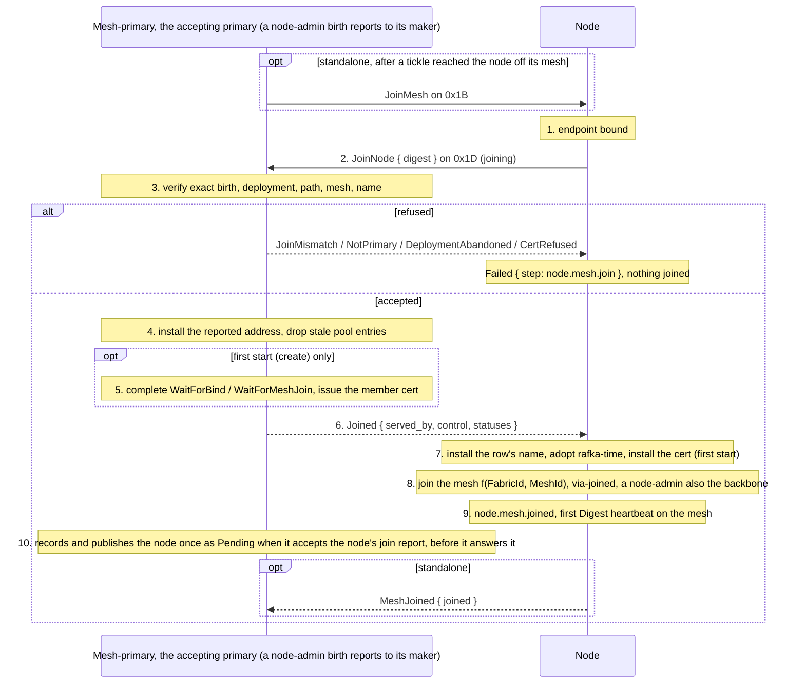

# node.mesh.join

[Lifecycle index](../fabric-mesh-node-lifecycles.md) · [States](states.md) · [Join op](../node-rpc-envelope.md#join-op-0x1d-rdm) · [Status op](../node-rpc-envelope.md#status-op-0x1b-rdm) · [Gossip](../gossip.md)

A primitive (R-MJ1). A mesh is a channel on the one fabric network, and `node.mesh.join` puts a
node on it: the node reports to its primary with `JoinNode` on op `0x1D`, and on acceptance
joins that mesh, `f(FabricId, MeshId)`. A node-admin joins two, its own mesh and the
node-admin backbone, and the primitive completes when both hold. Progress is `joining`,
completion `node.mesh.joined`. It is run by:

- [node.start](node-start.md) step 2, and so [node.restart](node-restart.md) and the first start
  inside [node.create](node-create.md);
- the mesh-primary, standalone, when a [tickle](node-tickle.md) reaches a node that is off its
  mesh: the node is commanded back on;
- a node-admin entering an existing mesh ([mesh investigation](mesh-investigation.md#a-node-admin-joins-the-live-mesh), [mesh.create](mesh-create.md)).

Those pages link here and restate nothing.

## Operation contract

| Field | Contract |
|---|---|
| Commander | Inside a start: the workflow itself. Standalone: the node's mesh-primary, after a tickle that reached the exact birth; the fabric-primary for a mesh-primary. Commands go down |
| Executor | The node itself: it makes the report and joins the mesh |
| Entry | The exact `(node.id, incarnation)` with its endpoint bound; its full `MeshDigest` for the report |
| Report | `JoinNode { digest }` to the accepting primary: an ordinary node's mesh-primary; a node-admin birth's maker; the fabric-primary while the mesh has no primary. Not forwardable. The primary verifies exact birth, deployment, path, mesh and name, installs the reported address, completes the deployment's waits, and answers `Joined` with its control snapshot, or refuses by field name |
| Mesh | Join `f(FabricId, MeshId)`; a node-admin also joins the backbone. A mesh with no live listener is created again under its own MeshId by this first listener |
| Order | Report accepted first, then the mesh; the handed name, rafka-time and cert installed before anything is published |
| Progress | `joining` from the report until the mesh holds, and the backbone too for a node-admin; the node publishes nothing in that state |
| Completion | `node.mesh.joined` on the commanding stream once the report is accepted and the mesh holds (and the backbone, a node-admin): the first `Digest` heartbeat follows it; the mesh-primary's one Pending publish for this join came before it, when the report was accepted (step 10) |
| Refusals | The report's: `JoinMismatch { field, deployed, reported }`, `NotPrimary { primary }`, `DeploymentAbandoned { build_id, attempt, node_id, incarnation }`, `CertRefused { name, detail }`, `NotReady`, `Busy`, `ConnectionsDeleting`, `Malformed`; a refused report fails the primitive by that name and the node joins nothing. `PeerUnresolved` and `Unauthorized` are codec positions only: a mesh receiver never sends either ([node-rpc.md](../node-rpc.md#40-error-truth-table) refusal table) |
| Gossip | No new frame. The join's visible effect is the node's first Digest and, from the mesh-primary, the one Pending publish when it accepts the node's join report, before it answers it; NodeStopped or NodeRestarting for that birth is cleared at `node.mesh.joined` |
| Wire | The report is [Join, op `0x1D`](../node-rpc-envelope.md#join-op-0x1d-rdm). The standalone command is `JoinMesh { node_id, incarnation, build_id, attempt, operation }` on 0x1B, answered `MeshJoined` on completion; an appended variant pair, `durable format moved`, retiring the legacy `Rejoin` control frame |
| Spans | `rdm.node.mesh.update.via-joining` at the report, `via-joined` once per mesh joined, each naming mesh, MeshId and which (`own` or `backbone`); the primary's `rdm.node_admin.node.update.via-join` on acceptance |

## Numbered end-to-end sequence

1. The node holds its bound endpoint; port 0 was bound at launch, or the stopped process still
   holds its port. Nothing predicts or reserves a port.
2. `joining`: the node calls `JoinNode { digest }` on its accepting primary. It serves calls on
   its bound endpoint while the report is outstanding, under the
   [Node RPC readiness gate](../node-rpc-envelope.md#node-rpc-readiness-gate).
3. The primary verifies the digest against the deployment it recorded: exact birth, deployment
   id, path, mesh, name. A first start's name is checked against the create spec; a held birth's
   name must be the row's or the one last accepted for that birth (R-JN1), and the digest is
   installed under the row's name. A difference is `JoinMismatch`; nothing is installed and no
   wait is released. A join for a deployment that ended before it arrived is
   `DeploymentAbandoned`. A primary that is not this birth's answers `NotPrimary { primary }`
   and the node reports to the one named.
4. On acceptance the primary installs the reported address for that exact birth and drops
   pooled connections and pending work aimed at the birth's old address.
5. At a first start the primary completes the deployment's WaitForBind / WaitForMeshJoin from the
   validated report. At every join, a first start, a start after a stop and a commanded re-entry alike
   (Q87), it issues the birth's member cert (`node.cert.create`: signed for the exact birth with the
   mesh's issuing key, 24 h, and its cert row written; a refused issuance refuses the join by name,
   [fabric certs](../fabric-certs.md#when-a-cert-is-issued)). A restart or a standalone rejoin has no
   deployment wait.
6. The primary answers `Joined`: who served it, the control snapshot (provider, fabric
   identity, shutdown if any, the Build floor, rafka-time now, the member cert, the row's name,
   the row's config) and the statuses it holds with their original authors and instants. An
   primary that holds no rafka-time answers `NotReady` naming why and builds no answer.
7. The node installs the handed name, the row's, at every join (R-JN1); adopts the rafka-time as it stands, at every join
   (origin-ordering.md); and installs the member cert, at every join (Q87).
8. The node joins its mesh, `f(FabricId, MeshId)`; a node-admin joins the backbone too. Each one
   joined emits `via-joined`. A mesh with no live listener is created again under its own MeshId
   by this first listener.
9. `node.mesh.joined`. The node's first `Digest` heartbeat follows.
10. The node's mesh-primary (the fabric-primary for a mesh with no primary) records and publishes
    the node once as Pending when it accepts the node's join report, before it answers it. Every
    later report of that join, its retries and its `NodeJoined` included, belongs to that Pending
    and starts no other; the node publishes no Pending of its own. What follows, the hook, the topology
    read, the Build floor and rafka-time refreshed last, is
    [node.start](node-start.md#end-to-end-sequence) steps 3 to 5, inside a start and on the
    standalone command alike: a birth commanded back leaves its channels, runs the whole sequence
    again on the commanding call and is published ready-for-traffic only once its hook has passed
    (Q87). The command is answered `MeshJoined` at this step, while the rest of the start runs on.

The report is only a report: it re-reads no topology for a held member, completes no start and
bypasses no hook; the start it is step 2 of does those, on the standalone command as inside a
start. Only an accepted full report completes the deployment's waits; a launched process, a
listening socket, a digest on gossip, a timeout or an unanswered call never does.

## Command, completion and gossip messages

The standalone command, from the mesh-primary to a node its tickle reached off its mesh, op
`0x1B` (27); inside a start the command is the start's own and this frame is not sent:

```json
{
  "target": { "node_id": "k8pag1qx95gw", "op": 27 },
  "context": {
    "caller_system": "rdm",
    "traceparent": "00-a7c3e9f1b5d2480a6c8e0f1a2b3c4d5e-6666666666666666-01",
    "tracestate": null,
    "baggage": "operation=node.mesh.join%3Amesh1.rpc.1"
  },
  "body": {
    "JoinMesh": {
      "node_id": "k8pag1qx95gw",
      "incarnation": "0000000000000008",
      "build_id": "3f9a1c7e5b2d",
      "attempt": 3,
      "operation": "node.mesh.join:mesh1.rpc.1"
    }
  }
}
```

The node's report, its own call to its primary, op `0x1D` (29); here a first start of
`mesh1.rpc.1`:

```json
{
  "target": { "node_id": "adm7k2q9x4w1", "op": 29 },
  "context": {
    "caller_system": "rdm",
    "traceparent": "00-f16a8b75a1b2c3d4e5f60718293a4b5c-2222222222222222-01",
    "tracestate": null,
    "baggage": "operation=node.create%3Amesh1.rpc.1"
  },
  "body": {
    "JoinNode": {
      "digest": {
        "fabric_id": "fab4m8n2p6q1",
        "node": {
          "node_id": "k8pag1qx95gw",
          "name": "mesh1.rpc.1",
          "endpoint_id": "7a7a7a7a7a7a7a7a7a7a7a7a7a7a7a7a7a7a7a7a7a7a7a7a7a7a7a7a7a7a7a7a",
          "transport_addr": "127.0.0.1:54473",
          "incarnation": "0000000000000001",
          "supersedes": null,
          "runtime": null
        },
        "status": "pending",
        "admin_api_base": null,
        "digest_seq": 1,
        "emitted_at_rafka_ms": 1718290000010,
        "data_dir": "/var/lib/rdm/mesh1.rpc.1",
        "mesh_id": "mesh1",
        "in_flight": null,
        "config": {},
        "load": null,
        "gossip": null
      }
    }
  }
}
```

The primary's unary reply, `Joined` with its answer decoded (on the wire `answer` is the postcard
`WireJoinAnswer`):

```json
{
  "Joined": {
    "answer": {
      "served_by": "mesh1.admin.1",
      "control": {
        "provider": "process",
        "fabric": { "fabric_id": "fab4m8n2p6q1", "name": "lab" },
        "shutdown": null,
        "build": { "build_id": "3f9a1c7e5b2d", "attempt": 1 },
        "rafka_time_ms": 1718290000042,
        "member_cert": "<cert bytes, opaque to RDM>",
        "name": "mesh1.rpc.1",
        "config": { "log_level": "info" }
      },
      "statuses": [
        { "frame": "mesh-status", "mesh": "mesh1", "status": "ready-for-traffic", "publisher": "mesh1.admin.1", "changed_at_rafka_ms": 1718289990000 },
        { "frame": "fabric-status", "fabric": "lab", "status": "ready-for-traffic", "publisher": "mesh1.admin.1", "changed_at_rafka_ms": 1718289990100 }
      ]
    }
  }
}
```

A refused report, the body alone; the reported incarnation is not the one deployed:

```json
{ "JoinMismatch": { "field": "incarnation", "deployed": "0000000000000001", "reported": "0000000000000002" } }
```

The completion on the commanding stream: standalone, `MeshJoined { node_id, incarnation, joined: ["own"] }`
(a node-admin: `["own", "backbone"]`) as the reply to `JoinMesh`; inside a start, the step frame
`node.mesh.joined` on the start's stream. A refused report ends the primitive as
`Failed { step: "node.mesh.join", reason }`, and no `node.mesh.joined`, `node.started` or later
success follows it ([caller execution](../node-rpc-envelope.md#caller-execution-and-certainty)).

The gossip after `node.mesh.joined`: the node's first heartbeat on its mesh, carrying the
row's name and config from the answer:

```json
{
  "frame": "digest",
  "digest": {
    "fabric_id": "fab4m8n2p6q1",
    "node": {
      "node_id": "k8pag1qx95gw",
      "name": "mesh1.rpc.1",
      "endpoint_id": "7a7a7a7a7a7a7a7a7a7a7a7a7a7a7a7a7a7a7a7a7a7a7a7a7a7a7a7a7a7a7a7a",
      "transport_addr": "127.0.0.1:54473",
      "incarnation": "0000000000000001",
      "supersedes": null,
      "runtime": null
    },
    "status": "pending",
    "admin_api_base": null,
    "digest_seq": 2,
    "emitted_at_rafka_ms": 1718290000090,
    "data_dir": "/var/lib/rdm/mesh1.rpc.1",
    "mesh_id": "mesh1",
    "in_flight": null,
    "config": { "log_level": "info" },
    "load": null,
    "gossip": null
  }
}
```

ReadyForTraffic is set by the mesh-primary after `node.started` ([node status](node-status.md)),
never by the joiner. The mesh-primary's next backbone `Members` aggregate carries the digest as
one entry of `digests` ([example](../gossip.md#examples)). A stopped node that rejoins keeps its
`digest_seq` running and mints no incarnation.

## Mermaid sequence diagram



Checked against the numbered sequence, one note per step: the command, when there is one,
precedes the report; one report, one answer; the first-start-only work in its own block; the mesh
after the answer; `node.mesh.joined` after the mesh (and the backbone) holds; the first Digest
after it; the Pending publish from the mesh-primary, never from the node.

## Failure and receipts

A refused report fails the primitive by the refusal's name, nothing joined. An uncertain answer
is not `Joined`: the node retries the identical report and the primary's installed report
resolves it. A mesh that cannot be joined after an accepted report leaves the primitive in
`joining`, named with which one, and the commanding workflow's next attempt resumes from the
accepted report; a runtime exit needs independent exact provider proof
([node.runtime.inspect](node-runtime-inspect.md)), even for a deployment that never joined.
Failures and stream certainty follow the
[caller execution contract](../node-rpc-envelope.md#caller-execution-and-certainty).

## Observability contract

| Step | Actor | Span | Fields |
|---|---|---|---|
| Report sent | node | `rdm.node.mesh.update.via-joining` | mesh, mesh_id, primary, operation |
| Report served | primary | `rdm.node_rpc.request.serve.via-direct`, then `rdm.node_admin.node.update.via-join`; a mismatch `rdm.node_admin.node.reject.via-join-mismatch` naming the field | exact birth, field |
| Mesh joined | node | `rdm.node.mesh.update.via-joined`, once per mesh the node is now on: its own mesh, and the backbone for a node-admin | mesh, mesh_id, which (`own` or `backbone`) |
| Completion | node, commander | the `node.mesh.joined` frame or the `MeshJoined` reply | operation, build, attempt |

The report call and its serve carry the runtime causal edge; trace propagation follows the
[runtime spans](../node-rpc-envelope.md#runtime-spans).
