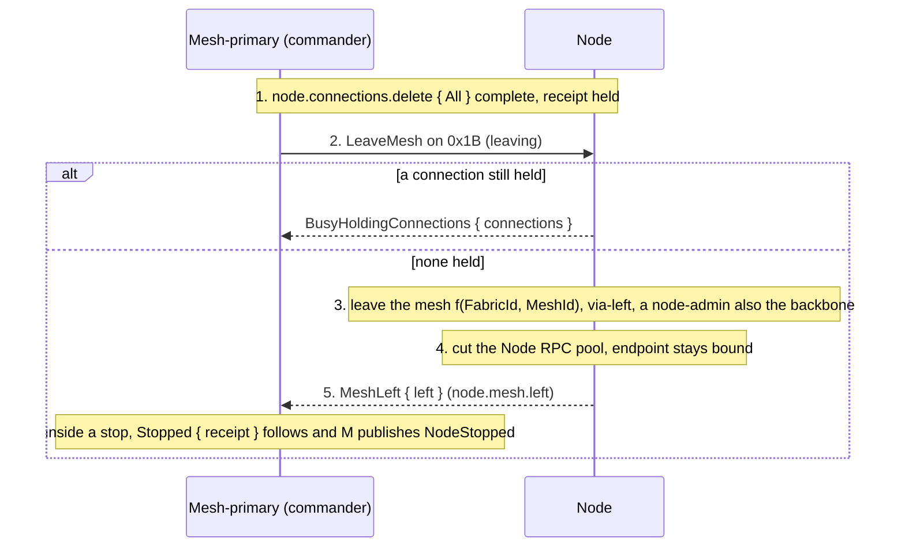

# node.mesh.leave

[Lifecycle index](../fabric-mesh-node-lifecycles.md) · [States](states.md) · [Status op](../node-rpc-envelope.md#status-op-0x1b-rdm) · [Gossip](../gossip.md)

A primitive (R-MJ1). `node.mesh.leave` takes a node off its mesh and, for a node-admin, off the backbone
too. It is the step [node.stop](node-stop.md) and [node.delete](node-delete.md)
end their live part with, after the node's connections are deleted and never before (R-CR5): the
data plane first, then the control plane. Progress is `leaving`, completion `node.mesh.left`. The
node keeps its endpoint bound, its identity, name, port and data dir; a left node is reachable by
a fresh Node RPC dial for start, update or delete.

## Operation contract

| Field | Contract |
|---|---|
| Commander | The workflow that stops or deletes the node: its mesh-primary for a member, the fabric-primary for a mesh-primary (a mesh's last admin included, mesh-delete.md step 7). Commands go down |
| Executor | The node itself |
| Entry | The exact `(node.id, incarnation)`, connections-deleted: `node.connections.delete { All }` completed with its receipt (`Established`, or `Deadline` with the held ids recorded). A node that still holds a connection is refused `BusyHoldingConnections { connections }` and leaves nothing |
| Leaves | Its gossip neighbours on its mesh (and the backbone, a node-admin) and its Node RPC pool; the control plane, which are not connections (R-CR5) |
| Keeps | Its endpoint bound, node.id, incarnation, path and name, port, bin, data dir |
| Progress | `leaving` from the command until the mesh is left (and the backbone, a node-admin); the node publishes nothing in that state and nothing after it (R-ON1) |
| Completion | `node.mesh.left` on the commanding stream; the stop's `Stopped { receipt }` or the delete's next step follows it |
| Gossip | None from the node. Its mesh-primary publishes NodeStopped from the stop's matching stopped frame, or NodeDeleted after exact exit proof; a mesh's last admin after mesh.deleted has its final aggregate instead ([mesh.delete](mesh-delete.md) step 7), and the fabric-primary publishes nothing for it. The reserved `NodeLeaving` / `NodeLeft` frame positions stay reserved and unpublished |
| Wire | `LeaveMesh { node_id, incarnation, build_id, attempt, operation }` on 0x1B, answered `MeshLeft { node_id, incarnation, left }`; an appended variant pair, `durable format moved`. Inside a stop the command is the stop's own and this frame is not sent |
| Spans | `rdm.node.mesh.update.via-leaving` at the command, `via-left` once per mesh left, each naming mesh, MeshId and which (`own` or `backbone`) |

## Numbered end-to-end sequence

1. The commanding workflow has completed `node.connections.delete { All }` on the node and holds
   its receipt. Inside node.stop this is step 2 of the stop; the leave is its step 3.
2. `leaving`: the node is commanded to leave. It checks it holds no connection; one still held
   is `BusyHoldingConnections { connections }`, the leave does not start, and the stop's
   `Deadline` evidence names why.
3. The node leaves its mesh: its gossip neighbours on `f(FabricId, MeshId)`. A node-admin then
   leaves the backbone. Each one left emits `via-left`.
4. The node cuts its Node RPC pool. Its endpoint stays bound and the commanding call's stream
   stays open.
5. `node.mesh.left`. The node publishes nothing. Inside a stop, `Stopped { receipt }` follows on
   the stop's stream and the mesh-primary publishes NodeStopped from it; inside a delete, the
   provider's [runtime inspect](node-runtime-inspect.md) follows.

## Command, completion and gossip messages

The command, from the mesh-primary to a member whose connections are deleted, op `0x1B` (27):

```json
{
  "target": { "node_id": "k8pag1qx95gw", "op": 27 },
  "context": {
    "caller_system": "rdm",
    "traceparent": "00-b8d4f0a2c6e3591b7d9f1a2b3c4d5e6f-7777777777777777-01",
    "tracestate": null,
    "baggage": "operation=node.stop%3Amesh1.rpc.1"
  },
  "body": {
    "LeaveMesh": {
      "node_id": "k8pag1qx95gw",
      "incarnation": "0000000000000008",
      "build_id": "bld-3f9a1c7e5b2d8046a1c3e5f7",
      "attempt": 1,
      "operation": "node.stop:mesh1.rpc.1"
    }
  }
}
```

The unary reply once the mesh (and the backbone, a node-admin) is left:

```json
{ "MeshLeft": { "node_id": "k8pag1qx95gw", "incarnation": "0000000000000008", "left": ["own"] } }
```

A node-admin answers `"left": ["own", "backbone"]`. A node still holding a connection answers:

```json
{ "BusyHoldingConnections": { "connections": ["cnx5t8w2y4z7"] } }
```

Inside node.stop the leave is a step of the stop's own stream, the progress view
[node-stop.md](node-stop.md#command-and-completion-messages) shows, and `node.mesh.left` is the
frame before `node.stopped`. The gossip after it is the mesh-primary's, not the node's: the
[NodeStopped example](../gossip.md#examples) for a stop, or [node.delete](node-delete.md)'s
NodeDeleting and NodeDeleted for a delete.

## Mermaid sequence diagram



Checked against the numbered sequence: the connections are deleted before the command; the busy
refusal happens before anything is left; the mesh (and the backbone) is left before the pool; the node publishes
nothing at any step.

## Failure and receipts

`BusyHoldingConnections` leaves nothing and names the connections; the commanding workflow's
`Deadline` receipt is the evidence. A mesh that cannot be left is reported by name with which one, the primitive stays `leaving`, and the workflow's next attempt resumes it; the node never
re-publishes meanwhile. Failures and stream certainty follow the
[caller execution contract](../node-rpc-envelope.md#caller-execution-and-certainty).

## Observability contract

| Step | Actor | Span | Fields |
|---|---|---|---|
| Command | node | `rdm.node.mesh.update.via-leaving` | mesh, mesh_id, operation |
| Mesh left | node | `rdm.node.mesh.update.via-left`, once per mesh the node was on: its own mesh, and the backbone for a node-admin | mesh, mesh_id, which (`own` or `backbone`) |
| Busy | node | `rdm.node.mesh.reject.via-busy-holding-connections` | connections |
| Completion | node, commander | the `MeshLeft` reply or the `node.mesh.left` frame | operation, build, attempt |

Trace propagation follows the [runtime spans](../node-rpc-envelope.md#runtime-spans).
