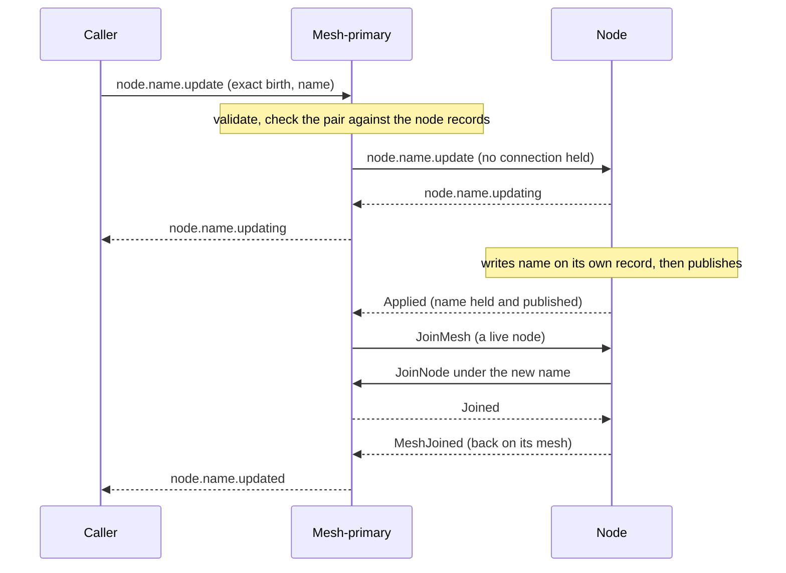

# Node name update

[Lifecycle index](../fabric-mesh-node-lifecycles.md) · [States](states.md) · [Typed calls and wire mapping](../node-rpc-envelope.md#typed-object-contract)

`node.name.update` renames a node. It is a single call, not a lifecycle operation: it moves no status
and is never a Build or part of one. It needs no connections: the node holds none, and a live node
rejoins its mesh under the new name. To keep a node aside, [node.stop](node-stop.md) follows as its
own primitive. A node's other properties have their own commands ([node properties](../node-rpc-envelope.md#node-properties));
[node.config.update](node-config-update.md) replaces its application config.

## Operation contract

| Field | Contract |
|---|---|
| Caller / executor | Caller to the fabric-primary, then the node's mesh-primary, then the node, each one direct call; an unreachable receiver ends the call `NotSent`. Before a mesh has a primary, the fabric-primary acts as its writer |
| Entry | The exact `(node.id, incarnation)` and unchanged registered path and new name as separate fields. A different path is refused; mesh, type and tags do not change |
| Precondition | The node holds no connection: it is stopped, or this mesh-primary holds the birth's `node.connection.deleted` of an `All` ([node.connection.delete](node-connections-delete.md)) that left zero connections held. A live node holding a connection is refused. No new connection is admitted from the row write until the node rejoins its mesh, retries after an interruption included |
| Validation | The exact birth matches the held record, else `RejectedStaleIncarnation { held }`; the receiver is the node's writer, else `ReceiverNotPrimary { needed }` (R-RX5); the precondition holds, else `RejectedAdmittingConnections { status, held_connections }`; the path/name pair is valid and the name has no dot, else `RejectedName { reason }`. The supplied path must equal the registered immutable path; a different path is refused by name |
| Check and move | The mesh-primary checks the destination pair against the node records; held by another node it refuses `NameHeld { by: node.id }` and nothing is written. Then the node writes its own record at its node.id with the destination name (Q356): the name move is that one write |
| Order | Check first, the node's write second, then the live node's rejoin |
| Rejoin | A live node, once it holds the new name, is commanded [node.mesh.join](node-mesh-join.md) by its mesh-primary and rejoins its mesh under the new name. A stopped node rejoins at its [node.start](node-start.md) |
| Completion | [By case](#completion-by-case) |
| Idempotency | Row-held and node-applied are two facts. A repeat naming the name the row already holds resends `UpdateName` to the node, and for a live node its rejoin, and completes as the first command does. A repeat with a different name is a new rename |
| Wire | `UpdateName { node_id, incarnation, name }` on [`0x22`](../node-rpc-envelope.md#nodecommand-op-0x22-rdm) at every hop, the name only: a node's path never moves. The node's `CommandAccepted` is `node.name.updating`, then `JoinMesh` on `0x1B` for a live node. The stream ends `PropertyUpdated { reply }`, or `PropertyRefused { reply }` before anything was accepted; `reply` is `NameUpdated`, `NameHeld`, `RejectedAdmittingConnections`, `RejectedName`, `RejectedStaleIncarnation`, `BusyHoldingConnections { connections }` or `NameNotApplied` |

## Numbered end-to-end sequence

1. The caller sends `node.name.update` to an admin; one that is not the fabric-primary carries it to the fabric-primary and streams the answer back. The fabric-primary sends the command to the node's mesh-primary and streams its frames back without installing a copied node row.
2. The mesh-primary validates from its view and the node's record: exact birth, that it is the node's mesh-primary, the precondition from the node's `state` and its `node.connection.deleted` receipt, the name grammar.
3. The mesh-primary checks the destination pair against the node records; a pair held by another node refuses `NameHeld { by }` with nothing written.
4. The node is sent `UpdateName` and answers `CommandAccepted`, its `node.name.updating`. It writes its own record at its node.id with the new name (Q356), the one durable name move, and only once that write is acked does it hold the new name and publish it.
5. It answers `Applied`, `AlreadyApplied` for a name it already holds, or `BusyHoldingConnections { connections }` naming each connection it still holds, with nothing written; a write the store refuses is answered `NodeRecordRefused`. `Busy` is the interrupted case under [Failure](#failure).
6. A live node rejoins its mesh under the new name: the mesh-primary commands its
   [node.mesh.join](node-mesh-join.md), the node reports under the new name and joins its mesh again,
   and answers `MeshJoined` once it is back on its mesh. A stopped node rejoins at its start.
7. `node.name.updated` is emitted [by case](#completion-by-case).

The node owns its name: it is the owner of the name it publishes, and what it publishes is the
row's name. A node never renames itself.

## Completion by case

- **The live node:** `node.name.updated` after `Applied` or `AlreadyApplied` and its `MeshJoined`:
  the node is back on its mesh, publishing the new name (step 6).
- **The stopped node:** `node.name.updated` after `Applied` or `AlreadyApplied`; its start rejoins it
  under the name.
- **Row written, apply or rejoin unresolved** (no answer, `Busy`, or a join that did not answer
  `MeshJoined`): the command ends incomplete, `NameNotApplied`, naming the row's new name and how the
  apply or the rejoin ended. The name has moved durably and the node will publish it at its next
  apply or join; the caller resubmits, the resubmit resends `UpdateName` to the node and the rejoin, and
  completes on the node's answers, never from the row. A live node is never reported renamed on the
  row alone.

## Command and completion messages

```text
node.name.update
  → validate → check the new pair against the node records
  → node.name.update (the node, holding no connection, answers node.name.updating, writes its record with the new name, then publishes it)
  → node.mesh.join (a live node: it rejoins its mesh under the new name)
  ← node.name.updated
```

## Mermaid sequence diagram



## States written

This operation writes no state. The node writes the name on its own record (Q356), as `name` on a `node-record` line in `nodes.jsonl`, the one durable name move.

| written | by | when |
|---|---|---|
| `name` | the node, on its own record | it holds no connection and accepted `UpdateName`, before it publishes the name |

As stored:

`name`:

```json
{"len":1373,"specversion":"1.0","id":"01a1ae8f-eeaf-78fc-a9b1-7c13f9f30511","source":"rdm://6r3bef8k2j70/dc3kwwjqbv52/9t78nw2kqte3","type":"node-record","subject":"dc3kwwjqbv52","time":"2026-11-06T01:53:50.762Z","datacontenttype":"application/json","dataschema":"node-record/2","data":{"node_id":"dc3kwwjqbv52","path":"mesh2.node","name":"renamed","type":"node","incarnation":"9t78nw2kqte3","state":"connections-deleted","endpoint_id":"fa1d433228244817c9e3c45e7598fb08fa944018636f479c92f4a842125fca69","transport_addr":"127.0.0.1:58961","listeners":[],"runtime":{"deployment_id":"hcak92d1dx32","provider":"process","control_domain":"process:e152f7e9-9c84-4260-8679-e39839d273ff:4026531836","locator":{"process":{"pid":1615535,"start":65863283}}},"is_primary":null,"is_fabric_primary":null,"cert":{"issued_at":1793930030071,"expires_at":1794016430071,"issuer_expires_at":1796522029182,"renew_at":1793990875360},"signing_cert":null,"storage":{"persistence":{"persistence":"ephemeral"},"data_dir":"/dev/shm/rdm-lane-5/cells-1615231/i143-a_name_update_served_at_another_meshs_primary_is_read_at_the_fabric_primary_at_once-1615277-0/dc3kwwjqbv52"},"executable":{"launch_id":"node","executable":"/home/admin/rdm-lanes/5/target/debug/testkit-node","sha256":"97380f0c084a0362952b6fd9fcdf6b0b540df4062d49bfd58c6502b33b48baee","image":null},"config":{},"tags":[]},"crc32":"8fcde176"}
```

## Failure

Failures and stream certainty follow the
[caller execution contract](../node-rpc-envelope.md#caller-execution-and-certainty).

- **Refused before the write** (stale birth, wrong receiver, admitting connections, bad name, `NameHeld`):
  nothing written, nothing changed.
- **The record write fails**: a named storage error; the record stands under the old name, and a retry
  writes it.
- **Apply or rejoin fails or is interrupted after the row**: the incomplete case [above](#completion-by-case).
  The admission block stays in force on the node until it rejoins its mesh, so no connection is
  opened under the old name while the row carries the new one; a retry of the same command resends
  `UpdateName` and the rejoin and completes on the node's answers.
- **Connection opened between the precondition check and the apply**: impossible by the admission
  block; a node that reports `Busy` is a defect in that block, named by the connections it lists.

## Observability contract

Trace propagation, step spans and correlation follow the
[runtime spans](../node-rpc-envelope.md#runtime-spans). The mesh-primary's
`rdm.node_admin.name.update.via-writer` span records `connections` (`deleted` or `stopped` when
admitted), `apply` and `answered`, and `rejoin` (`mesh-joined`, `at-start`, or how the join ended);
the rejoin is its `rdm.node_admin.node.update.via-mesh-join-commanded` span, `cause = node.name.update`,
in the same trace.
