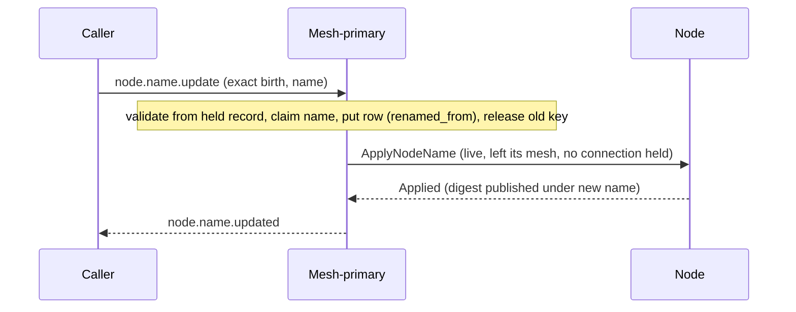

# Node name update

[Lifecycle index](../fabric-mesh-node-lifecycles.md) · [States](states.md) · [Typed calls and wire mapping](../node-rpc-envelope.md#typed-object-contract)

`node.name.update` renames a node. It is a single call, not a lifecycle operation: it moves no status
and is not a Build step by itself, though a recipe such as [replace](node-replace.md) calls it as a
step. A node's other properties have their own commands ([node properties](../node-rpc-envelope.md#node-properties));
[node.config.update](node-config-update.md) replaces its application config.

## Operation contract

| Field | Contract |
|---|---|
| Caller / executor | Caller to the node's mesh-primary, the only writer of its mesh's rows (Forward `0x1A` when not directly reachable). Before a mesh has a primary, the fabric-primary acts as its writer. The replace recipe calls it as a step; a caller may call it alone |
| Entry | The exact `(node.id, incarnation)` and the new name. Nothing else: no path, no mesh, no type, no tags |
| Precondition | The node is live and admits no connection: this mesh-primary holds the birth's `node.connections.deleted` of an `All`, then its `node.mesh.left` ([node.mesh.leave](node-mesh-leave.md)), and it holds zero connections. A stopped node is never renamed; a ready-for-traffic node, or one still holding a connection, is refused. No new connection is admitted from the row write through `ApplyNodeName`, retries after an interruption included |
| Validation | The exact birth matches the held record, else `RejectedStaleIncarnation { held }`; the receiver is the node's writer, else `ReceiverNotPrimary { needed }` (R-RX5); the precondition holds, else `RejectedAdmittingConnections { status, held_connections }`; the name is within the name grammar, else `RejectedName { reason }`. A rename may take any name within the grammar, unique within its path |
| Claim and move | The new name is claimed by insert-and-fail on the kind's `path.name` index inside the store adapter; a held name answers `NameHeld { by: node.id }` and nothing is written. The move is two writes: the row is put at the new key carrying `renamed_from: <old path.name>`, then the old key is released. Between them the node holds both keys, and the destination row says which is which: **a row whose `renamed_from` key still holds the same node id has a pending release, and the writer releases it.** The rule needs no clearing: once the source no longer holds the id it is false. It runs wherever a writer meets the row: a retry of the command, the Build attempt's resume of a replace or recovery step, and a mesh-primary's rebuild from its mesh's rows after a seat change (R13), which already reads every row of the mesh |
| Order | Row first, node second |
| Completion | [By case](#completion-by-case) |
| Idempotency | Row-held and node-applied are two facts. A repeat naming the name the row already holds finishes any pending release and then, for a live node, resends `ApplyNodeName` and completes on `Applied` or `AlreadyApplied`. A repeat with a different name is a new rename |
| Wire | `UpdateName { node_id, incarnation, name }` and `ApplyNodeName { node_id, incarnation, name }` on [`0x1B`](../node-rpc-envelope.md#status-op-0x1b-rdm); replies `NameUpdated`, `NameHeld`, `RejectedAdmittingConnections`, `RejectedName`, `RejectedStaleIncarnation`, `BusyHoldingConnections { connections }` |

## Numbered end-to-end sequence

1. The caller sends `node.name.update` to the node's mesh-primary.
2. The mesh-primary validates from the record it holds: exact birth, its own writer role, the
   precondition from the node's status and its `node.connections.deleted` and `node.mesh.left` receipts, the name grammar.
3. The new name is claimed by insert-and-fail in the store adapter; a held name refuses
   `NameHeld { by }` with nothing written.
4. The mesh-primary writes the row with the new name. The old name's key is released. This is the
   durable name move.
5. The left node is sent `ApplyNodeName`. It publishes its digest with the new
   name only on that apply and answers `Applied`, `AlreadyApplied` for a name it already holds, or
   `BusyHoldingConnections { connections }` naming each connection it still holds; `Busy` after the row is the
   interrupted case under [Failure and receipts](#failure-and-receipts).
6. `node.name.updated` is emitted [by case](#completion-by-case).

The node owns its name: it is the authority on the name it publishes, and what it publishes is the
row's name. A node never renames itself.

## Completion by case

- **The left node:** `node.name.updated` after `Applied` or `AlreadyApplied` (step 5).
- **Row written, apply unresolved** (no answer, or `Busy`): the command ends incomplete, naming the
  row's new name and the apply's state. The name has moved durably and the node will publish it at
  its next apply or join; the caller resubmits, the resubmit resends `ApplyNodeName`, and completes on
  `Applied` or `AlreadyApplied` from the node, never from the row. A live node is never reported
  renamed on the row alone.

## Command and completion messages

```text
node.name.update
  → validate → claim new name (insert-and-fail) → put row at the new key (renamed_from) → release the old key
  → ApplyNodeName (the live node that has left its mesh)
  ← node.name.updated
```

## Mermaid sequence diagram



## Failure and receipts

Failures and stream certainty follow the
[caller execution contract](../node-rpc-envelope.md#caller-execution-and-certainty).

- **Refused before the claim** (stale birth, wrong receiver, admitting connections, bad name):
  nothing written, nothing changed.
- **Claim refused** (`NameHeld`): nothing written.
- **The put at the new key fails**: a named storage error, nothing written, the old name stands.
- **The put succeeded and the release of the old key fails or is interrupted**: the node holds both
  keys, and the destination row's `renamed_from` names the source. The command ends incomplete naming
  the new key as claimed and the old key's release as pending; the release is finished by whichever
  writer next meets the row (a retry, the next attempt, or a successor mesh-primary's rebuild) and
  the move continues to the apply. Nothing is rolled back and no second row is written. The writer
  that wrote the put may be gone; the row carries everything the next one needs.
- **Apply fails or is interrupted after the row**: the incomplete case [above](#completion-by-case).
  The admission block stays in force on the node until the apply resolves, so no connection is
  opened under the old name while the row carries the new one; a retry of the same command resends
  `ApplyNodeName` and completes on the node's answer.
- **Connection opened between the precondition check and the apply**: impossible by the admission
  block; a node that reports `Busy` is a defect in that block, named by the connections it lists.

## Observability contract

Trace propagation, step spans and correlation follow the
[runtime spans](../node-rpc-envelope.md#runtime-spans).
