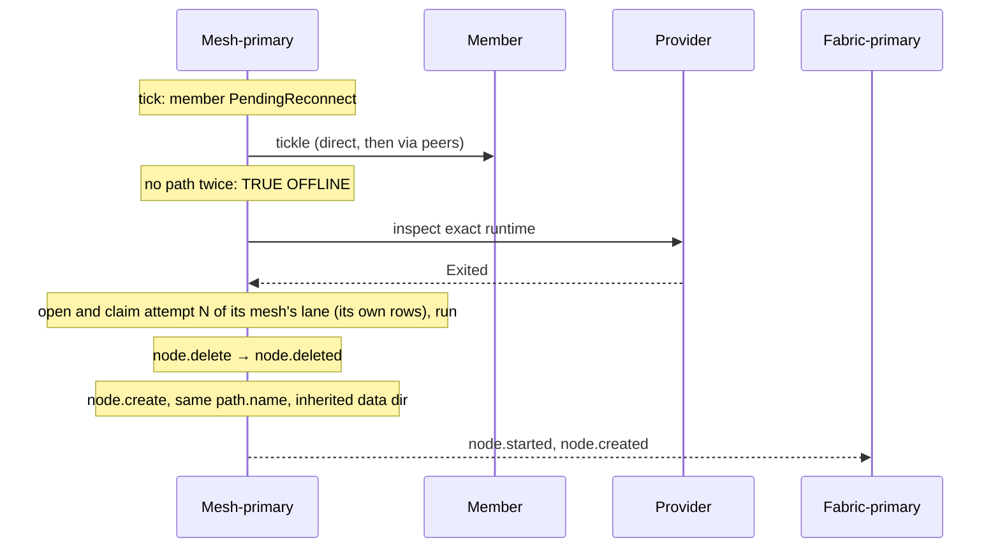

# Node recovery

[Lifecycle index](../fabric-mesh-node-lifecycles.md) · [States](states.md) · [Typed calls and wire mapping](../node-rpc-envelope.md#typed-object-contract)

Node recovery is RDM's drift reconciliation for a member that exits outside any
workflow. The accepted Build is the fabric's desired topology; a member at a path.name
that is proven exited is drift, and RDM puts it back. The mesh-primary is the
reconciler for its own members: it tracks them, proves the exit and starts the recovery.
The app takes part only through the start hook of the new node. Recovery is not a
caller op. (A mesh none of whose node-admins can be reached is
[mesh investigation](mesh-investigation.md), driven by the fabric-primary; its decision step
runs node.create of a node-admin into the live mesh, on a carrier-edge-lost verdict or, for a fully
crashed mesh, on exact provider exit proof.)

## Operation summary

| Field | Contract |
|---|---|
| Reconciler | The mesh-primary of the member's mesh |
| Detection | The mesh-primary's tick (every gossip interval) reads the members its view marks `PendingReconnect` (unheard past the staleness floor) |
| Investigation | The tickle ladder (`offline.rs`), then the provider's exact-exit proof |
| Trigger | Exact provider proof only. Silence, a failed tickle and TRUE OFFLINE are not proof |
| Execution | The mesh-primary opens the recovery as the next attempt of the current Build in its mesh's lane, claims it on its mesh's rows and runs it; no call to the fabric-primary, which learns it from the Build topic |
| Steps | node.delete of the exited instance, node.create at the same path.name over the inherited data dir; the Build's steps are keyed `node.delete:<path.name>` and `node.create:<path.name>` |
| Retained | path.name, placement, inherited data dir, endpoint key, config (seeded from the deleted row) |
| New | node.id, incarnation, OS-assigned port and exact runtime |
| App part | The new node's start runs `hydrate_before_ready` with start_kind FirstStart and an inherited data dir; Rafka runs broker resync there |
| Lineage | No supersedes: recovery creates a new node.id ([node identity](../node-identity-and-state.md#2-a-node-is-an-entity-and-it-has-three-ids)) |

## Detection and proof

The mesh-primary runs one loop for its own members, on every gossip interval, never on a
timer of its own:

1. **Silence.** Each node's pruner marks a member `PendingReconnect` once it is unheard
   past the staleness floor. Nothing is sent; the mark comes from the digests not arriving.
   Peers stop routing new work to it. Silence is not death. Every node-admin keeps the
   silence bookkeeping (`first_seen`), so a node-admin that takes the seat mid-window
   continues the window already running.
2. **Tickle.** Only the mesh-primary acts. Half a floor after the mark it makes one QUIC
   connect, direct; if that fails, the same kick through up to two eligible live peers of
   the birth's mesh, sent at once (`rafka-node-admin-core/src/offline.rs`, module doc).
   Completion rules: any answer from the exact birth (`Current`, `CurrentParked` or
   `Blocked` on the kick) ends the ladder and cancels the probes still running; one failed
   peer probe does not cancel the other; every probe names the same exact
   `(node.id, incarnation)`; a failure, a deadline included, never
   proves anything, and the provider check below stays mandatory. A node-admin watching a
   silent seat holder (seat watch) runs this same ladder. An answer is
   `reachable-silent`: recorded, no action. No path opens a hold-down; no path again at
   least one floor later is TRUE OFFLINE, written as status Dead on the node's row.
   Dead is observer-inferred and is never itself a reason to act.
3. **Provider proof.** On TRUE OFFLINE the mesh-primary asks the provider (the deployment
   backend that launched the runtime) about the exact runtime recorded at launch. Exited
   is the proof, recorded durably. `Unknown` or an unreadable runtime row proves nothing
   and opens no hold. When the provider reports `Running` for the exact runtime handle,
   the mesh-primary records the durable status-row fact `held-running { since, verdicts }`
   (surfaced on `node.get`, never as a gossip `MemberStatus`: the gossip wire is untouched)
   and opens the hold (step 4).
4. **Hung runtime hold and terminate (`R-FM1`).** During the hold (`RDM_HUNG_HOLD_FLOORS`
   staleness floors, default 10 = 300 s at the 30 s floor), the mesh-primary keeps running
   the investigation ladder every tick; an answer from the exact birth or its returning
   digest ends the hold and clears `held-running` (`reachable-silent` / `offline-returned`,
   no action). When the hold expires with the provider still reporting `Running`, the
   mesh-primary submits the recovery Build for that birth whose first step is
   `TerminateRuntime { node_id, incarnation, handle }`: the provider's
   `terminate(handle, Graceful)` then `Forced` after the stop grace on the exact runtime
   handle recorded at launch, recording `exit_proof` durably and clearing `held-running`,
   then continuing ordinary recovery in the same attempt (a new `node.id` at the same
   `path.name`). A terminate the provider refuses or cannot prove ends the attempt
   `Failed { step: TerminateRuntime, reason }` by name; the fact stays and a person decides.
   For a hung mesh-primary, the fabric-primary runs the same hold and submits the same
   Build; for a hung fabric-primary, watching admins record `held-running` (surfaced on
   `node.get` and `fabric.get`) and publish `Concern` as today, and nothing below it
   commands its termination.

## Numbered end-to-end sequence

1. The mesh-primary proves the exit (or the `held-running` hold expires with the provider
   still reporting `Running`, above) and opens the recovery attempt itself, keyed on
   the target birth `(node.id, incarnation)`, and claims it on its mesh's rows (or, for a
   hung mesh-primary, the fabric-primary opens and claims it). A repeat answers
   AlreadyApplied or BuildInProgress from the mesh's own rows, never a second recovery.
2. The claimant runs the attempt through its own executor in the target mesh's lane.
3. [node.delete](node-delete.md#numbered-end-to-end-sequence) of the target instance: for an
   already-exited target, as a crashed target with no RPC to the dead process and no stop
   frames; for a hung target whose `held-running` hold expired (`R-FM1`), `TerminateRuntime`
   runs first on the exact runtime handle, records the provider's exit proof durably and
   clears `held-running`, and `node.deleted` follows from that recorded exit proof.
4. [node.create](node-create.md) at the same path.name, its spec naming the old data dir:
   it loads the endpoint key from that data dir and binds port 0, with a new node.id,
   incarnation and port. Its config is seeded from the deleted row at that path.name.
5. Create runs the whole [start](node-start.md#end-to-end-sequence) with FirstStart and an
   inherited data dir, Rafka's broker resync inside its hook, and ends node.created.

## Command, completion and gossip messages

```text
mesh-primary tick: PendingReconnect → tickle → TRUE OFFLINE → provider: Exited
mesh-primary: open + claim attempt N of its mesh's lane on its own rows, run
  node.delete(exited instance) → node.deleted   (no stop frames)
  node.create(same path.name, inherited data dir) → every FirstStart event, node.started, node.created
```

Delete blocks the old instance before the new join, so a late old digest cannot return
the retained endpoint key to the old port. The workflow waits on stream events and Build
receipts, not gossip.

## Sequence diagram



## Failure and receipts

Failures and stream certainty follow the
[caller execution contract](../node-rpc-envelope.md#caller-execution-and-certainty); here the
mesh-primary is the submitter that resubmits by `build_id`. An exit during a workflow
belongs to that workflow: its Build ends Failed, and the mesh-primary's next tick finds the
member still proven exited and submits the recovery.

## Observability contract

Trace propagation, step spans and correlation follow the
[runtime spans](../node-rpc-envelope.md#runtime-spans). The tickle, the TRUE OFFLINE mark,
the provider inspection and the submit each have a span on the mesh-primary.
