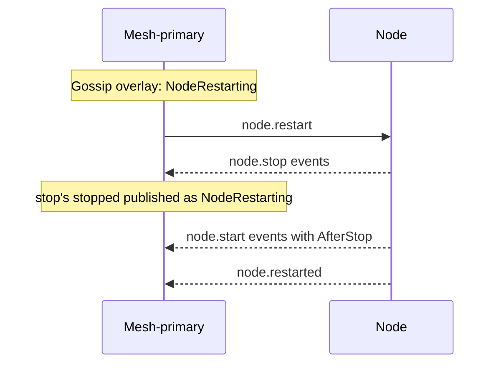

# Node restart

[Lifecycle index](../fabric-mesh-node-lifecycles.md) · [States](states.md) · [Typed calls and wire mapping](../node-rpc-envelope.md#typed-object-contract)

`node.restart` is a composed workflow: NodeRestarting + the entire
[node.stop](node-stop.md) + the entire [node.start](node-start.md) + node.restarted.
It runs on the stopped process, which never exits.

## Operation contract

| Field | Contract |
|---|---|
| Kept | Same node.id, incarnation, immutable path, name, endpoint key, bound port, bin and data dir |
| Runtime | Live process stops and rejoins; no new process |
| Start kind | AfterStop |
| Peer overlay | Mesh-primary authors NodeRestarting, including from stop's stopped; never NodeStopped for this restart |
| Readiness | The whole [node.start](node-start.md) through node.started |
| Hooks | The composed start's: [`pre_node_ready`](../fabric-node-hooks.md#pre_node_ready), blocking, with `start_kind = AfterStop`, and [`on_node_ready`](../fabric-node-hooks.md#on_node_ready), a notice after node.started |
| New executable | Requires a new node through Rafka's replace recipe |
| Completion | node.restarted after the whole start completes; no event is inferred from gossip |
| Primary | A restart of a primary with no successor is refused by name before anything moves, with [node.stop](node-stop.md)'s texts; the same two exceptions apply: [fabric.delete](fabric-delete.md) and the final-admin deletion after mesh.delete's confirmed fabric handover |
| Stopped or restarting target | A fresh `node.restart` of a stopped node, or of a birth whose own restart is open, is refused `node-not-live` by name before anything moves: a stopped node is started by `node.start`. An open restart is resumed by resubmitting its Build with the existing `build_id`. A live attempt is reattached; a new attempt is claimed only under the existing attempt rules. Execution continues from confirmed receipts: resume the uncompleted stop sequence, then start; if the stop already completed, continue at start. |

## Numbered end-to-end sequence

1. Mesh-primary publishes [NodeRestarting](../gossip.md#31-frame-catalog) for this
   accepted workflow.
2. Compose the whole [node.stop](node-stop.md#numbered-end-to-end-sequence). For this
   workflow's stopped the mesh-primary publishes NodeRestarting instead of NodeStopped.
3. Compose the whole [node.start](node-start.md#end-to-end-sequence) with AfterStop. No
   supersedes lineage or new incarnation is introduced.
4. When the start completes through node.started, emit node.restarted. A failed or
   uncertain start does not produce node.restarted.

## Command, completion and gossip messages

```text
node.restart
  [mesh-primary gossip: NodeRestarting]
  ← every node.stop event
  [stop's stopped published as NodeRestarting]
  ← every node.start(AfterStop) event
  ← node.restarted
```

Caller events stay on the restart's reply stream. The mesh-primary publishes
NodeRestarting for the whole restart, stop's stopped included; the node authors no gossip
after its connection cut.

## Mermaid sequence diagram



## Failure and receipts

Failures and stream certainty follow the
[caller execution contract](../node-rpc-envelope.md#caller-execution-and-certainty).

## Observability contract

Trace propagation, step spans and correlation follow the
[runtime spans](../node-rpc-envelope.md#runtime-spans).
