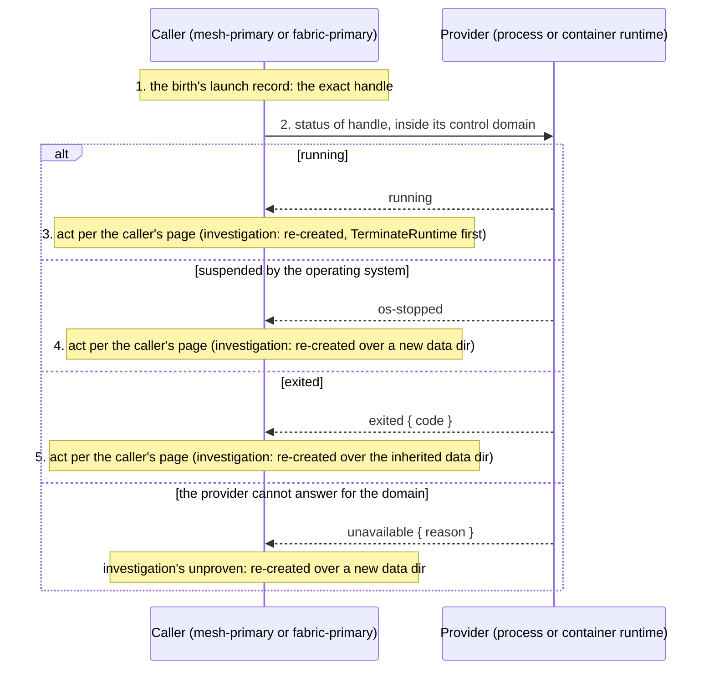

# node.runtime.inspect

[Lifecycle index](../fabric-mesh-node-lifecycles.md) · [States](states.md) · [Deployment provider](../deployment-provider.md#24-exact-provider-locator-and-control-domain)

A primitive. `node.runtime.inspect` asks the deployment provider, the process provider or the
container runtime that launched a birth, about the exact runtime handle it recorded at launch:
the PID with its start identity, or the immutable container id. It answers `running`,
`os-stopped` or `exited { code }`. It is the provider step of [node investigation](node-investigation.md),
whose verdict is the one decision about an unheard node (Q111); nothing waits on it as a proof of
termination. It touches no network and asks the node nothing. It is run by:

- [node investigation](node-investigation.md), as its first step after the index read: `exited` or `os-stopped` is the verdict and no tickle is sent; on `running` or `unavailable` the tickles follow;
- [node.delete](node-delete.md), at its start (an `os-stopped` runtime answers no stop: the delete skips the stop by name and begins at `TerminateRuntime`);
- node recovery's `TerminateRuntime`, at the step's own instant, before it asks the provider to
  terminate ([node recovery](node-recovery.md) step 3);
- [mesh.delete](mesh-delete.md) through each member's delete, and the last admin's;
- [fabric.delete](fabric-delete.md) the same way;
- the boot of a node-admin on an inherited data dir, on the old birth of that dir
  ([fabric recovery](fabric-recovery.md)).

## Operation contract

| Field | Contract |
|---|---|
| Caller | The primary that holds the birth's launch record: its mesh-primary for a member, the fabric-primary for a mesh-primary or a mesh's last admin, the booting node-admin for the old birth on its own data dir |
| Target | The exact runtime handle recorded at launch: `provider_control_domain + pid + start identity` for a process, `provider_control_domain + container id` for a container. A PID or a container name alone is insufficient and is refused by name |
| Domain | The handle is acted on only inside its control domain; a cross-domain handle is routed to a domain-local execution path or refused by name ([deployment-provider §2.4](../deployment-provider.md#24-exact-provider-locator-and-control-domain)) |
| Result | `running`: the exact runtime is alive, however silent the node. `os-stopped`: the operating system holds the exact runtime suspended, so no `node.stop` completed ([deployment provider §2.5](../deployment-provider.md#25-runtime-state-what-the-provider-reports)). `exited { code }`: the provider's terminal status for that exact handle. Each is a verdict of [node investigation](node-investigation.md) when the tickles did not reach the birth |
| Not a result | A RuntimeFact's presence says neither running nor gone; a provider that cannot answer for the domain answers `unavailable { reason }`, which is investigation's `unproven` |
| Bound | The provider answers within 2 s. Expiry answers `unavailable { reason }`, never proof of exit, and the provider ends the subprocess it started; node investigation's tickles follow |
| What follows | The caller's: investigation's verdict re-creates the node on any answer here (`exited` over the inherited data dir, the others over a newly allocated one), with `TerminateRuntime` first on every answer but `os-stopped` (of an `exited` runtime the provider removes what it left, Q145); delete writes the row deleted and publishes `NodeDeleted`; a boot on an inherited dir proceeds as recovery. On an explicit delete, an `os-stopped` result skips the unexecutable Node RPC stop by name and proceeds to `TerminateRuntime` on the exact handle |
| Not a Node RPC | The inspect is a provider call from the caller's process; it has no op number and no frame. Its span is the evidence |
| Spans | `rdm.node_admin.node.resolve.via-provider-inspection` with node, node_id, incarnation, the handle, `verdict` (`running` / `os-stopped` / `exited` / `unavailable`), `exit_code` and the reason |

## Numbered end-to-end sequence

1. The caller holds the birth's launch record: the handle the provider returned when it launched
   this exact incarnation.
2. It asks the provider for that handle's status inside the handle's control domain.
3. `running`: the caller acts as its page says for a live but unreached node (investigation's
   verdict: re-created, `TerminateRuntime` first; delete has a defect to explain, since it stopped the
   node first).
4. `os-stopped`: the caller acts as its page says (investigation's verdict: re-created over a newly
   allocated data dir; delete skips the stop and terminates).
5. `exited { code }`: the caller acts as its page says (investigation's verdict: re-created over the
   inherited data dir; delete proceeds to `node.deleted`).
6. The caller continues per its page: `node.deleted`, the recovery attempt, the investigation's
   verdict.

## Command, completion and gossip messages

There is no wire frame: the inspect is a call into the provider from the caller's own process.
Its evidence is the span. For the process provider the question and the three answers, as the span
records them:

```text
inspect  { domain: "host-7", pid: 48213, start_id: "btime:1718289900:48213" }
running
os-stopped                        every task in state T or t
exited { code: 0 }                the provider's terminal status of (k8pag1qx95gw, 0000000000000008)
```

For the container provider the handle is `{ domain: "docker:host-7", container_id: "9f2c…e1" }`
and the answers are the same. The gossip after the answer is the caller's, not the primitive's:
`NodeDeleted` from the executor of a delete ([catalog example](../gossip.md#examples)), or the
recovery's `NodeDeleting` then `NodeDeleted`.

## Mermaid sequence diagram



Checked against the numbered sequence: one question, one answer; the row that follows is the
caller's own, never the primitive's.

## Failure and receipts

`unavailable` is a named answer, never treated as any of the other three; for node investigation
it is the `unproven` verdict, and for a delete the step fails naming the domain and the reason. A
later attempt of the caller's workflow asks the provider again.

## Observability contract

| Step | Actor | Span | Fields |
|---|---|---|---|
| Inspect | caller | `rdm.node_admin.node.resolve.via-provider-inspection` | node, node_id, incarnation_id, inspector, handle, verdict, exit_code, reason |

Trace propagation follows the [runtime spans](../node-rpc-envelope.md#runtime-spans).
