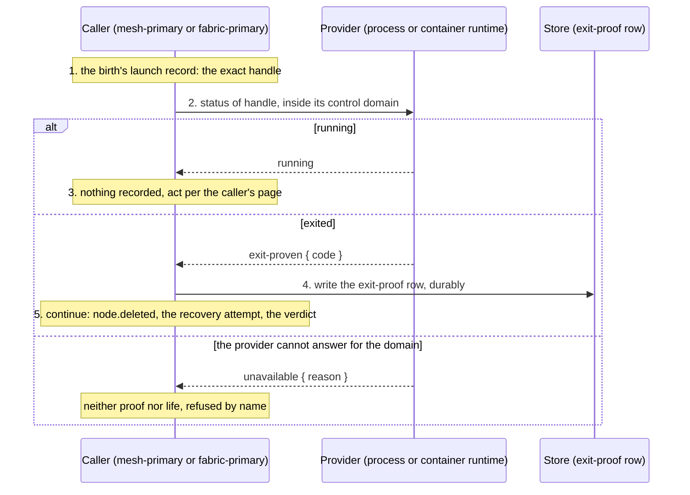

# node.runtime.inspect

[Lifecycle index](../fabric-mesh-node-lifecycles.md) · [States](states.md) · [Deployment provider](../deployment-provider.md#24-exact-provider-locator-and-control-domain)

A primitive. `node.runtime.inspect` asks the deployment provider, the process provider or the
container runtime that launched a birth, about the exact runtime handle it recorded at launch:
the PID with its start identity, or the immutable container id. It answers `running` or
`exit-proven { code }`. It is the only thing in the design that proves a runtime is gone;
silence, a failed call, a closed endpoint, a timeout and an `unreached` tickle prove nothing
([node.tickle](node-tickle.md)). It touches no network and asks the node nothing. It is run by:

- [node.delete](node-delete.md), after the stop, before `node.deleted`;
- [node recovery](node-recovery.md), after a tickle ends `unreached`;
- [mesh investigation](mesh-investigation.md)'s fully-crashed arm, on every node of the mesh;
- [mesh.delete](mesh-delete.md) through each member's delete, and the last admin's;
- [fabric.delete](fabric-delete.md) the same way;
- the boot of a node-admin on an inherited data dir, on the old birth of that dir
  ([fabric recovery](fabric-recovery.md)).

## Operation contract

| Field | Contract |
|---|---|
| Caller | The authority that holds the birth's launch record: its mesh-primary for a member, the fabric-primary for a mesh-primary or a mesh's last admin, the booting node-admin for the old birth on its own data dir |
| Target | The exact runtime handle recorded at launch: `provider_control_domain + pid + start identity` for a process, `provider_control_domain + container id` for a container. A PID or a container name alone is insufficient and is refused by name |
| Domain | The handle is acted on only inside its control domain; a cross-domain handle is routed to a domain-local execution path or refused by name ([deployment-provider §2.4](../deployment-provider.md#24-exact-provider-locator-and-control-domain)) |
| Result | `running`: the exact runtime is alive, however silent the node; nothing is recovered or deleted on it. `exit-proven { code }`: the provider's terminal status for that exact handle, recorded durably as the birth's exit-proof row |
| Not a result | A RuntimeFact's presence proves neither running nor gone; a provider that cannot answer for the domain answers `unavailable { reason }`, which is neither |
| What follows | The caller's: delete writes the row deleted and publishes `NodeDeleted`; recovery opens its attempt; investigation's fully-crashed arm creates the node-admin; a boot on an inherited dir proceeds as recovery |
| Not a Node RPC | The inspect is a provider call from the caller's process; it has no op number and no frame. Its span is the evidence |
| Spans | `rdm.node_admin.node.resolve.via-provider-inspection` with node, node_id, incarnation, the handle, `verdict` (`running` / `exited` / `unavailable`), `exit_code` and the reason |

## Numbered end-to-end sequence

1. The caller holds the birth's launch record: the handle the provider returned when it launched
   this exact incarnation.
2. It asks the provider for that handle's status inside the handle's control domain.
3. `running`: the caller records nothing and acts as its page says for a live but unreached node
   (recovery waits; delete has a defect to explain, since it stopped the node first).
4. `exit-proven { code }`: the caller writes the birth's exit-proof row, durably, before anything
   else: it is the receipt every later step rests on.
5. The caller continues per its page: `node.deleted`, the recovery attempt, the investigation's
   verdict.

## Command, completion and gossip messages

There is no wire frame: the inspect is a call into the provider from the caller's own process.
Its evidence is the span and the exit-proof row. For the process provider the question and the
two answers, as the span records them:

```text
inspect  { domain: "host-7", pid: 48213, start_id: "btime:1718289900:48213" }
running
exit-proven { code: 0 }           recorded as the exit-proof row of (k8pag1qx95gw, 0000000000000008)
```

For the container provider the handle is `{ domain: "docker:host-7", container_id: "9f2c…e1" }`
and the answers are the same. The gossip after an `exit-proven` is the caller's, not the
primitive's: `NodeDeleted` from the executor of a delete ([catalog example](../gossip.md#examples)),
or the recovery's `NodeDeleting` then `NodeDeleted`.

## Mermaid sequence diagram



Checked against the numbered sequence: one question, one answer; the row is written only on
`exit-proven` and before anything else; `running` writes nothing.

## Failure and receipts

`unavailable` is a named refusal, never treated as either answer; the caller's step fails naming
the domain and the reason. The exit-proof row is the durable receipt; a later attempt of the
caller's workflow reads it and asks the provider again only for a birth with no row.

## Observability contract

| Step | Actor | Span | Fields |
|---|---|---|---|
| Inspect | caller | `rdm.node_admin.node.resolve.via-provider-inspection` | node, node_id, incarnation_id, inspector, handle, verdict, exit_code, exit_proof (`put` / `held` / none), reason |
| Row | caller | the store write of the exit-proof row | node_id, incarnation |

Trace propagation follows the [runtime spans](../node-rpc-envelope.md#runtime-spans).
