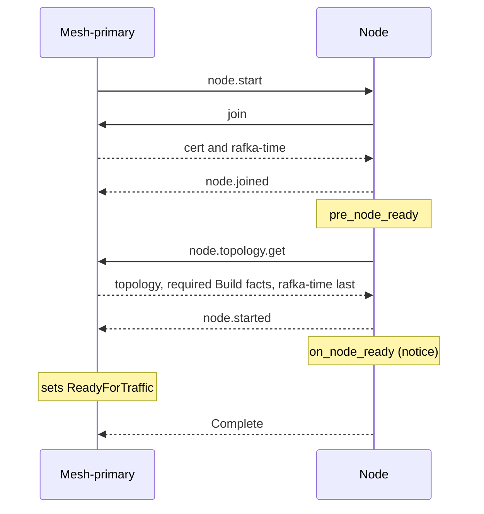

# Node start

[Lifecycle index](../fabric-mesh-node-lifecycles.md) · [States](states.md) · [Typed calls and wire mapping](../node-rpc-envelope.md#typed-object-contract)

`node.start` rejoins a stopped or just-created process. It creates no identity or
runtime. Create composes it with FirstStart; a start of a stopped node runs it with AfterStop.

## Operation contract

| Field | Contract |
|---|---|
| Identity | Same node.id, incarnation, path/name, endpoint key, bound port and bin |
| Entry | A just-created process or a live process in stopped |
| Admission | The fabric-primary admits a start from its view, where a stopped node of a peer mesh is the mesh-primary's NodeStopped ([Build §4.4](../build.md#44-the-gates-before-an-operation)); the mesh-primary verifies the exact birth (node id and incarnation) when it runs the start |
| Stopped reachability | Fresh Node RPC dial to its still-bound endpoint ([stopped nodes](states.md#stopped-nodes)) |
| Context | `start_kind = FirstStart` or `AfterStop`; the spec says whether the data dir is inherited |
| Hooks | [`pre_node_ready`](../fabric-node-hooks.md#pre_node_ready), blocking, with joined channel, cert and current rafka-time; topology follows the hook. [`on_node_ready`](../fabric-node-hooks.md#on_node_ready), a notice, once after `node.started` |
| Completion | Hook Ok, complete topology, current time, required Build floor, `node.started`, and the mesh-primary's ReadyForTraffic on it |

## End-to-end sequence

1. A stopped process remains the same exact
   runtime and keeps its endpoint/port; it does not start a new process or load a new executable.
2. Run [node.mesh.join](node-mesh-join.md): `JoinNode` on the accepting primary, the answer's name, cert
   and rafka-time installed, the mesh channel joined (and the backbone, a node-admin), `node.mesh.joined`. FirstStart makes it the process's first
   outbound call; AfterStop rejoins the same `(node.id, incarnation)` over the endpoint and path of
   the call that commanded it, and learns who answered from the answer. Emit
   `NodeJoined` (Data) only after the accepted join and channel join; the mesh-primary records
   pending from that frame. node.start clears NodeStopped at NodeJoined. No state is written
   before `CommandAccepted`; the mesh-primary records starting from that frame, the node's
   acknowledgement (a create's starting from the launch), and a query answers it ([states](states.md)).
3. Run [pre_node_ready](../fabric-node-hooks.md#pre_node_ready) with the
   start kind and inherited-data-dir indication. The app subscribes its kind topics
   through the joined channel and reads no topology snapshot as a prerequisite.
   Ready waits for the hook; its Ok, Blocked and Failed outcomes, the Blocked probe
   answer and cancellation follow [Outcomes and the gate](../fabric-node-hooks.md#outcomes-and-the-gate).
4. Obtain complete topology through [node.topology.get](node-topology-get.md). Install
   only complete source snapshots; partial snapshots never complete start. Fetch Build
   facts only when the node is below the primary's floor, after the hook and before
   node.started: the node-admin Ready check reports a missing pointer, an unreadable Build
   or holdings behind the required floor, and the node reads the facts with
   [FetchCurrentBuild](../node-rpc-envelope.md#build-facts-op-0x1f-rdm) when the missing pointer names no Build,
   else with [FetchBuildFacts](../node-rpc-envelope.md#build-facts-op-0x1f-rdm) of the Build named, each served
   only by a node-admin, under that schema's resolution order and backoff. The
   facts are absorbed through the Build log; the step completes when the Ready check holds
   the required facts, never on a received frame alone. Refresh rafka-time **last**, so it
   is current when the node re-enters.
5. Emit `NodeStarted` (Terminal): its hook passed, with nothing pending. Neither a partial snapshot nor a
   Blocked hook permits it. That frame is the node's report: the mesh-primary sets
   ReadyForTraffic on that exact birth through the [node status](node-status.md) apply,
   not a caller op. The node also declares ReadyForTraffic to its mesh-primary as an owed message, as it declares
   Stopped (Q36, Q87); frame and declaration apply once (Q49). A typed
   refusal of that apply completes no readiness.
6. Start ends with `node.started`. The node then calls
   [on_node_ready](../fabric-node-hooks.md#on_node_ready) once, with the same `NodeReadyCtx`, on a
   task of its own: a notice that gates nothing (`rdm.mesh.node.update.via-on-node-ready`). Create
   ends with `node.created` after the start it contains.

## Command, completion and gossip messages

The mesh-primary → exact-node hop uses NodeCommand 0x22. The caller's hop and Build carrier
are unchanged:

```text
StartNode { node_id, incarnation, build_id, attempt, operation }
  ← CommandAccepted (Started; admission, no lifecycle state)
  ← NodeJoined (Data; mesh-primary records pending)
  [pre_node_ready]
  [node.topology.get, missing Build floor, rafka-time last]
  ← NodeStarted (Terminal; mesh-primary records ReadyForTraffic)
  [on_node_ready, a notice]
  [outer Build Complete only after the ReadyForTraffic record]
```

If join fails after start:

```text
CommandAccepted
Failed { step: "node.join", reason: "…", code } (Terminal)
```

No node.joined, node.started or downstream success follows that failure
([caller execution](../node-rpc-envelope.md#caller-execution-and-certainty)). The process's
`digest_seq` continues across stop/start and no new incarnation is minted; digest ordering
is the [frame catalog](../gossip.md#31-frame-catalog)'s.

## Sequence diagram



## Failure and receipts

Failures and stream certainty follow the
[caller execution contract](../node-rpc-envelope.md#caller-execution-and-certainty).

## Observability contract

Trace propagation, step spans and correlation follow the
[runtime spans](../node-rpc-envelope.md#runtime-spans).
