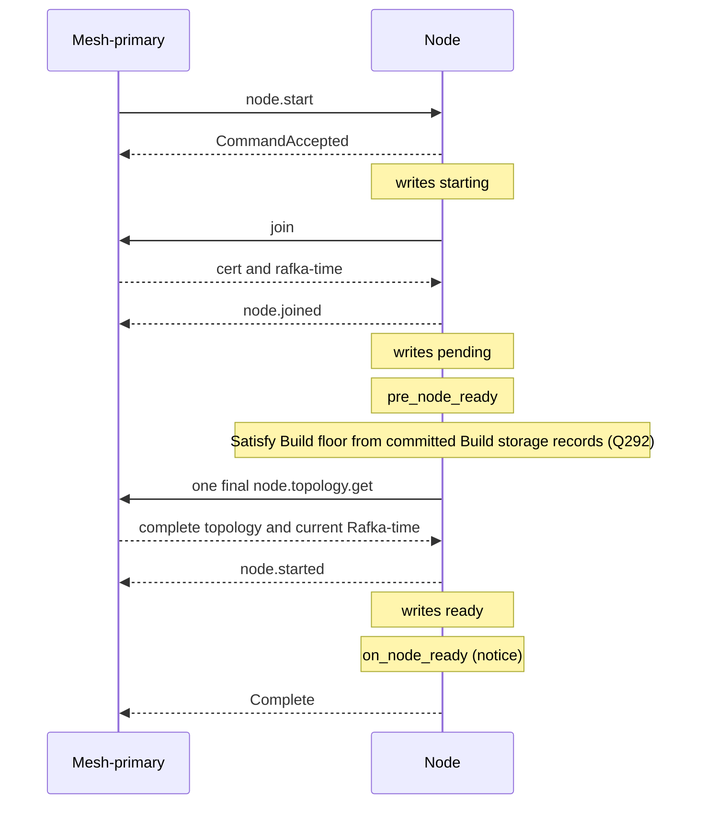

# Node start

[Lifecycle index](../fabric-mesh-node-lifecycles.md) · [States](states.md) · [Typed calls and wire mapping](../node-rpc-envelope.md#typed-object-contract)

`node.start` rejoins a stopped or just-created process. It creates no identity or
runtime. Create composes it with FirstStart; a start of a stopped node runs it with AfterStop.

## Operation contract

| Field | Contract |
|---|---|
| Identity | Same node.id, incarnation, path/name, endpoint key, bound port and bin |
| Entry | A just-created process or a live process in stopped |
| Admission | The caller sends NodeCommand 0x22 `StartNode` to the node's mesh-primary (the fabric-primary for a mesh-primary; directly; an unreachable mesh-primary ends the call `NotSent` by name), which admits a start of a stopped exact birth (node id and incarnation) and runs it; any other state is refused `node-not-live` by name. node.start is a node command of the primary above the node, never a Build or part of one (Q342) |
| Stopped reachability | Fresh Node RPC dial to its still-bound endpoint ([stopped nodes](states.md#stopped-nodes)) |
| Context | `start_kind = FirstStart` or `AfterStop`; the spec says whether the data dir is inherited |
| Hooks | [`pre_node_ready`](../fabric-node-hooks.md#pre_node_ready), blocking, with joined channel, cert and current rafka-time; topology follows the hook. [`on_node_ready`](../fabric-node-hooks.md#on_node_ready), a notice, once after `node.started` |
| Completion | Hook Ok, complete topology, current time, required Build floor, `node.started`, and the mesh-primary's Ready on it |

## End-to-end sequence

1. A stopped process remains the same exact
   runtime and keeps its endpoint/port; it does not start a new process or load a new executable.
2. Run [node.mesh.join](node-mesh-join.md): `JoinNode` on its node-admin, the answer's name, cert
   and rafka-time installed, the mesh channel joined (and the backbone, a node-admin), `node.mesh.joined`. FirstStart makes it the process's first
   outbound call; AfterStop rejoins the same `(node.id, incarnation)` over the endpoint and path of
   the call that commanded it, and learns who answered from the answer. Emit
   `NodeJoined` (Data) only after the accepted join and channel join; the node writes pending
   on its own record (Q356) with that frame. node.start clears NodeStopped at NodeJoined, or, for an executor whose
   replayed start of a birth its view holds stopped is answered `AlreadyApplied`, at that answer: the
   join it did not see; it clears the mark in its overlay and publishes the clear as the mesh's
   primary (Q249). No state is written
   before `CommandAccepted`; the node writes starting on its own record with that frame, its
   acknowledgement (a create's starting from the launch), and a query answers it ([states](states.md)).
   The join and the start stream are two calls with no order between them: a starting frame that
   reaches the mesh-primary after the same start's join has set pending, or its completion has set
   ready, moves the row nowhere, as a late frame does on the stop ([node.stop](node-stop.md)); a
   later start's acknowledgement is its own. The progression in [states](states.md) is an order,
   not a promise that every intermediate state is durably observed.
3. Run [pre_node_ready](../fabric-node-hooks.md#pre_node_ready) with the
   start kind and inherited-data-dir indication. The app subscribes its kind channels
   through the joined channel and reads no topology aggregate as a prerequisite.
   Ready waits for the hook; its `Ok`, `Pending` and `Failed` answers under the hook's `Send`, the `Pending` probe
   answer and cancellation follow [Outcomes and the gate](../fabric-node-hooks.md#outcomes-and-the-gate).
4. Satisfy the required Build floor after the hook. Read committed facts from Build storage
   only when the node is below the primary's floor: the current Build when no pointer is known,
   otherwise the named Build. Absorb the facts through the existing Build log and Ready check;
   a successful storage read alone does not satisfy the floor. This check must not depend on
   fetching topology early.
   Then obtain topology once through [node.topology.get](node-topology-get.md), as the final
   startup read. Request it without a conditional source version and write only complete
   aggregates to the topology view. The same reply supplies the recorded primaries, startup context and current
   Rafka-time; adopt the time after writing topology to the topology view and before reporting started.
   Preserve retained own properties. Do not fetch topology before
   the Build-floor check and do not issue a second topology request just to refresh time.
5. Emit `NodeStarted` (Terminal): its hook passed, with nothing pending. Neither a partial aggregate nor a
   `Pending` hook permits it. That frame is the node's report, and the node writes
   ready on its own record (Q356). The node also declares Ready to its mesh-primary as an owed message, as it declares
   Stopped (Q36, Q87); frame and declaration apply once (Q49). A typed
   refusal of that apply completes no readiness.
6. Start ends with `node.started`. The node then calls
   [on_node_ready](../fabric-node-hooks.md#on_node_ready) once, with the same `NodeReadyCtx`, on a
   task of its own: a notice that gates nothing (`rdm.mesh.node.update.via-on-node-ready`). Create
   ends with `node.created` after the start it contains.

## Command, completion and gossip messages

The mesh-primary → exact-node hop uses NodeCommand 0x22:

```text
StartNode { node_id, incarnation, operation }
  ← CommandAccepted (Started; admission, no lifecycle state)
  ← NodeJoined (Data; the node writes pending)
  [pre_node_ready]
  [required Build floor, one final node.topology.get with current Rafka-time]
  ← NodeStarted (Terminal; the node writes ready)
  [on_node_ready, a notice]
  [the caller's node.start completes only after the Ready record]
```

If join fails after start:

```text
CommandAccepted
Failed { step: "node.join", reason: "…", code } (Terminal)
```

No node.joined, node.started or downstream success follows that failure
([caller execution](../node-rpc-envelope.md#caller-execution-and-certainty)); an AfterStop start
whose join failed is stopped again, as it was. A start that ends Failed at its `pre_node_ready` hook,
FirstStart or AfterStop, answers `Failed { step: "node.pre-node-ready", reason, code }` and leaves the
node rejoined and `Pending`, its process running and never stopped again; its probe answers
`StartFailed` ([fabric-node-hooks.md](../fabric-node-hooks.md#outcomes-and-the-gate), Q350). The process's
`digest_seq` continues across stop/start and no new incarnation is minted; digest ordering
is the [frame catalog](../gossip.md#31-frame-catalog)'s.

## Sequence diagram



## States written

The node writes each state on its own record (Q356), a `node-record` line in `nodes.jsonl`, whole.

| written | by | when |
|---|---|---|
| `starting` | the node | it admits the command; its `CommandAccepted` frame |
| `pending` | the node | its join report is accepted; its `NodeJoined` frame |
| `ready` | the node | every start gate passed; its `NodeStarted` frame, the stream's terminal |

As stored:

`starting`:

```json
{"len":1335,"specversion":"1.0","id":"01a1ae4b-29fe-775e-9fdf-28054cd82c9f","source":"rdm://gtba9750bpk7/a5xkb8pck5e6/rnqs4tgmfj0b","type":"node-record","subject":"a5xkb8pck5e6","time":"2026-11-06T00:38:43.962Z","datacontenttype":"application/json","dataschema":"node-record/2","data":{"node_id":"a5xkb8pck5e6","path":"mesh1.node","name":"1","type":"node","incarnation":"rnqs4tgmfj0b","state":"starting","endpoint_id":"2300ba7e329edc5c2c1fecc9c725692e7bb5f8ff5edfa86809f256b74afebf7a","transport_addr":"127.0.0.1:43943","listeners":[],"runtime":{"deployment_id":"dr9323hp16mj","provider":"process","control_domain":"process:e152f7e9-9c84-4260-8679-e39839d273ff:4026531836","locator":{"process":{"pid":744666,"start":65412649}}},"is_primary":null,"is_fabric_primary":null,"cert":{"issued_at":1793925523755,"expires_at":1794011923755,"issuer_expires_at":1796517523088,"renew_at":1793984400156},"signing_cert":null,"storage":{"persistence":{"persistence":"ephemeral"},"data_dir":"/dev/shm/rdm-lane-5/cells-744446/i143-a_stop_keeps_the_process_and_a_start_rejoins_it_as_the_same_birth-744518-0/a5xkb8pck5e6"},"executable":{"launch_id":"node","executable":"/home/admin/rdm-lanes/5/target/debug/testkit-node","sha256":"6c5e453782e6b611128637e8952c26a706558054d75f83259a2e13d3056484df","image":null},"config":{},"tags":[]},"crc32":"928482c0"}
```

`pending`:

```json
{"len":1334,"specversion":"1.0","id":"01a1ae4b-2a05-7cb0-b99a-1c0a280a0a34","source":"rdm://gtba9750bpk7/a5xkb8pck5e6/rnqs4tgmfj0b","type":"node-record","subject":"a5xkb8pck5e6","time":"2026-11-06T00:38:43.969Z","datacontenttype":"application/json","dataschema":"node-record/2","data":{"node_id":"a5xkb8pck5e6","path":"mesh1.node","name":"1","type":"node","incarnation":"rnqs4tgmfj0b","state":"pending","endpoint_id":"2300ba7e329edc5c2c1fecc9c725692e7bb5f8ff5edfa86809f256b74afebf7a","transport_addr":"127.0.0.1:43943","listeners":[],"runtime":{"deployment_id":"dr9323hp16mj","provider":"process","control_domain":"process:e152f7e9-9c84-4260-8679-e39839d273ff:4026531836","locator":{"process":{"pid":744666,"start":65412649}}},"is_primary":null,"is_fabric_primary":null,"cert":{"issued_at":1793925523968,"expires_at":1794011923968,"issuer_expires_at":1796517523088,"renew_at":1793984960390},"signing_cert":null,"storage":{"persistence":{"persistence":"ephemeral"},"data_dir":"/dev/shm/rdm-lane-5/cells-744446/i143-a_stop_keeps_the_process_and_a_start_rejoins_it_as_the_same_birth-744518-0/a5xkb8pck5e6"},"executable":{"launch_id":"node","executable":"/home/admin/rdm-lanes/5/target/debug/testkit-node","sha256":"6c5e453782e6b611128637e8952c26a706558054d75f83259a2e13d3056484df","image":null},"config":{},"tags":[]},"crc32":"cfdf9a8a"}
```

`ready`:

```json
{"len":1332,"specversion":"1.0","id":"01a1ae4b-2a10-715f-9ae0-e139b2125503","source":"rdm://gtba9750bpk7/a5xkb8pck5e6/rnqs4tgmfj0b","type":"node-record","subject":"a5xkb8pck5e6","time":"2026-11-06T00:38:43.981Z","datacontenttype":"application/json","dataschema":"node-record/2","data":{"node_id":"a5xkb8pck5e6","path":"mesh1.node","name":"1","type":"node","incarnation":"rnqs4tgmfj0b","state":"ready","endpoint_id":"2300ba7e329edc5c2c1fecc9c725692e7bb5f8ff5edfa86809f256b74afebf7a","transport_addr":"127.0.0.1:43943","listeners":[],"runtime":{"deployment_id":"dr9323hp16mj","provider":"process","control_domain":"process:e152f7e9-9c84-4260-8679-e39839d273ff:4026531836","locator":{"process":{"pid":744666,"start":65412649}}},"is_primary":null,"is_fabric_primary":null,"cert":{"issued_at":1793925523968,"expires_at":1794011923968,"issuer_expires_at":1796517523088,"renew_at":1793984960390},"signing_cert":null,"storage":{"persistence":{"persistence":"ephemeral"},"data_dir":"/dev/shm/rdm-lane-5/cells-744446/i143-a_stop_keeps_the_process_and_a_start_rejoins_it_as_the_same_birth-744518-0/a5xkb8pck5e6"},"executable":{"launch_id":"node","executable":"/home/admin/rdm-lanes/5/target/debug/testkit-node","sha256":"6c5e453782e6b611128637e8952c26a706558054d75f83259a2e13d3056484df","image":null},"config":{},"tags":[]},"crc32":"1fbdec1a"}
```

## Failure

Failures and stream certainty follow the
[caller execution contract](../node-rpc-envelope.md#caller-execution-and-certainty).

## Observability contract

Trace propagation, step spans and correlation follow the
[runtime spans](../node-rpc-envelope.md#runtime-spans).
