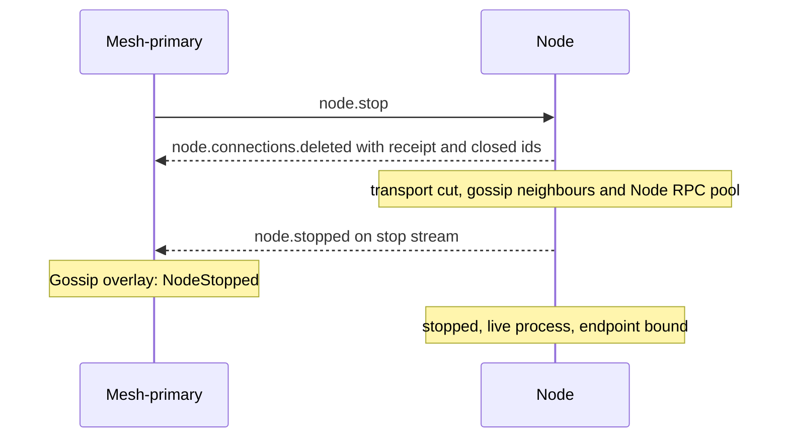

# Node stop

[Lifecycle index](../fabric-mesh-node-lifecycles.md) · [States](states.md) · [Typed calls and wire mapping](../node-rpc-envelope.md#typed-object-contract)

`node.stop` runs [node.connections.delete](node-connections-delete.md) with `{ scope: All }`, cuts its own
transport, then stops the live process.
The node keeps its identity, endpoint key, bound port, bin, name and data dir.
Exact runtime exit belongs to [node.delete](node-delete.md), not this stop.

## Operation contract

| Field | Contract |
|---|---|
| Caller / executor | Mesh-primary through the typed object; exact node executes the stop |
| Entry | Live exact `(node.id, incarnation)` |
| Steps | Whole `node.connections.delete { scope: All }` → the transport cut → node.stopped |
| Seat holder | A target holding a seat has it moved first by [node.primary.update](node-primary-update.md) ([node.fabric-primary.update](node-primary-update.md#fabric-seat) for the fabric seat) and is stopped by its successor. With no successor the stop is refused by name before anything moves: `cannot transfer: no secondary of type <node_type> in mesh <mesh>`, or `cannot transfer fabric seat: no other node-admin ReadyForTraffic in mesh <mesh>, no other mesh-primary ReadyForTraffic`; the holder stays primary and no row is written. A single-admin single-mesh fabric's primary cannot be stopped until a secondary is ReadyForTraffic. A standalone node.stop or node.restart never yields a seat without a successor. This refusal does not apply to [fabric.delete](fabric-delete.md), which retains seats until their holders are deleted ([elections §6](../fabric-node-lifecycle-elections.md#6-fabric-shutdown-does-not-invent-another-election)), or to the final-admin deletion after mesh.delete's confirmed fabric handover ([mesh-delete.md step 7](mesh-delete.md#numbered-end-to-end-sequence)) |
| Transport cut | The stop's own step after the connections are deleted: its gossip neighbours and its Node RPC pool, which are not connections; never its own endpoint or the stop call's stream |
| Reply | `node.stopped` on the stop call's reply stream |
| Peer publication | Mesh-primary authors NodeStopped from the matching stopped frame, in its in-flight overlay |
| Status | stopping, then stopped with a live process: the [stopped node](states.md#stopped-nodes) |
| Completion | The matching `node.stopped` on the stop stream and the recorded stop receipt; no runtime Exited receipt is required |
| Kept | node.id, incarnation, endpoint key, port, bin, path/name and storage |
| Reachability | Endpoint stays bound; fresh Node RPC dials reach start/update/delete |

## Numbered end-to-end sequence

1. The mesh-primary sends NodeCommand `StopNode { node_id, incarnation, build_id, attempt,
   operation }` to the exact birth. The caller's hop and Build carrier are unchanged. The node
   validates the command and sends `CommandAccepted`; only this admission makes the mesh-primary
   record stopping. A never-sent command writes no state.
2. Run the entire [node.connections.delete](node-connections-delete.md) with `{ scope: All }`:
   graceful closure of every open connection of the node, each open Direct or Proxy entry of its
   connections log, ending in node.connections.deleted with its `Established` or `Deadline` receipt
   and the closed ids, reported as `StopConnectionsDeleted { receipt }` (Data) on the stop stream.
   The stop's visible status is stopping; the child call keeps its events,
   spans and receipt. On the deadline the stop may hard-cut, and its receipt keeps the deadline
   evidence.
3. Cut the stop's own transport: its gossip neighbours and its Node RPC pool. Never unbind the
   node's own endpoint or close the stop call's stream.
4. Emit `NodeStopped` (Terminal) on that same reply stream, and declare `Stopped` to the mesh-primary naming
   the stop's operation, an owed message ([Node RPC §43](../node-rpc.md#43-owed-messages-delivery-is-the-runtimes))
   sent whether or not the stop call's stream is still open. The node gossips nothing for this step.
5. The mesh-primary takes the matching stopped frame, or the node's declaration of `Stopped`
   naming the stop's operation, whichever reaches it first, and publishes
   [NodeStopped](../gossip.md#node-stopped-lifecycle-overlay) with that operation in its in-flight
   overlay, once. The mesh-primary blindly puts the applied effect under `(birth, build_id, attempt,
   operation)`; a cycle begin never clears that row, which is forgotten only with the birth (Q49).
   A declaration or frame naming that applied operation answers `AlreadyApplied` and applies nothing
   again. A report naming no operation follows the state transition rule.
   NodeStopped is retained as that section states; for the last node-admin of a deleted mesh the
   fabric-primary publishes it ([Mesh delete](../gossip.md#mesh-delete)). The node's status is
   stopped and its process is live.
6. A stopped node leaves the stopped status only through [node.start](node-start.md) or
   [node.delete](node-delete.md) ([stopped nodes](states.md#stopped-nodes)); the
   [stopped-node garbage collector](../node-identity-and-state.md#stopped-node-garbage-collector)
   is what deletes a node left stopped past the fabric's `stopped_node_ttl`.

## Command and completion messages

Readable execution view; the [typed-object contract](../node-rpc-envelope.md#typed-object-contract)
owns wire mapping, target and context:

```text
node.stop (mesh-primary → exact node, NodeCommand 0x22)
  ← CommandAccepted (Started; admission, no lifecycle state)
  ← StopConnectionsDeleted { receipt: ConnectionsReceipt } (Data)
  ← NodeStopped (Terminal)
  or, after acceptance: Failed { step, reason, code } (Terminal)
```

These are reply frames on one call; each step has its own span and Build receipt.

## Gossip message and channels

The mesh-primary publishes the [NodeStopped lifecycle overlay](../gossip.md#node-stopped-lifecycle-overlay)
from the matching node.stopped frame; the node authors no gossip. The decoded frame is the
[NodeStopped example](../gossip.md#examples). Its channels, forwarding and meaning are the overlay's.
Inside [node.restart](node-restart.md), the mesh-primary publishes that stop's stopped as
NodeRestarting instead of NodeStopped.

## Mermaid sequence diagram



## Failure and receipts

Failures and stream certainty follow the
[caller execution contract](../node-rpc-envelope.md#caller-execution-and-certainty).

## Observability contract

Trace propagation, step spans and correlation follow the
[runtime spans](../node-rpc-envelope.md#runtime-spans).
