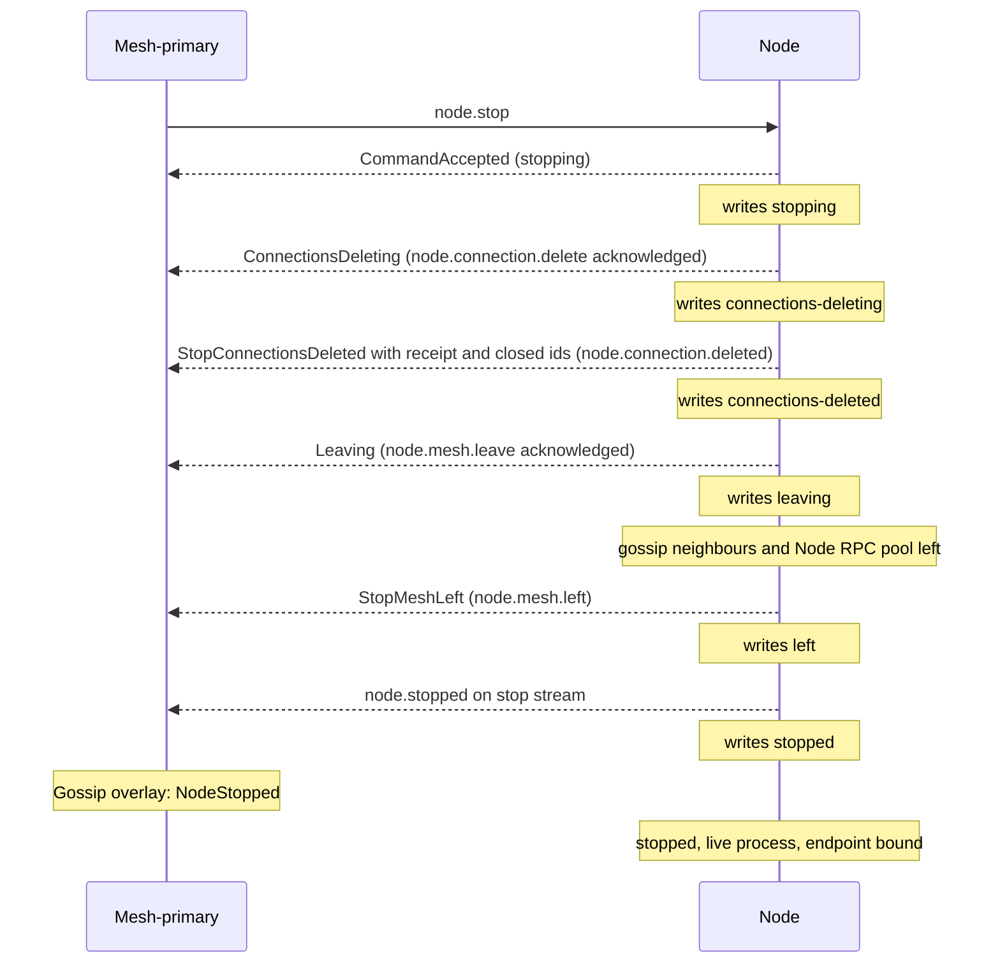

# Node stop

[Lifecycle index](../fabric-mesh-node-lifecycles.md) · [States](states.md) · [Typed calls and wire mapping](../node-rpc-envelope.md#typed-object-contract)

`node.stop` is a workflow: it calls [node.connection.delete](node-connections-delete.md) with `{ scope: All }`,
then [node.mesh.leave](node-mesh-leave.md), streaming each one's acknowledgement and completion on the
stop's own stream, then stops the live process. The node writes each status on its own record
(Q356) with that frame. node.stop is a node command of the primary above the node, never a Build or part
of one (Q342).
The node keeps its identity, endpoint key, bound port, bin, name and data dir.
Exact runtime exit belongs to [node.delete](node-delete.md), not this stop.

## Operation contract

| Field | Contract |
|---|---|
| Caller / executor | The caller, through the typed object, sends NodeCommand 0x22 `StopNode` to the node's mesh-primary (the fabric-primary for a mesh-primary; directly; an unreachable mesh-primary ends the call `NotSent` by name), which runs it; exact node executes the stop |
| Entry | Live exact `(node.id, incarnation)`; any other state is refused `node-not-live` by name, nothing written |
| Steps | Whole `node.connection.delete { scope: All }` → `node.mesh.leave` → node.stopped; each primitive's acknowledgement and completion is a Data frame on the stop's stream, and the node writes each status on its own record with its frame (Q356) |
| Primary | A target that is a primary hands over first by [node.primary.update](node-primary-update.md) ([node.fabric-primary.update](node-primary-update.md#the-fabric-primary-nodefabric-primaryupdate) for the fabric-primary) and is then stopped by its mesh-primary as it stands after the update: the new primary the update's `node_id` names, for a mesh-primary or the fabric-primary (node-primary-update.md step 6). With no successor the stop is refused by name before anything moves: `cannot transfer: no secondary of type <type> in mesh <mesh>`, or `cannot transfer fabric-primary: no other node-admin Ready in mesh <mesh>, no other mesh-primary Ready`; the primary stays primary and no row is written. A single-admin single-mesh fabric's primary cannot be stopped until a secondary is Ready. A standalone node.stop never hands over without a successor. This refusal does not apply to [fabric.delete](fabric-delete.md), which keeps every primary until it is deleted ([elections §6](../fabric-node-lifecycle-elections.md#6-fabric-shutdown-does-not-invent-another-election)), or to the final-admin deletion after mesh.delete's confirmed fabric handover ([mesh-delete.md step 7](mesh-delete.md#numbered-end-to-end-sequence)) |
| Transport cut | [node.mesh.leave](node-mesh-leave.md), called after the connections are deleted: its gossip neighbours and its Node RPC pool, which are not connections; never its own endpoint, the stop call's stream, or the connection to its mesh-primary its owed declarations ride |
| Reply | `node.stopped` on the stop call's reply stream |
| Peer publication | Mesh-primary authors NodeStopped from the matching stopped frame, in its in-flight overlay |
| Upward | Each frame the node sends on the stop stream, the mesh-primary sends on as a live frame of the caller's node.stop stream; two one-hop streams, never a forwarded one |
| Status | stopping from the stop's admission, then connections-deleting, connections-deleted, leaving and left from its primitives' frames, then stopped with a live process: the [stopped node](states.md#stopped-nodes) |
| Completion | The matching `node.stopped` on the stop stream and the stop recorded on the node record; no runtime Exited receipt is required |
| Kept | node.id, incarnation, endpoint key, port, bin, path/name and storage |
| Reachability | Endpoint stays bound; fresh Node RPC dials reach start/update/delete |

## Numbered end-to-end sequence

1. The mesh-primary sends NodeCommand `StopNode { node_id, incarnation, operation }` to the exact
   birth; `operation` is the stop's identity, keyed on the node.id. The node
   validates the command and sends `CommandAccepted`; only this admission writes stopping,
   on the node's own record. A never-sent command writes no state.
2. Call the entire [node.connection.delete](node-connections-delete.md) with `{ scope: All }`:
   graceful closure of every open connection of the node, each open Direct or Proxy entry of its
   connections log. Its acknowledgement, `ConnectionsDeleting` (Data), goes on the stop stream once
   its block on new application work is in force, and the node writes connections-deleting
   with it; its completion, node.connection.deleted with its `Established` or `Deadline` receipt
   and the closed ids, goes on the stop stream as `StopConnectionsDeleted { receipt }` (Data), and the
   node writes connections-deleted with an `Established` one. The child call keeps its spans
   and receipt. On the deadline the stop may hard-cut, and its receipt keeps the deadline evidence.
3. Call [node.mesh.leave](node-mesh-leave.md): its gossip neighbours and its Node RPC pool. Its
   acknowledgement, `Leaving` (Data), and its completion, `StopMeshLeft { left }` (Data), go on the
   stop stream, and the node writes leaving, then left, with them. Never unbind the node's
   own endpoint or close the stop call's stream or the connection to its mesh-primary its owed
   declarations ride. A node already connections-deleted (an `All`
   completed `Established` since its last start) and already left answers each primitive's
   acknowledgement and completion at once, the receipt the `All` established in its
   `StopConnectionsDeleted`, and repeats no work.
4. Emit `NodeStopped` (Terminal) on that same reply stream, and declare `Stopped` to the mesh-primary naming
   the stop's operation, an owed message ([Node RPC §43](../node-rpc.md#43-send-delivery-is-the-runtimes))
   sent whether or not the stop call's stream is still open. The node gossips nothing for this step.
5. The mesh-primary takes the matching stopped frame, or the node's declaration of `Stopped`
   naming the stop's operation, whichever reaches it first, and publishes
   [NodeStopped](../gossip.md#node-stopped-lifecycle-overlay) with that operation in its in-flight
   overlay, once. The mesh-primary blindly puts the applied effect under `(birth, operation)`; a cycle begin never clears that row, which is forgotten only with the birth (Q49).
   A declaration or frame naming that applied operation answers `AlreadyApplied` and applies nothing
   again. A report naming no operation follows the state transition rule.
   NodeStopped is retained as that section states; for the last node-admin of a deleted mesh the
   fabric-primary publishes it ([Mesh delete](../gossip.md#mesh-delete)). The node's status is
   stopped and its process is live.
6. A stopped node leaves the stopped status only through [node.start](node-start.md) or
   [node.delete](node-delete.md) ([stopped nodes](states.md#stopped-nodes)); the
   [stopped-node garbage collector](../node-identity-and-state.md#stopped-node-garbage-collector)
   is what deletes a node left stopped past the fabric's `stopped_node_ttl`.

## Command and completion messages

Readable execution view; the [typed-object contract](../node-rpc-envelope.md#typed-object-contract)
owns wire mapping, target and context:

```text
node.stop (mesh-primary → exact node, NodeCommand 0x22)
  ← CommandAccepted (Started; admission: stopping)
  ← ConnectionsDeleting (Data; node.connection.delete's acknowledgement: connections-deleting)
  ← StopConnectionsDeleted { receipt: ConnectionsReceipt } (Data; its completion: connections-deleted)
  ← Leaving (Data; node.mesh.leave's acknowledgement: leaving)
  ← StopMeshLeft { left } (Data; its completion: left)
  ← NodeStopped (Terminal; stopped)
  or, after acceptance: Failed { step, reason, code } (Terminal)
```

These are reply frames on one call; each step has its own span and is recorded on the node record. The node
writes the status each frame names above on its own record with that frame.

## Gossip message and channels

The mesh-primary publishes the [NodeStopped lifecycle overlay](../gossip.md#node-stopped-lifecycle-overlay)
from the matching node.stopped frame; the node authors no gossip. The decoded frame is the
[NodeStopped example](../gossip.md#examples). Its channels, forwarding and meaning are the overlay's.

## Mermaid sequence diagram



## States written

The node writes each state on its own record (Q356), a `node-record` line in `nodes.jsonl`, whole.

| written | by | when |
|---|---|---|
| `stopping` | the node | it admits the command; its `CommandAccepted` frame |
| `connections-deleting` | the node | `node.connection.delete { All }` acknowledged; its `ConnectionsDeleting` frame |
| `connections-deleted` | the node | the delete completed; its `StopConnectionsDeleted` frame |
| `leaving` | the node | `node.mesh.leave` acknowledged; its `Leaving` frame |
| `left` | the node | the leave completed; its `StopMeshLeft` frame |
| `stopped` | the node | the transport cut completed; its `NodeStopped` frame, the stream's terminal |

As stored:

`stopping`:

```json
{"len":988,"specversion":"1.0","id":"01a1ae8c-01f2-7cf4-8954-8c49eb59b4f6","source":"rdm://tngwfrd0p9vv/9rgap8z13kty/pze496vbjh1n","type":"node-record","subject":"9rgap8z13kty","time":"2026-11-06T01:49:33.552Z","datacontenttype":"application/json","dataschema":"node-record/2","data":{"node_id":"9rgap8z13kty","path":"mesh1.node","name":"1","type":"node","incarnation":"pze496vbjh1n","state":"stopping","endpoint_id":"b8c03c61bb182d7b41402d182888a1eba21895f3ee2ea3bd0a0e5bd207845eee","transport_addr":"127.0.0.1:45458","listeners":[],"runtime":{"deployment_id":"k2ryj3ypad1n","provider":"process","control_domain":"process:e152f7e9-9c84-4260-8679-e39839d273ff:4026531836","locator":{"process":{"pid":1506148,"start":65837629}}},"is_primary":null,"is_fabric_primary":null,"cert":null,"signing_cert":null,"storage":{"persistence":{"persistence":"ephemeral"},"data_dir":"/dev/shm/rdm-lane-5/cells-1506098/stop-start-ymgd6qjpp569"},"executable":null,"config":{},"tags":[]},"crc32":"b18e9265"}
```

`connections-deleting`:

```json
{"len":1001,"specversion":"1.0","id":"01a1ae8c-01f3-7f1e-bd34-5fb152cf9026","source":"rdm://tngwfrd0p9vv/9rgap8z13kty/pze496vbjh1n","type":"node-record","subject":"9rgap8z13kty","time":"2026-11-06T01:49:33.552Z","datacontenttype":"application/json","dataschema":"node-record/2","data":{"node_id":"9rgap8z13kty","path":"mesh1.node","name":"1","type":"node","incarnation":"pze496vbjh1n","state":"connections-deleting","endpoint_id":"b8c03c61bb182d7b41402d182888a1eba21895f3ee2ea3bd0a0e5bd207845eee","transport_addr":"127.0.0.1:45458","listeners":[],"runtime":{"deployment_id":"k2ryj3ypad1n","provider":"process","control_domain":"process:e152f7e9-9c84-4260-8679-e39839d273ff:4026531836","locator":{"process":{"pid":1506148,"start":65837629}}},"is_primary":null,"is_fabric_primary":null,"cert":null,"signing_cert":null,"storage":{"persistence":{"persistence":"ephemeral"},"data_dir":"/dev/shm/rdm-lane-5/cells-1506098/stop-start-ymgd6qjpp569"},"executable":null,"config":{},"tags":[]},"crc32":"c2e9c2c9"}
```

`connections-deleted`:

```json
{"len":999,"specversion":"1.0","id":"01a1ae8c-01f4-7d46-a64d-3f5c9fba3b11","source":"rdm://tngwfrd0p9vv/9rgap8z13kty/pze496vbjh1n","type":"node-record","subject":"9rgap8z13kty","time":"2026-11-06T01:49:33.553Z","datacontenttype":"application/json","dataschema":"node-record/2","data":{"node_id":"9rgap8z13kty","path":"mesh1.node","name":"1","type":"node","incarnation":"pze496vbjh1n","state":"connections-deleted","endpoint_id":"b8c03c61bb182d7b41402d182888a1eba21895f3ee2ea3bd0a0e5bd207845eee","transport_addr":"127.0.0.1:45458","listeners":[],"runtime":{"deployment_id":"k2ryj3ypad1n","provider":"process","control_domain":"process:e152f7e9-9c84-4260-8679-e39839d273ff:4026531836","locator":{"process":{"pid":1506148,"start":65837629}}},"is_primary":null,"is_fabric_primary":null,"cert":null,"signing_cert":null,"storage":{"persistence":{"persistence":"ephemeral"},"data_dir":"/dev/shm/rdm-lane-5/cells-1506098/stop-start-ymgd6qjpp569"},"executable":null,"config":{},"tags":[]},"crc32":"c963e31a"}
```

`leaving`:

```json
{"len":987,"specversion":"1.0","id":"01a1ae8c-01f5-741b-a731-3ed2f92b322f","source":"rdm://tngwfrd0p9vv/9rgap8z13kty/pze496vbjh1n","type":"node-record","subject":"9rgap8z13kty","time":"2026-11-06T01:49:33.554Z","datacontenttype":"application/json","dataschema":"node-record/2","data":{"node_id":"9rgap8z13kty","path":"mesh1.node","name":"1","type":"node","incarnation":"pze496vbjh1n","state":"leaving","endpoint_id":"b8c03c61bb182d7b41402d182888a1eba21895f3ee2ea3bd0a0e5bd207845eee","transport_addr":"127.0.0.1:45458","listeners":[],"runtime":{"deployment_id":"k2ryj3ypad1n","provider":"process","control_domain":"process:e152f7e9-9c84-4260-8679-e39839d273ff:4026531836","locator":{"process":{"pid":1506148,"start":65837629}}},"is_primary":null,"is_fabric_primary":null,"cert":null,"signing_cert":null,"storage":{"persistence":{"persistence":"ephemeral"},"data_dir":"/dev/shm/rdm-lane-5/cells-1506098/stop-start-ymgd6qjpp569"},"executable":null,"config":{},"tags":[]},"crc32":"1e4882ac"}
```

`left`:

```json
{"len":984,"specversion":"1.0","id":"01a1ae8c-01f5-7a4e-9a7b-0703df51279a","source":"rdm://tngwfrd0p9vv/9rgap8z13kty/pze496vbjh1n","type":"node-record","subject":"9rgap8z13kty","time":"2026-11-06T01:49:33.555Z","datacontenttype":"application/json","dataschema":"node-record/2","data":{"node_id":"9rgap8z13kty","path":"mesh1.node","name":"1","type":"node","incarnation":"pze496vbjh1n","state":"left","endpoint_id":"b8c03c61bb182d7b41402d182888a1eba21895f3ee2ea3bd0a0e5bd207845eee","transport_addr":"127.0.0.1:45458","listeners":[],"runtime":{"deployment_id":"k2ryj3ypad1n","provider":"process","control_domain":"process:e152f7e9-9c84-4260-8679-e39839d273ff:4026531836","locator":{"process":{"pid":1506148,"start":65837629}}},"is_primary":null,"is_fabric_primary":null,"cert":null,"signing_cert":null,"storage":{"persistence":{"persistence":"ephemeral"},"data_dir":"/dev/shm/rdm-lane-5/cells-1506098/stop-start-ymgd6qjpp569"},"executable":null,"config":{},"tags":[]},"crc32":"8784d094"}
```

`stopped`:

```json
{"len":987,"specversion":"1.0","id":"01a1ae8c-01f6-757c-82b1-0dc03b07c88e","source":"rdm://tngwfrd0p9vv/9rgap8z13kty/pze496vbjh1n","type":"node-record","subject":"9rgap8z13kty","time":"2026-11-06T01:49:33.555Z","datacontenttype":"application/json","dataschema":"node-record/2","data":{"node_id":"9rgap8z13kty","path":"mesh1.node","name":"1","type":"node","incarnation":"pze496vbjh1n","state":"stopped","endpoint_id":"b8c03c61bb182d7b41402d182888a1eba21895f3ee2ea3bd0a0e5bd207845eee","transport_addr":"127.0.0.1:45458","listeners":[],"runtime":{"deployment_id":"k2ryj3ypad1n","provider":"process","control_domain":"process:e152f7e9-9c84-4260-8679-e39839d273ff:4026531836","locator":{"process":{"pid":1506148,"start":65837629}}},"is_primary":null,"is_fabric_primary":null,"cert":null,"signing_cert":null,"storage":{"persistence":{"persistence":"ephemeral"},"data_dir":"/dev/shm/rdm-lane-5/cells-1506098/stop-start-ymgd6qjpp569"},"executable":null,"config":{},"tags":[]},"crc32":"c77c909e"}
```

## Failure

Failures and stream certainty follow the
[caller execution contract](../node-rpc-envelope.md#caller-execution-and-certainty).

## Observability contract

Trace propagation, step spans and correlation follow the
[runtime spans](../node-rpc-envelope.md#runtime-spans).
