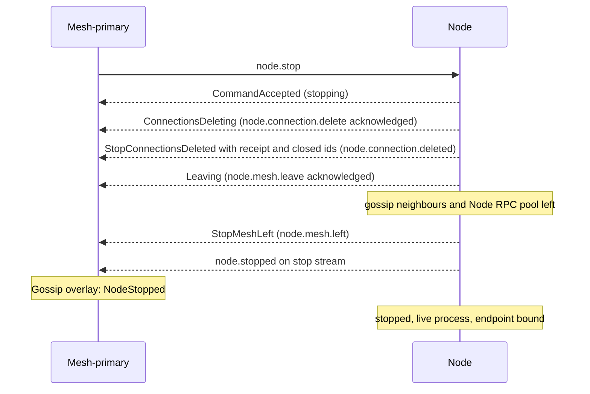

# Node stop

[Lifecycle index](../fabric-mesh-node-lifecycles.md) · [States](states.md) · [Typed calls and wire mapping](../node-rpc-envelope.md#typed-object-contract)

`node.stop` is a workflow: it calls [node.connection.delete](node-connections-delete.md) with `{ scope: All }`,
then [node.mesh.leave](node-mesh-leave.md), streaming each one's acknowledgement and completion on the
stop's own stream, then stops the live process. The mesh-primary writes each frame as the node's
status and streams it on to the fabric-primary on the attempt's stream as it arrives.
The node keeps its identity, endpoint key, bound port, bin, name and data dir.
Exact runtime exit belongs to [node.delete](node-delete.md), not this stop.

## Operation contract

| Field | Contract |
|---|---|
| Caller / executor | Mesh-primary through the typed object; exact node executes the stop |
| Entry | Live exact `(node.id, incarnation)` |
| Steps | Whole `node.connection.delete { scope: All }` → `node.mesh.leave` → node.stopped; each primitive's acknowledgement and completion is a Data frame on the stop's stream, and the mesh-primary writes each status from its frame |
| Primary | A target that is a primary hands over first by [node.primary.update](node-primary-update.md) ([node.fabric-primary.update](node-primary-update.md#the-fabric-primary-nodefabric-primaryupdate) for the fabric-primary) and is stopped by its successor. With no successor the stop is refused by name before anything moves: `cannot transfer: no secondary of type <node_type> in mesh <mesh>`, or `cannot transfer fabric-primary: no other node-admin Ready in mesh <mesh>, no other mesh-primary Ready`; the primary stays primary and no row is written. A single-admin single-mesh fabric's primary cannot be stopped until a secondary is Ready. A standalone node.stop never hands over without a successor. This refusal does not apply to [fabric.delete](fabric-delete.md), which keeps every primary until it is deleted ([elections §6](../fabric-node-lifecycle-elections.md#6-fabric-shutdown-does-not-invent-another-election)), or to the final-admin deletion after mesh.delete's confirmed fabric handover ([mesh-delete.md step 7](mesh-delete.md#numbered-end-to-end-sequence)) |
| Transport cut | [node.mesh.leave](node-mesh-leave.md), called after the connections are deleted: its gossip neighbours and its Node RPC pool, which are not connections; never its own endpoint, the stop call's stream, or the connection to its mesh-primary its owed declarations ride |
| Reply | `node.stopped` on the stop call's reply stream |
| Peer publication | Mesh-primary authors NodeStopped from the matching stopped frame, in its in-flight overlay |
| Upward | Each frame the node sends on the stop stream, the mesh-primary writes as the node's status and sends on as a live frame of the attempt's stream to the fabric-primary ([build.attempt.run](../node-rpc-envelope.md#build-op-0x20-rdm): receipt replay, the current Blocked, then live frames), which records each receipt on the Build; two one-hop streams, never a forwarded one |
| Status | stopping from the stop's admission, then connections-deleting, connections-deleted, leaving and left from its primitives' frames, then stopped with a live process: the [stopped node](states.md#stopped-nodes) |
| Completion | The matching `node.stopped` on the stop stream and the recorded stop receipt; no runtime Exited receipt is required |
| Kept | node.id, incarnation, endpoint key, port, bin, path/name and storage |
| Reachability | Endpoint stays bound; fresh Node RPC dials reach start/update/delete |

## Numbered end-to-end sequence

1. The mesh-primary sends NodeCommand `StopNode { node_id, incarnation, build_id, attempt,
   operation }` to the exact birth. The caller's hop and Build carrier are unchanged. The node
   validates the command and sends `CommandAccepted`; only this admission makes the mesh-primary
   record stopping. A never-sent command writes no state.
2. Call the entire [node.connection.delete](node-connections-delete.md) with `{ scope: All }`:
   graceful closure of every open connection of the node, each open Direct or Proxy entry of its
   connections log. Its acknowledgement, `ConnectionsDeleting` (Data), goes on the stop stream once
   its block on new application work is in force, and the mesh-primary writes connections-deleting
   from it; its completion, node.connection.deleted with its `Established` or `Deadline` receipt
   and the closed ids, goes on the stop stream as `StopConnectionsDeleted { receipt }` (Data), and the
   mesh-primary writes connections-deleted from an `Established` one. The child call keeps its spans
   and receipt. On the deadline the stop may hard-cut, and its receipt keeps the deadline evidence.
3. Call [node.mesh.leave](node-mesh-leave.md): its gossip neighbours and its Node RPC pool. Its
   acknowledgement, `Leaving` (Data), and its completion, `StopMeshLeft { left }` (Data), go on the
   stop stream, and the mesh-primary writes leaving, then left, from them. Never unbind the node's
   own endpoint or close the stop call's stream or the connection to its mesh-primary its owed
   declarations ride. A node already connections-deleted (an `All`
   completed `Established` since its last start) and already left answers each primitive's
   acknowledgement and completion at once, the receipt the `All` established in its
   `StopConnectionsDeleted`, and repeats no work.
4. Emit `NodeStopped` (Terminal) on that same reply stream, and declare `Stopped` to the mesh-primary naming
   the stop's operation, an owed message ([Node RPC §43](../node-rpc.md#43-owed-messages-delivery-is-the-runtimes))
   sent whether or not the stop call's stream is still open. The node gossips nothing for this step.
5. The mesh-primary takes the matching stopped frame, or the node's declaration of `Stopped`
   naming the stop's operation, whichever reaches it first, and publishes
   [NodeStopped](../gossip.md#node-stopped-lifecycle-overlay) with that operation in its in-flight
   overlay, once. The mesh-primary blindly puts the applied effect under `(birth, build_id, attempt,
   operation)`; a cycle begin never clears that row, which is forgotten only with the birth (Q49).
   A declaration or frame naming that applied operation answers `AlreadyApplied` and applies nothing
   again. A report naming no operation follows the state transition rule.
   NodeStopped is retained as that section states; for the last node-admin of a deleted mesh the
   fabric-primary publishes it ([Mesh delete](../gossip.md#mesh-delete)). The node's status is
   stopped and its process is live.
6. A stopped node leaves the stopped status only through [node.start](node-start.md) or
   [node.delete](node-delete.md) ([stopped nodes](states.md#stopped-nodes)); the
   [stopped-node garbage collector](../node-identity-and-state.md#stopped-node-garbage-collector)
   is what deletes a node left stopped past the fabric's `stopped_node_ttl`.

## Command and completion messages

Readable execution view; the [typed-object contract](../node-rpc-envelope.md#typed-object-contract)
owns wire mapping, target and context:

```text
node.stop (mesh-primary → exact node, NodeCommand 0x22)
  ← CommandAccepted (Started; admission: stopping)
  ← ConnectionsDeleting (Data; node.connection.delete's acknowledgement: connections-deleting)
  ← StopConnectionsDeleted { receipt: ConnectionsReceipt } (Data; its completion: connections-deleted)
  ← Leaving (Data; node.mesh.leave's acknowledgement: leaving)
  ← StopMeshLeft { left } (Data; its completion: left)
  ← NodeStopped (Terminal; stopped)
  or, after acceptance: Failed { step, reason, code } (Terminal)
```

These are reply frames on one call; each step has its own span and Build receipt. The mesh-primary
writes the status each frame names above on the node's row from that frame; a status whose frame
reaches it after the node's owed `Stopped` declaration (step 5) finds the row already stopped and moves
it nowhere.

## Gossip message and channels

The mesh-primary publishes the [NodeStopped lifecycle overlay](../gossip.md#node-stopped-lifecycle-overlay)
from the matching node.stopped frame; the node authors no gossip. The decoded frame is the
[NodeStopped example](../gossip.md#examples). Its channels, forwarding and meaning are the overlay's.

## Mermaid sequence diagram



## Failure and receipts

Failures and stream certainty follow the
[caller execution contract](../node-rpc-envelope.md#caller-execution-and-certainty).

## Observability contract

Trace propagation, step spans and correlation follow the
[runtime spans](../node-rpc-envelope.md#runtime-spans).
