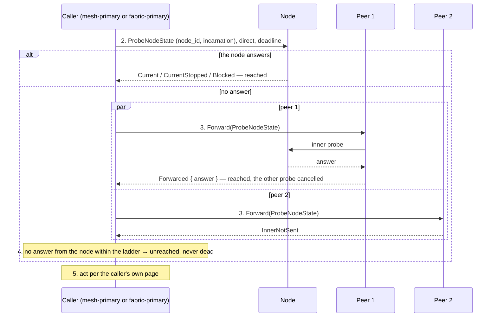

# node.tickle

[Lifecycle index](../fabric-mesh-node-lifecycles.md) · [States](states.md) · [Status op](../node-rpc-envelope.md#status-op-0x1b-rdm) · [Forward op](../node-rpc-envelope.md#forward-op-0x1a-core) · [Elections](../fabric-node-lifecycle-elections.md)

A primitive. `node.tickle` asks one node, by node.id and incarnation, whether anyone can reach it: one probe direct,
and if that fails the same probe through up to two live peers of the node's mesh, sent at once
(R-SW1). It answers `reached`, with what the node said, or `unreached`. It never answers dead:
a failure, a deadline included, proves nothing, and only [node.runtime.inspect](node-runtime-inspect.md)
proves a runtime gone. It is run by:

- the mesh-primary in [node recovery](node-recovery.md), on a member marked `PendingReconnect`;
- the fabric-primary in [mesh investigation](mesh-investigation.md), on a mesh's primary and then
  its other node-admins (probe 1 at 20 s, probe 2 at 40 s);
- [node investigation](node-investigation.md) of a silent primary ([elections](../fabric-node-lifecycle-elections.md));
- the successor ladder of [node.primary.update](node-primary-update.md) after the row.

Mesh investigation is this primitive run by the fabric-primary over a mesh's node-admins; node
recovery is it run by the mesh-primary over a member. Who runs it and at what level differs;
the primitive does not.

## Operation contract

| Field | Contract |
|---|---|
| Caller | The primary above the node: its mesh-primary for a member, the fabric-primary for a mesh-primary or another mesh's node-admin |
| Target | One node, by `(node.id, incarnation)`; every probe names the same pair, and only that pair's answer counts |
| Probe | `ProbeNodeState { node_id, incarnation }` on 0x1B, a bounded call with a deadline; the node answers `Current { state }`, `CurrentStopped` or `Blocked { reason, retry_on }` |
| Ladder | Direct first. On failure, the same probe carried by [Forward](../node-rpc-envelope.md#forward-op-0x1a-core) through up to two eligible live peers of the node's mesh, both at once; one failed peer probe does not cancel the other |
| Ends | Any answer from the node, under the probed incarnation, ends the ladder and cancels the probes still running |
| Result | `reached { answer }`: the node is alive and said what it is; `unreached`: nobody reached it within the ladder. Unreached is never death |
| What follows | The caller's: on `unreached` the investigation's verdict is the inspect's answer, read before the tickle; on `reached` for a node that is off its channel it commands [node.mesh.join](node-mesh-join.md); mesh investigation decides at 60 s |
| Spans | `rdm.node.tickle.resolve.via-direct` for the direct probe, `via-peer` per carrier, each with the answer or the failure; `rdm.node.tickle.returns-unknown.via-unreached` when the ladder ends with no answer; `rdm.node_admin.node.update.via-mesh-join-commanded` when the caller commands the reached node back through node.mesh.join, with the reply |

## Numbered end-to-end sequence

1. The caller holds the node's id and incarnation and a reason to ask: silence past the staleness floor, a
   command to the node that was never sent for a reachability reason (the connect refused, timed out
   or failed; the endpoint unresolved: [node recovery](node-recovery.md) step 1), a silent
   primary, an investigation's clock, a successor that has not answered.
2. Direct: `ProbeNodeState { node_id, incarnation }` to the node's held address, with the probe's deadline.
3. On no answer, the same probe through up to two eligible live peers of the node's mesh, both
   sent at once, each a `Forward` whose inner op is the probe; a peer that cannot carry it is
   `InnerNotSent` and counts as no answer.
4. The first answer from the node, under the probed incarnation, ends the ladder: `reached { answer }`, the other probes
   cancelled. No answer within the ladder: `unreached`.
5. The caller acts on the result per its own page. Nothing on this page writes a row, changes a
   primary or publishes a frame.

## Command, completion and gossip messages

The direct probe, op `0x1B` (27):

```json
{
  "target": { "node_id": "k8pag1qx95gw", "op": 27 },
  "context": {
    "caller_system": "rdm",
    "traceparent": "00-c9e5a1b3d7f2460c8e0a2b4c6d8e0f1a-8888888888888888-01",
    "tracestate": null,
    "baggage": "operation=node.tickle%3Amesh1.rpc.1"
  },
  "body": {
    "ProbeNodeState": { "node_id": "k8pag1qx95gw", "incarnation": "0000000000000008" }
  }
}
```

The node's unary reply when reached:

```json
{ "Current": { "node_id": "k8pag1qx95gw", "incarnation": "0000000000000008", "state": "Ready" } }
```

A stopped node answers `CurrentStopped { node_id, incarnation }`; a node held at its hook answers
`Blocked { node_id, incarnation, reason, retry_on }`. All three are `reached`.

The same probe carried through a peer, op `0x1A` (26): the inner bytes are the probe above, the
peer makes one direct inner call and chooses no other target:

```json
{
  "target": { "node_id": "k9qbh2ry06hx", "op": 26 },
  "context": {
    "caller_system": "rdm",
    "traceparent": "00-c9e5a1b3d7f2460c8e0a2b4c6d8e0f1a-9999999999999999-01",
    "tracestate": null,
    "baggage": "operation=node.tickle%3Amesh1.rpc.1"
  },
  "body": {
    "Forward": {
      "target": "k8pag1qx95gw",
      "inner_op": 27,
      "inner": "<the ProbeNodeState request bytes>",
      "remaining_ms": 1800
    }
  }
}
```

The carrier's reply is `Forwarded { inner }` with the node's answer inside, or `InnerNotSent { reason }`
when the carrier could not reach it. The tickle has no gossip of its own: the caller publishes
nothing for a probe, an answer or a failure. The probed node re-publishes its presence on the
channel it is on, the check-in it owes its primary ([states.md](states.md#the-check-in-checklist)),
and answers its current state; while its `pre_node_ready` hook is Blocked it answers `Blocked`
and re-publishes nothing.

## Mermaid sequence diagram



Checked against the numbered sequence: direct before the peers; the two peer probes concurrent;
the first answer from the node, under the probed incarnation, ends the ladder; `unreached` only when nothing answered.

## Failure and receipts

The primitive has no failure of its own: `unreached` is a result, not an error, and it is never
recorded as the node's death. Proof of exit is [node.runtime.inspect](node-runtime-inspect.md)'s, which node investigation reads before the tickle. Budgets and the certainty of each call
follow the [caller execution contract](../node-rpc-envelope.md#caller-execution-and-certainty).

## Observability contract

| Step | Actor | Span | Fields |
|---|---|---|---|
| Direct probe | caller | `rdm.node.tickle.resolve.via-direct` | node, node_id, incarnation, answer or failure, deadline |
| Peer probe | caller, per carrier | `rdm.node.tickle.resolve.via-peer` | carrier, answer or failure |
| Ladder result | caller | the direct or peer span that carried the answer; `rdm.node.tickle.returns-unknown.via-unreached` when none did | what the caller does next |

Trace propagation follows the [runtime spans](../node-rpc-envelope.md#runtime-spans).
