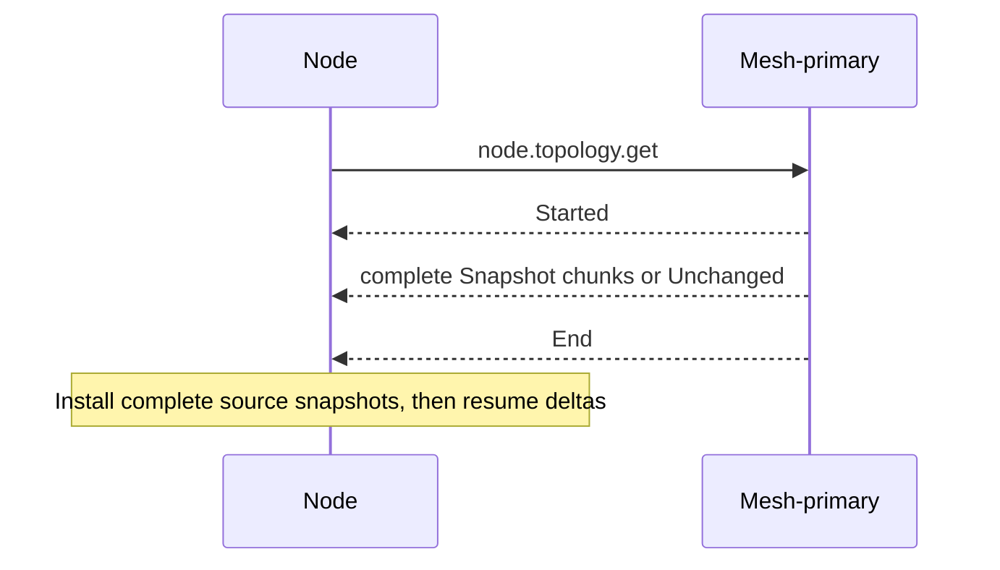
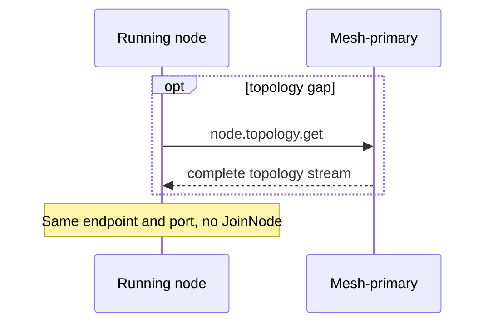

# Node topology get

<a id="node-topology-top-up"></a>

[Lifecycle index](../fabric-mesh-node-lifecycles.md) · [States](states.md) · [Op contracts](../node-rpc-envelope.md#the-op-ledger)

An already-held member requests [node.topology.get](../node-rpc-envelope.md#topology-op-0x1e-rdm)
from its OWN mesh-primary. It supplies its held source version under that schema, installs
only complete snapshots, then resumes applicable deltas. JoinNode is only a join and is
never a topology re-read. Gossip gap detection schedules the read; it does not create a
Build or change the target's meta.

## Typed read contract

`node.topology.get` maps to GetTopology on op 0x1E. It emits no lifecycle event and keeps
the admitted endpoint and port.

## Command, completion and gossip messages

This is a read/connection repair, not a stop, restart or new admission. It has no
command/completion gossip hook, and the same running endpoint and birth are reused.

```text
node.topology.get { mesh, since: held source version }     exact member → own mesh-primary
  ← Started
  ← Snapshot chunks | Unchanged | Stored
  ← End
install complete source snapshots, then resume deltas
```

The request, reply variants, install rules and spans are the
[Topology schema](../node-rpc-envelope.md#topology-op-0x1e-rdm). The node's own Digest and
its mesh-primary's aggregates follow the [frame catalog](../gossip.md#31-frame-catalog) and
the [cross-mesh projection](../gossip.md#33-cross-mesh-topology-inside-a-mesh-deltas-full-snapshots-and-the-top-up).
Read completion does not prove a runtime exited.

## Message sequence diagram



## Running node reconnect

A running node that loses its connections for a while reconnects as the same exact birth:
same node.id, incarnation, endpoint key and path.name. Only its reachability changes.
Reconnect is not an op. It opens no Build and emits no join receipt.

1. The node reuses its bound endpoint, its OS-assigned port and its held topology; no port
   is picked or rebound. It sends no JoinNode: JoinNode is [node.start](node-start.md)'s
   join step, never a topology re-read. A restarted node also keeps its endpoint and port;
   a recovered node (a new node over the inherited data dir) binds port 0 through
   [node.create](node-create.md).
2. When source versions reveal a delta gap, the node calls node.topology.get on its own
   exact current mesh-primary, installs the complete snapshot, then applies further deltas
   against that source version. A fresher digest alone does not fill a gap.
3. The node publishes its current digest. Transient connection markers clear only on
   connection or readiness proof for the same exact birth.

A topology refusal or an incomplete stream installs no partial snapshot. Transport
uncertainty is neither a successful read nor proof of death. Reconnect needs no restart
and changes no identity.



| Actor | Channel/op | Payload / proof | Span |
|---|---|---|---|
| Held member → own mesh-primary | node.topology.get on delta gap | [Topology schema](../node-rpc-envelope.md#topology-op-0x1e-rdm) | `rdm.node_rpc.request.update.via-call`, `rdm.node_rpc.request.serve.via-direct`, `rdm.mesh.topology.serve.via-read` |
| Held member | complete topology install | complete source snapshot; no partial install | `rdm.mesh.topology.update.via-read-install` |
