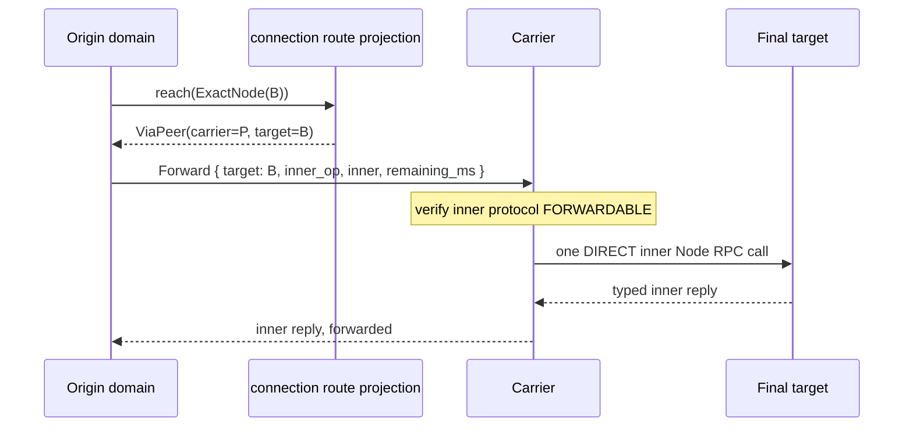

<a id="node-rpc-typed-node-to-node-communication"></a>
# Node RPC runtime

This page owns the Node RPC runtime, how one invocation executes: the resolver, the pool, the dispatch pipeline after the target, admission and memory, supervision, `HandlerScope` and `ReplySink`, the `RpcOutcome` algebra, budgets, Draining behaviour and retry guidance. The wire (the target, the context, the typed body, the op ledger, the reserved stream codes and every schema) is [node-rpc-envelope.md](node-rpc-envelope.md).

**Crates:** RDM `rafka-node-rpc` (the runtime) and `rafka-node-rpc-contract` (descriptor, framing and outcome vocabulary).

**Companion architecture:** [`connections.md`](connections.md) owns Direct/Proxy/Failed connection facts, effective node-to-node reachability, the protocol carrier-policy hook and direct reconnect reconciliation; [`data-plane-transport.md`](/home/admin/rafka-v2/docs/architecture/data-plane-transport.md) owns Iroh/QUIC transport mechanics; [`ops-protocol-and-usage.md`](/home/admin/rafka-v2/docs/architecture/ops-protocol-and-usage.md) owns broker `DataFrame` operation semantics; [`readers-and-writers.md`](/home/admin/rafka-v2/docs/architecture/readers-and-writers.md) owns reader/writer attempt policy; [`lifecycles/states.md`](lifecycles/states.md) owns node states and authority, and [`node-identity-and-state.md`](node-identity-and-state.md) node identity and topology; [`internal-mesh-auth.md`](/home/admin/rafka-v2/docs/architecture/internal-mesh-auth.md) owns the gateway↔broker trust model; trust between mesh nodes is [`fabric-certs.md`](fabric-certs.md#inside-the-mesh).

---

## 1. The one-sentence rule

**The owning domain chooses one exact semantic node; the connections projection says whether that exact node is Direct, Proxy via one exact carrier, or unreachable under the protocol's carrier policy; `rafka-node-rpc` executes the selected direct leg or one-hop carried invocation over Iroh/QUIC and reports exactly what is known about that attempt.**

Everything else in this document protects that sentence from convenience shortcuts.

---

## 2. Why Node RPC exists

Node RPC is the one common invocation mechanism; domain policy stays out of it.

One application role asks another to execute that role's behaviour through a typed op on the exact owner, never by importing the owner's implementation ([customer seams](build.md#node-admin-composition-and-customer-seams)); how a product adds such an op is §8.

---

## 3. Crate and process boundaries

The generic crates remain siblings. Do not add a mesh-transport -> node-rpc or node-rpc -> mesh-transport dependency just to feed resolution state.

~~~mermaid
flowchart TB
    ME[rafka-mesh-entity\nidentity/value types] --> MT[rafka-mesh-transport\ngossip / Iroh transport]
    ME --> NR[rafka-node-rpc\nresolver + client/runtime]
    NC[rafka-node-rpc-contract\ndescriptor / framing / outcome] --> NR
    MO[rafka-mesh-ops\nRafka product contracts/codecs] --> PC

    MT --> PC[process composition\nnode-admin / rpc node / downstream node-base]
    NR --> PC
    C[connections / RDM Mesh EF\nDirect / ViaPeer / NoActiveRoute] --> PC

    PC --> D[domain state machines]
~~~

The arrows mean "is consumed by."

### 3.1 rafka-mesh-transport

Owns Iroh/gossip transport mechanics and current membership dissemination. It does not import Node RPC to become its resolver adapter.

One live Iroh Endpoint belongs to one process. Router/ALPN multiplexes gossip and Node RPC over that process endpoint. Multiple bound addresses/endpoint slots may exist under the process EndpointId; EndpointId is the process transport identity, not a slot id.

### 3.2 rafka-mesh-ops

Rafka owns its product protocol descriptors, codecs, op allocations and request/reply payloads in `rafka-mesh-ops`, and adds its rows to the [op ledger](node-rpc-envelope.md#the-op-ledger) through the server builder. RDM `rafka-node-rpc-contract` owns the generic protocol and envelope vocabulary and the core ledger rows. Product contracts have no generic topology/election authority; domain retry policy stays with the owning caller.

### 3.3 rafka-node-rpc

Owns:
- NodeResolver contract;
- the process-scoped LiveNodeResolver state;
- one long-lived NodeRpcClient handle per process;
- semantic connection pool and stale-slot fencing;
- one-call/one-leg execution;
- server registration/dispatch;
- request framing and complete-send certainty;
- RpcOutcome;
- deadline/cancellation, admission, supervision and observability.

StaticResolver remains test-only. Production callers do not construct a one-node resolver/client per call.

### 3.4 Process composition owns the feed

The running process state sees both membership and Node RPC and wires them together without making the sibling crates depend on each other.

~~~text
membership Members/current births + retained deleted identities
    -> process composition adapter
    -> LiveNodeResolver

process running state
    -> one Iroh Endpoint
    -> one LiveNodeResolver
    -> one long-lived NodeRpcClient
~~~

Node-admin readiness Ping, control calls, proof-store calls, Forward inner calls and ordinary RPC-node callers reuse that process client and resolver.

The process-scoped LiveNodeResolver is the only membership model Node RPC reads.

### 3.5 Connections and domains

[connections.md](connections.md) remains the one reachability owner for an already-selected semantic target:

~~~text
Direct
ViaPeer(exact carrier)
NoActiveRoute
~~~

The domain chooses WHO. Connections chooses HOW. Node RPC executes the selected direct or one-hop invocation.

Node RPC never chooses a role/replica/fallback and never turns failed reachability into death proof.

---

## 4. Identity and freshness facts

A node's `path.name`, minted id (NodeId), incarnation (IncarnationId) and `endpoint_id` (EndpointId) are defined in [node-identity-and-state.md §2](node-identity-and-state.md#2-a-node-is-an-entity-and-it-has-three-ids); FabricId is never EndpointId ([node-identity-and-state.md §2.8](node-identity-and-state.md#28-a-fabric-is-an-entity-and-the-fabric-primary-owns-it)). The runtime adds two pool facts:

| fact | meaning |
|---|---|
| endpoint slot | one address/slot under the process Endpoint |
| slot freshness | freshness token for that exact slot binding |

The connection pool key is §20's.

### 4.1 Exact targets

~~~text
CurrentPath(path.name)
    -> current exact holder of that logical slot

ExactNode(NodeId)
    -> that exact logical identity only
~~~

CurrentPath intentionally follows replacement. ExactNode never does.

### 4.2 Live resolver contract

LiveNodeResolver is location/identity state only. It does not own MemberStatus policy, election, topology authority, or death inference.

Conceptually it holds:
- current exact NodeId -> path, IncarnationId, EndpointId, endpoint slot/freshness;
- current path -> exact NodeId;
- bounded known-deleted exact NodeIds.

Resolution semantics:

~~~text
ExactNode(current id)        -> Found
ExactNode(retained deleted) -> Gone
ExactNode(never known)       -> Unknown
CurrentPath(path)            -> current holder or Unknown
~~~

A connections-deleting, connections-deleted, stopping or stopped current birth may still resolve Found. Lifecycle status is not resolver policy.

A known deletion comes only from canonical deletion facts. A stopped status, silence, a failed RPC or dial, or a peer mesh that goes unheard does not produce Gone.

A deletion arrives as a `NodeDeleted` event and is retained in `Members.deleted`; when a deletion exists and how long it is held are [gossip.md §6.1](gossip.md#61-deletions-an-event-for-promptness-members-for-retention). The resolver reads no lifecycle overlay, so a lifecycle op still reaches the node it is deleting. Gone is resolver knowledge, never a current node row.

The resolver exposes a change signal. A slot/freshness move while a dial/call is being prepared invalidates that pinned target before dispatch.

---

## 7. Reachability is not attempt policy

The layers are deliberately three, not two:

| layer | owns |
|---|---|
| domain state machine | semantic destination, leg order, retries, next leg |
| `connections` / RDM Mesh EF | Direct / Proxy-via-carrier / unreachable answer for that destination; Proxy validity and reconnect |
| `rafka-node-rpc` | execution and certainty for the selected direct or one-hop carried invocation |

`rafka-reach-reroute` adapts Rafka's callers to the middle layer and owns no route truth.

Write attempt policy stays in writer ingress; the replica walk stays in the reader ([readers-and-writers.md](/home/admin/rafka-v2/docs/architecture/readers-and-writers.md)).

A future maintainer must not "simplify" this by moving retries into the connections layer or fallbacks into node-rpc.

---

## 8. Protocol family model

Node RPC is a runtime, **not a wire protocol of its own**.

Every wire family is one op with one codec. Its declaration is the envelope's [`NodeProtocol`](node-rpc-envelope.md#section-2-the-body). Every shared refusal constructor and the reply classifier are required, never defaulted away.

An ordinary product op is addable entirely in rafka-v2: define its typed request and reply and its op and descriptor, register the owning role's handler, and invoke the typed client. Adding it needs no RDM revision change. A missing generic capability is implemented and proven in RDM, then imported at one exact revision; the product never copies or reimplements the generic algorithm after import.

Streaming adds a frame type and classifier:

```rust
pub trait StreamingNodeProtocol: NodeProtocol {
    type Frame: Send + Sync;

    fn frame_kind(frame: &Self::Frame) -> FrameKind;
    fn encode_frame_size(frame: &Self::Frame) -> Result<usize, EncodeFailure>;
    fn encode_frame_exact(frame: &Self::Frame, dst: &mut [u8]) -> Result<(), EncodeFailure>;
    fn decode_frame(bytes: &[u8]) -> Result<Self::Frame, DecodeFailure>;
}
```

---

## 9. Protocol catalog and op allocation

The op registry is the [sole op ledger](node-rpc-envelope.md#the-op-ledger): core rows are built into `rafka-node-rpc-contract`, a product adds its rows through the server builder, and the seal builds the served catalog once at boot. Op uniqueness, retired ops, unserved ops and postcard variant evolution are the [ledger](node-rpc-envelope.md#the-op-ledger), [Section 0](node-rpc-envelope.md#section-0-the-target) and [Section 2](node-rpc-envelope.md#section-2-the-body).

A descriptor is the envelope's `NodeProtocol` declaration plus two runtime facts: unary or server-streaming, and its default admission (§17).

The evolution rules (a new op for a wire-incompatible change, append-only enums, discriminants never reordered or reused) are the envelope's [Section 2](node-rpc-envelope.md#section-2-the-body).

### 9.1 Op registry

See the [sole op ledger](node-rpc-envelope.md#the-op-ledger).

---

## 10. Canonical framing

The wire is the [envelope](node-rpc-envelope.md): target, context and typed body, one invocation per QUIC bi-stream, decided on the [target](node-rpc-envelope.md#section-0-the-target) before anything else is read. Client streaming is not supported.

### 10.1 Observability fields cannot change RPC semantics

The context's bounds, drop rules, `caller_system` form and baggage allowlist are [Section 1](node-rpc-envelope.md#section-1-the-context).

---

## 11. Unary and streaming response order

### 11.1 Unary

```text
request -> exactly one reply -> EOF
```

### 11.2 Server streaming

Each protocol owns its frame enum and classifies frames as:

```rust
pub enum FrameKind {
    Refusal(ReplyKind),
    Started,
    Data,
    Terminal,
}
```

Legal order:

```text
Refusal
```

or:

```text
Started
Data*
Terminal
```

A refusal is only legal before `Started`.

EOF/reset after `Started` without `Terminal` is `Indeterminate`.

`Data` before `Started`, a second `Started`, a refusal after `Started`, a second terminal, or anything after terminal is `PROTOCOL_VIOLATION`.

There is no generic START/DATA/ERROR wire envelope. The runtime enforces order using the protocol's classifier.

---

## 12. Server registration is sealed at boot

A process registers every served op at boot:

```rust
builder.serve::<P>(...)
builder.serve_stream::<P>(...)
```

The table is sealed **before the mesh endpoint can dispatch its first accepted bi-stream**.

It is immutable for the process incarnation.

The [seal](node-rpc-envelope.md#the-op-ledger) refuses the process on any ledger fault; the runtime also refuses an invalid configured admission or memory limit and a streaming budget that does not fit the transport invariant.

### 12.1 Type erasure boundary

Registration monomorphizes the typed dispatcher and erases it to a runtime shape conceptually equivalent to:

```rust
Fn(InvocationCtx, RecvHalf, ReplyTransport)
    -> BoxFuture<'static, InvocationOutcome>
```

The reader sees only a descriptor plus boxed dispatcher. Decode, handler invocation and encode stay generic over `P` inside the dispatcher.

No `Any`, downcast or giant domain enum is permitted.

---

## 13. Served is not ready

The door that refuses every op with typed `NotReady` until the process can serve, and what `NotReady` means, are the envelope's [readiness gate](node-rpc-envelope.md#node-rpc-readiness-gate). Past the door, a served protocol can be temporarily unable to execute.

That distinction is explicit:

```text
op not registered         -> Unserved transport reset
registered, dependency off -> typed NotReady reply
```

Each registration includes a local readiness guard.

A readiness guard:

- is cheap and non-blocking;
- is request-independent;
- reads node-base lifecycle/readiness facts;
- cannot call another RPC;
- cannot select a target;
- cannot mutate domain state;
- is sealed with the registry.

Examples include `NodeReadiness`, system-org-ready, peer-directory coverage and rafka-time adoption.

Passing readiness is a fast-path check, not a guarantee. A handler can still return typed `NotReady` if the dependency disappears later.

---

## 14. Authenticated `PeerContext`

The transport proves one fact: the caller's iroh `EndpointId`, which Node RPC hands each handler. A request can never claim its sender. Nothing inside the mesh checks who sent a frame or call: a Node RPC handler is addressed by target node id + op, and a gossip receiver takes or ignores a frame by what it carries ([gossip receive path](gossip.md#31-frame-catalog)). `Unauthorized`, `SenderNotSubject` and a caller-side `PeerUnresolved` keep their codec positions and a mesh receiver never sends them.

---

## 16. Dispatch order

The receive loop is deliberately constant-cost.

```text
read the target (421 / 424)
  -> runtime Draining guard (never the Status family)
  -> readiness guard (typed NotReady)
  -> admission
  -> start one supervised invocation task
```

The supervised invocation task then owns the expensive work:

```text
read request length prefix
  -> compare MAX_REQUEST_FRAME_BYTES
  -> acquire request-memory credit immediately
  -> bounded payload read
  -> decode
  -> domain handler
  -> scope join
  -> reply publication
```

This separation prevents a connection reader from becoming a body-read worker and preserves bounded dispatch cost.

---

## 17. Admission: execution capacity, not transport capacity

Admission belongs to the server node runtime, not a QUIC connection.

For each served protocol:

```text
node-wide in-flight cap
optional per-(protocol, caller EndpointId) cap
```

All endpoints and all pooled connections feed the same counters.

Increasing `RAFKA_MESH_DATA_CONNS_PER_PEER` therefore increases transport parallelism but **never multiplies execution capacity**.

Admission never queues on the server. Failure is an immediate typed:

```text
Busy(reason)
```

and proves the domain handler never ran.

### 17.1 Caller identity key

The per-caller cap is keyed by the caller's transport-proven `EndpointId`, never by slot or freshness.

### 17.2 Why caller and server keys differ

Caller-side wait state is exact slot/freshness-scoped because it protects **freshness**: never wait behind capacity attached to a superseded slot.

Server-side admission is caller-endpoint-scoped because it protects **fairness and orphan bounds**.

These are deliberately different keys.

---

## 18. Request memory is admitted, never awaited

Each protocol declares `MAX_REQUEST_FRAME_BYTES`.

At registry seal:

```text
sum(protocol_admission_limit * MAX_REQUEST_FRAME_BYTES)
```

must fit the configured node-wide request-memory budget. If it does not, the process refuses to boot.

At runtime, after the length prefix is known but before allocation, the invocation attempts to acquire exactly that many bytes of node-wide memory credit.

It never waits.

No credit yields:

```text
Busy { MemoryBudget }
```

through the typed early-refusal path.

Credit stays held for the entire supervised invocation because the decoded request may remain alive in handler memory. It releases on every exit path, including panic and cancellation.

---

## 19. Reply memory is exact-sized

Each protocol declares `MAX_REPLY_FRAME_BYTES`.

The runtime first asks postcard for serialized size. It does not grow a `Vec` speculatively.

```text
serialized_size(reply)
  -> compare ceiling
  -> allocate exact size
  -> encode exactly once
```

If a server reply exceeds the protocol maximum, that is a protocol/runtime bug:

```text
PROTOCOL_VIOLATION
caller => Indeterminate
```

Unary reply types must therefore be bounded by construction. Any result that can grow without a hard bound is server-streaming.

Node RPC has no second reply-memory semaphore. Per active stream, runtime-owned memory is bounded by one encoded frame plus the QUIC send window; aggregate concurrency is already bounded by admission.

---

## 20. One process Endpoint and semantic connection pool

One process owns one live Iroh Endpoint shared by gossip and Node RPC through Router/ALPN.

The Node RPC client and pool live for the process lifetime and are reused across calls.

Pool identity:

~~~text
(scope, peer node, incarnation)
~~~

This is `PoolKey` in `rafka-node-rpc` (`scope`, `peer`, `incarnation`). For Rafka, `scope` is the shard: the Rafka adapter keeps shard scope in the key and never collapses it.

The endpoint slot and its freshness are facts the pool holds per entry. The caller checks them against the resolver before dial; they are never key fields and never on the wire. Every request pins an exact target slot/freshness before dispatch.

### 20.1 Caller-side supersession

Before/during dial, LiveNodeResolver may already know that the pinned slot/freshness was superseded.

That is not a transport NotSent reason. It is `RejectedStale`, decided by the caller before anything is sent.

The resolver change signal cancels obsolete in-flight pre-dispatch dial work. Node RPC never chases the replacement inside the same call; the owning domain may resolve again as a new attempt.

### 20.2 Mechanical connection choice

Selection among exact-current pooled connections is local load distribution only. There are no protocol-specific pools.

A connection may enter/re-enter the pool only while its peer + incarnation key and its held slot + freshness still match resolver/current transport state.

---

## 21. Iroh owns liveness

Node RPC never builds a second liveness system.

The process endpoint's QUIC transport sets the idle timeout to the staleness floor and the keepalive to half the gossip interval, and the topology drives departure purge.

Node RPC may evict because:

- Iroh reports the connection closed/unusable;
- `open_bi` fails before commit;
- resolver/current transport state proves the exact incarnation or slot/freshness was superseded;
- a peer answers typed `Draining`;
- topology departure invokes the pool purge hook.

It must not evict merely because:

- no RPC succeeded recently;
- gossip appears stale;
- a local health score fell;
- a custom ping timed out.

Between a hard peer death and transport/topology detection, `open_bi` may succeed, the request may commit, and the caller may eventually time out. That outcome is truthfully `Indeterminate`.

Faster dead-peer detection is a transport or topology tuning problem, not a Node RPC heartbeat feature.

---

## 22. Stream-capacity headroom

The mesh endpoint's concurrent bi-stream cap is a shared invariant (4096).

Iroh/noq does not expose the remote-advertised cap on the high-level connection, so the runtime uses the shared invariant and labels it so.

Connection telemetry records the source explicitly:

```text
stream_cap_source = observed
```

or:

```text
stream_cap_source = shared-invariant
```

It never calls the invariant "observed".

A pool's server-streaming budget is strictly below the aggregate remote exposure of its `N` connections. It reserves headroom for unary and control traffic and for compatibility ops that do not use the runtime.

Streaming permit waits are:

- FIFO;
- pre-commit;
- bounded by the caller deadline;
- exact slot/freshness-scoped;
- woken as `RejectedStale` when the pinned incarnation/slot/freshness is invalidated before dispatch.

The reserve prevents streaming from owning every slot, but it does not guarantee unary calls can never wait under a unary burst.

Per-protocol and per-peer admission remain the server execution safety boundary. Increasing `N` never bypasses them.

---

## 23. Complete-send certainty cut

One Node RPC call is one attempt.

The request becomes committed for uncertainty purposes only after:
1. the complete request frame has been sent; and
2. the request direction finishes cleanly.

If send/finish fails before that cut, the receiver must not dispatch a partial request and the caller returns NotSent/499 FRAME_NOT_SENT.

After that cut, Node RPC never silently replays. Reply loss/timeout is Indeterminate absent stronger evidence.

A stronger explicit no-dispatch fact such as 421 UNSERVED_OP remains definitive even if bytes crossed the process boundary.

Pre-cut work includes target resolution, reachability selection, pool lookup, dial/open wait, and caller-side stale-slot detection. All consume the caller's one deadline.

---

## 24. Local outcome algebra

The caller sees:

~~~rust
#[must_use]
pub enum RpcOutcome<R> {
    Reply { value: R, class: ReplyKind },
    RejectedStale { target_node_id: NodeId },
    NotSent(NotSentReason),
    Unserved(UnservedInfo),
    Indeterminate(IndeterminateInfo),
}
~~~

NotSent is reserved for transport/certainty facts such as:
- Resolve(Unknown | Gone);
- connection/open failure before complete-send+finish;
- stream budget/deadline/cancellation before the certainty cut.

There is no NotSentReason::Superseded.

RejectedStale means the caller's pinned target is superseded, decided by the caller before send. It is definitive no-dispatch.

Unserved means the receiver's reserved unserved-op reset proves protocol dispatch did not occur.

Indeterminate means the request crossed the complete-send certainty cut and no stronger evidence proves non-dispatch or returns a valid protocol reply.

The runtime never automatically retries any outcome.

---

## 25. Shared reply classification, protocol-owned bytes

There is no universal success/refusal wire envelope.

Before dispatch, Node RPC has transport outcomes such as `Unserved`.

After protocol dispatch, every reply byte belongs to that protocol's codec.

Shared semantics are represented by `ReplyKind`:

```rust
pub enum ReplyKind {
    Success,
    PeerUnresolved,
    NotReady,
    Busy,
    Draining,
    Malformed(MalformedKind),
    Unauthorized,
    ProtocolRefusal,
    Unclassified,
}
```

`Malformed` carries the envelope's [`MalformedKind`](node-rpc-envelope.md#runtime-spans).

The protocol supplies constructors for shared states and a classifier for decoded replies.

Node RPC uses the classification for telemetry/outcome metadata only. It never infers meaning from reply bytes or strings and never automatically retries because of a class.

Required codec tests prove every shared constructor survives:

```text
constructor -> encode -> decode -> classify
```

with the same class.

---

## 26. Malformed requests

The runtime distinguishes:

### `TooLarge`

The declared length exceeds `MAX_REQUEST_FRAME_BYTES`. The receiver does not allocate/read the payload body. It returns typed `Malformed(TooLarge)` and stops the request receive half.

### `UnknownVariant`

The payload is structurally valid enough to identify version/enum mismatch but contains an unsupported operation variant. The handler does not run. Retrying the same request against the same build is not useful; a domain may choose a different build/target.

### `Corrupt`

The bytes are undecodable/corrupt. The handler does not run. Retrying the same bytes is not useful.

No malformed request is answered with an unserved reset. The op was served, so the protocol reply path is used.

---

## 27. Early refusal and half-stream precedence

For an early typed refusal such as:

```text
Draining
NotReady
Busy
Malformed(TooLarge)
```

the server:

1. writes the protocol's typed reply on the response/send half;
2. finishes that half normally;
3. stops only the request/receive half with `REQUEST_STOP`.

`REQUEST_STOP` is flow-control hygiene, not an outcome signal.

### 27.1 Caller write error does not trump a reply

After commit, a request-write error does not end the call. The client continues reading the response until it gets:

- a complete valid protocol reply;
- EOF/reset without a complete reply;
- its deadline.

A valid typed reply always wins over a concurrent request-write error.

If no valid reply arrives after commit, outcome is `Indeterminate`.

---

## 28. Reserved transport codes

The reserved stream codes are the envelope's [Reserved stream codes](node-rpc-envelope.md#reserved-stream-codes).

Only Node RPC emits the canonical 421-424 and 499 reset namespace. Domain protocols never reset streams; they reply with typed protocol values.

`421 UNSERVED_OP` is the receiver reset that proves non-dispatch; `499 FRAME_NOT_SENT` is the caller's own reset of an unfinished request.

---

## 29. Supervised invocation tasks

The connection reader does not run domain work inline.

Immediately after successful admission it creates one Node RPC supervised invocation task.

That task owns:

```text
admission permit
request-memory credit once acquired
request and response stream halves
PeerContext
cancellation state
server invocation span once trace context exists
HandlerScope
```

Every exit path releases owned capacity.

A panic is caught at this boundary and cannot crash the reader/runtime.

---

## 30. Structured concurrency with `HandlerScope`

Handlers may fan out only through a runtime-provided scope/JoinSet abstraction.

Direct domain use of:

```text
tokio::spawn
std::thread::spawn
```

inside Node RPC handler modules is forbidden by ratchet.

The handler normally joins its own children and incorporates their results into its typed reply.

After the handler returns a candidate completion, Node RPC safety-joins any forgotten children.

- forgotten child exists: record a structured-concurrency violation;
- forgotten children all succeed: candidate reply may still be published;
- any forgotten child fails or panics: `INTERNAL_RPC_FAILURE`, caller `Indeterminate`.

Unary reply and streaming terminal publication happen only after the full scope joins.

Streaming data may flow while scoped children compute.

There is no independent scope-join timeout. Shutdown's drain deadline is the outer lifecycle bound.

### 30.1 Work that must outlive a call

The only sanctioned detachment is durable work:

```text
enqueue durable job with job_id / claim_epoch / lease / verdict
return job id
```

A bare task never outlives the supervised handler.

---

## 31. Streaming `ReplySink`

Streaming handlers never touch raw transport streams.

They receive one non-cloneable typed sink:

```rust
ReplySink<P, NotStarted>
    .refuse(...)
    .started(frame) -> ReplySink<P, Streaming>

ReplySink<P, Streaming>
    .data(frame)
```

There is deliberately **no `terminal()`** method.

The handler returns the terminal frame as its function result. Node RPC publishes it only after `HandlerScope` is fully joined.

The sink:

- enforces typestate/order;
- computes encoded size before allocation;
- checks the protocol reply-frame limit;
- allocates one exact frame;
- writes it serially;
- records byte counts/timing;
- waits directly on QUIC flow control;
- has no Node RPC queue.

At most one encoded protocol frame exists in runtime memory per writer plus the bounded transport send window.

`data()` can return typed `CallerGone(reason)` when cancellation makes further delivery impossible.

---

## 32. Handler return contract

A handler returns its protocol's typed reply/terminal value.

Every condition that a caller's state machine can react to belongs in that type, including:

- domain refusal;
- conflict;
- partial application;
- wrong build;
- stale epoch;
- validation;
- durable state that could not be read;
- dependency unavailable.

Unavailable durable state is ordinary/recoverable information, not a runtime bug.

### 32.1 `HandlerFault`

Unexpected execution faults may escape through a deliberately narrow `HandlerFault`.

There is no blanket conversion from `anyhow::Error`, `io::Error`, store error or generic domain error.

A fault is created only by named constructors such as:

```rust
HandlerFault::invariant_broken("...")
```

so fault sites are searchable and deliberate.

A ratchet rejects `impl From<...> for HandlerFault` in handler modules.

This prevents the server-side equivalent of collapsing `NotSent`/`Indeterminate`: ordinary `do_domain_thing().await?` must not turn an expected store outage into `INTERNAL_RPC_FAILURE` and falsely tell the caller "may have executed".

A panic, explicit `HandlerFault`, impossible codec failure or unexpected supervised child failure goes through `INTERNAL_RPC_FAILURE` and the caller receives `Indeterminate`.

`unwrap()`/`expect()` remain legal for genuinely impossible states; if wrong, they become caught panics and are reported as faults.

---

## 33. No deduplication in Node RPC

Node RPC keeps no idempotency cache, replay table or completed-call registry.

Every admitted, decoded invocation starts exactly one handler execution.

A later call is a new attempt even if it carries the same domain identity.

Protocol state machines own:

```text
duplicate
stale
already-applied
in-flight
completed
replayed
```

For durable-job mutation, the request carries `job_id` and `claim_epoch`; stale epochs are refused by name and the durable mutation itself is fenced on that epoch.

Admission is capacity control, never deduplication.

---

## 34. Deadlines and cancellation

The generic API supports two budget shapes:

```text
Overall { deadline }
Split {
    request_send_deadline
    reply_budget_after_commit
}
```

Overall is the default: one absolute deadline covers resolve -> route/pool -> dial/open -> complete request send + clean finish -> reply/stream. Node RPC does not quietly reset it between phases.

Split exists for domains such as writer ingress that already have a stronger request-send certainty bound followed by a separate post-commit reply budget. The reply budget begins only after the complete-send certainty cut.

The [Build carrier](node-rpc-envelope.md#build-op-0x20-rdm) runs its outer and inner streams with no overall deadline, bounded by the transport idle timeout and keepalive. A carried call's inner budget is the `remaining_ms` the source stamps ([Forward](node-rpc-envelope.md#forward-op-0x1a-core)).

Before complete-send + clean finish, deadline/cancellation/send failure is NotSent/499. After that cut, reply timeout is Indeterminate absent stronger no-dispatch evidence.

The caller budget is not a generic remote execution deadline. After dispatch, the handler receives cancellation when the caller/connection/runtime disappears. The owning protocol decides whether to stop, finish or detach durable work.

Node RPC never rolls back domain mutations and never pretends cancellation proves non-execution.

A protocol that needs its own execution budget carries a protocol-specific field, expressed as a relative budget or Rafka-time instant, not arbitrary local wall-clock time.

If a handler continues after caller cancellation, telemetry records caller_cancelled=true and cancellation_reason. Its admission permit remains held until the invocation truly completes.

---

## 35. Draining

When its node enters connections-deleting under [node.connections.delete](lifecycles/node-connections-delete.md) with `{ scope: All }`, on its own or as the first step of [node.stop](lifecycles/node-stop.md), the runtime answers new non-status calls with typed `Draining`, which proves their handler did not run. The Status family stays served.

The caller invalidates pooled connections to that birth and re-enters its own target and reachability policy on a future attempt.

Handlers already running keep their admission and memory permits, may finish, and may issue outbound Node RPC calls while finishing. In-flight work finishes under node.connections.delete's own rules; its receipt is `ConnectionsReceipt`: `Established { in_flight, closed }`, or `Deadline { last_in_flight, closed, held }` at its bound (`RDM_CONNECTIONS_DELETE_DEADLINE_MS`). Node RPC never rolls back domain work.

A stopped node keeps its endpoint bound; stopped does not refuse node.start, node.update or node.delete ([readiness gate](node-rpc-envelope.md#node-rpc-readiness-gate)). A restart never exits the process.

Lifecycle vocabulary is fixed:

```text
not initialized = NotReady
overloaded      = Busy
draining        = Draining
op not served   = Unserved
```

---

## 36. Forwarding is opt-in, never ambient

A carrier changes who the target cryptographically sees.

When origin `A` asks carrier `P` to contact target `B`, `B` authenticates `P`, not `A`.

Therefore forwarding is disabled by default:

```rust
const FORWARDABLE: bool = false;
```

If the effective connection projection says a direct-only protocol has only a Proxy route, the answer to the domain is `NoActiveRoute` for that protocol.

The `Proxy` connection kind is not a Node RPC forwarding cache. The connection subsystem owns whether a Proxy exists, which exact carrier it names, whether it remains valid, and when it is retired. Node RPC only executes the selected carried invocation. A reply timeout or other `Indeterminate` Node RPC outcome does not, by itself, create or invalidate Proxy state.

### 36.1 Generic forward invocation

Forwarding is one named op, never a universal wrapper through which every call passes. What the carrier does is the [Forward schema](node-rpc-envelope.md#forward-op-0x1a-core).

### 36.3 Streaming forwarding

A server-streaming op is never forwardable: the [seal](node-rpc-envelope.md#the-op-ledger) refuses a forwardable server-streaming entry.

---

## 37. Broker data is one protocol family

Broker data is the Rafka [data-frame op](node-rpc-envelope.md#data-frame-op-0x12-rafka); it runs on the runtime with no broker-specific runtime crate, and its move onto the runtime is the [i142 plan](/home/admin/rafka-v2/docs/plans/i142-node-rpc-migrations-prd.md#9-u6---broker_data-and-proxy-carried-execution). The layers around it are §7's.

The reader's `ReadHooks::data_rpc` and writer's `NodeWriteHooks::data_rpc`/`forward_rpc` transport duplication disappears because both use Node RPC.

---

## 39. Span vocabulary

The span names, the attributes each records and the trace edge between caller and server are the envelope's [Runtime spans](node-rpc-envelope.md#runtime-spans).

---

## 40. Error truth table

| fact | local outcome | handler ran? | automatic Node RPC retry? |
|---|---|---:|---:|
| resolver `Unknown/Gone` | `NotSent` | no | no |
| caller knows pinned slot/freshness is superseded | `RejectedStale` | no | no |
| dial/open/send failure before complete-send + finish | `NotSent` | no | no |
| unserved op reset | `Unserved` | no | no |
| `PeerUnresolved` typed reply | `Reply` | no domain handler | no |
| `NotReady` typed reply | `Reply` | no domain handler when guard/refusal path | no |
| `Busy` typed reply | `Reply` | no | no |
| `Draining` typed reply | `Reply` | no | no |
| `TooLarge` typed reply | `Reply` | no | no |
| `UnknownVariant` typed reply | `Reply` | no | no |
| `Corrupt` typed reply | `Reply` | no | no |
| `Unauthorized` typed reply (codec position only; a mesh receiver never sends it) | `Reply` | no | no |
| domain refusal | `Reply` | yes or no per protocol semantics | no |
| valid reply races with request write error | `Reply` wins | as reply says | no |
| committed stream dies before valid reply | `Indeterminate` | unknown | no |
| handler panic / `HandlerFault` | `Indeterminate` | yes/possibly partial | no |
| streaming EOF after Started before Terminal | `Indeterminate` | yes/unknown completion | no |

Node RPC communicates facts. State machines decide the next action.

---

## 41. Protocol retry guidance is descriptive, not policy

The runtime itself does not retry, but callers may use these semantic facts:

| class | same target later? | same request, same build, immediate retry? |
|---|---|---|
| `Busy` | possibly | domain decision |
| `NotReady` | possibly | usually later, domain decision |
| `PeerUnresolved` | after topology convergence | domain decision |
| `Draining` | no; re-resolve the target | no |
| `UnknownVariant` | maybe another compatible build | no |
| `TooLarge` | only if request changes | no |
| `Corrupt` | only if bug/data changes | no |
| `Unauthorized` | never sent by a mesh receiver | no |
| `ProtocolRefusal` | protocol-defined | protocol-defined |

No branch of this table appears as an automatic retry inside Node RPC.

---

## 42. No capability handshake

Node RPC has no capability negotiation stream and no per-peer catalog exchange.

Compatibility is discovered at call time:

```text
op not served              -> Unserved
op served, variant unknown -> Malformed(UnknownVariant)
```

Domains may use build metadata such as `bin_key` or build SHA when selecting an exact eligible target, but that is advisory placement input. The call outcome remains authoritative.

This avoids a second distributed cache of remote capabilities that can itself go stale.

---

## 45. Example: carrier forward



`B` authenticates `P`. It never treats an origin id copied into the request as authenticated identity.

The carrier never chooses another carrier and never forwards twice. The route projection, not Node RPC, owns the durable Proxy that selected P.

---

## 46. Security invariants

1. Transport identity is always the authenticated Iroh EndpointId; logical FabricId is never transport identity.
2. Request bytes can never override `PeerContext`.
3. Forwarding does not magically preserve origin authentication.
4. Unserved ops never reach a protocol handler.
5. Malformed requests never reach the domain handler.
6. Node RPC does not log protocol secrets merely because it owns framing; request/reply payloads are not generic span attributes.

---

## 47. Testing contract

The runtime is proven once in RDM; a product proves only the ops it adds.

---

## 51. Repository-specific non-interference rule

Node RPC is layered **above** Iroh. It must not replace or reinterpret:

- Iroh gossip;
- Iroh/QUIC connection drivers;
- mesh peer discovery;
- topology membership/departure;
- the transport's keepalive and idle semantics;
- remote QUIC flow control.

Node RPC consumes those facts and adds typed invocation semantics. It is not a new mesh framework.

---

## 52. Forbidden designs

The following are architecture violations:

- `call_role("gateway", ...)` inside node-rpc;
- automatic retry after commit;
- hidden second pool-slot attempt inside one call;
- a generic success/error RPC envelope around every protocol;
- observability context that affects dispatch, authorization, routing or execution;
- reading a refused body only to get `traceparent`;
- per-refusal info/root spans for Busy/NotReady storms;
- per-protocol QUIC connection classes;
- server admission counters per connection;
- changing pool width at runtime;
- Node RPC heartbeat/ping health scoring;
- treating gossip staleness as an RPC eviction rule;
- `From<anyhow::Error> for HandlerFault`;
- detached handler tasks;
- a Node RPC deduplication cache;
- a `rafka-broker-rpc` pass-through crate with no independent domain abstraction;
- moving reader/writer retry policy into the connections/reachability layer;
- letting node-rpc choose a replica, role, carrier or fallback;
- letting Node RPC persist or retire Proxy connection state.
