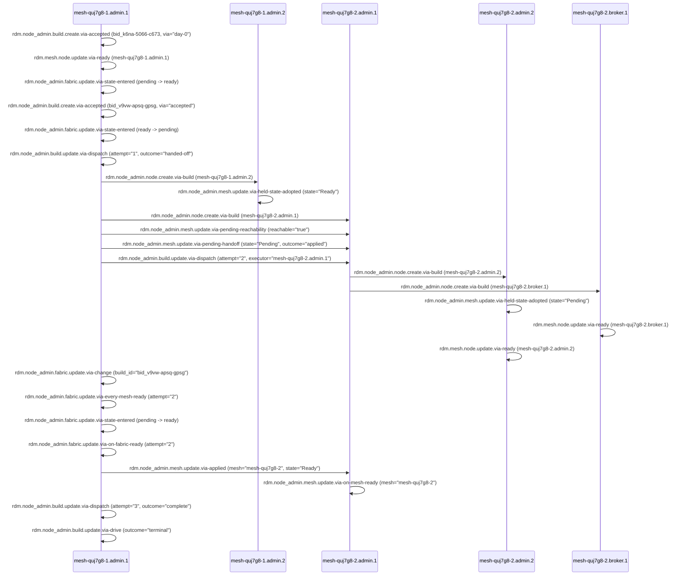
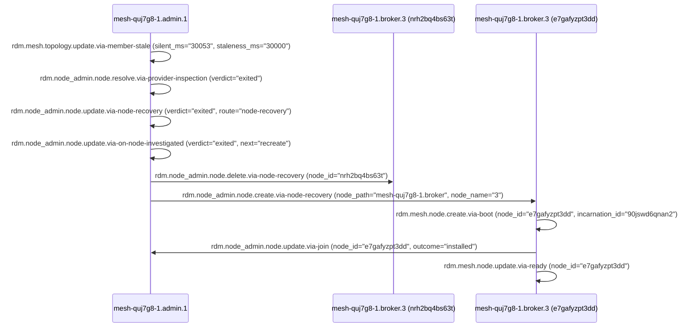
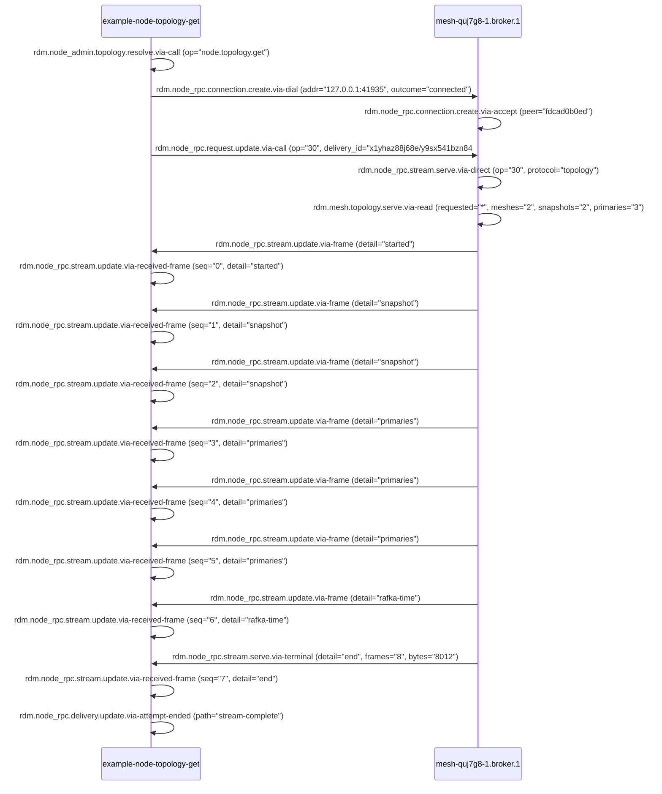

# What happens when

This page traces four workflows on the two-mesh demo estate ([Getting started](../getting-started.md)), told from the OpenTelemetry evidence spans written to `<root>/evidence/*.spans.jsonl` ([Local OTLP and Evidence Capture](test-otlp-capture.md#evidence-jsonl-capture-rdm_evidence_dir), [RDM Spans](../reference/rdm/spans.md)). Each walkthrough gives the architecture page section for every step, the span lines (name and key fields) from a live run of `scripts/demo-estate.sh`, and a `sequenceDiagram` built from those spans.

## 1. Day-0 bring-up (`scripts/demo-estate.sh up`)

Running `scripts/demo-estate.sh up` sets `RDM_EVIDENCE_DIR=$ROOT/evidence`, boots the Day-0 `node-admin` (`mesh-quj7g8-1.admin.1`), and submits the bootstrap Build (`v9vwapsqgpsg`) that creates the two-mesh, 20-node estate ([Local OTLP and Evidence Capture](test-otlp-capture.md#evidence-jsonl-capture-rdm_evidence_dir)):

```bash
RDM_EVIDENCE_DIR=$PWD/target/demo-estate-current/evidence RDM_DEMO_BIN=$PWD/demo/target/debug scripts/demo-estate.sh up
```

### Step 1: Day-0 boot and the bootstrap Build accepted

When the first `node-admin` (`mesh-quj7g8-1.admin.1`) boots in Day-0 mode, it mints the fabric CA, creates `fabric-quj7g8` (`fabric_id="bt828feh1cc6"`) and `mesh-quj7g8-1` (`mesh_id="6jxatzq1vv58"`), accepts its own Day-0 Build (`bid_k6na-5066-c673`, `via="day-0"`), enters `Ready`, and sets both `mesh-quj7g8-1` and `fabric-quj7g8` to `Ready` ([`fabric.create` — Steps](../architecture/lifecycles/fabric-create.md#steps), [`node-admin` lifecycle — Two ways a node-admin starts](../architecture/node-admin-lifecycle.md#two-ways-a-node-admin-starts)). When `scripts/demo-estate.sh up` then submits the 20-node estate specification, the fabric-primary accepts Build `bid_v9vw-apsq-gpsg` (`via="accepted"`, `previous_build_id="k6na5066c673"`) and moves the fabric state from `ready` to `pending` while the Build runs ([Build — 3. The fabric-primary and the mesh-primaries](../architecture/build.md#3-the-fabric-primary-and-the-mesh-primaries), [States — 1. Fabric](../architecture/lifecycles/states.md#1-fabric)):

```json
{"service":"rshape-node-admin","name":"rdm.node_admin.build.create.via-accepted","attributes":{"build_id":"bid_k6na-5066-c673","node":"mesh-quj7g8-1.admin.1","previous_build_id":"","via":"day-0"}}
{"service":"rshape-node-admin","name":"rdm.mesh.node.update.via-ready","attributes":{"build_id":"k6na5066c673","fabric_id":"bt828feh1cc6","incarnation_id":"yw9m94ephg4q","mesh_id":"6jxatzq1vv58","node":"mesh-quj7g8-1.admin.1","node_id":"n6mkmxhqp7s4"}}
{"service":"rshape-node-admin","name":"rdm.node_admin.fabric.update.via-state-entered","attributes":{"fabric_id":"bt828feh1cc6","from":"pending","node":"mesh-quj7g8-1.admin.1","to":"ready"}}
{"service":"rshape-node-admin","name":"rdm.node_admin.build.create.via-accepted","attributes":{"build_id":"bid_v9vw-apsq-gpsg","node":"mesh-quj7g8-1.admin.1","previous_build_id":"k6na5066c673","via":"accepted"}}
{"service":"rshape-node-admin","name":"rdm.node_admin.fabric.update.via-state-entered","attributes":{"fabric_id":"bt828feh1cc6","from":"ready","node":"mesh-quj7g8-1.admin.1","to":"pending"}}
```

### Step 2: Section 1 (`mesh-quj7g8-1`) `node.create` and mesh state hand-off

The fabric-primary (`mesh-quj7g8-1.admin.1`) drives the first section of `bid_v9vw-apsq-gpsg` (`attempt="1"`), executing `node.create` for the remaining nine nodes in `mesh-quj7g8-1` and creating the first `node-admin` of the second mesh (`mesh-quj7g8-2.admin.1`) before handing the Build forward (`outcome="handed-off"`; [Build — 3. The fabric-primary and the mesh-primaries](../architecture/build.md#3-the-fabric-primary-and-the-mesh-primaries), [`node.create` — Steps](../architecture/lifecycles/node-create.md#steps)). Once `mesh-quj7g8-2.admin.1` (`node_id="m2nk0k2styft"`) answers `Ping` (`rdm.node_admin.mesh.update.via-pending-reachability`), the launching `node-admin` (`mesh-quj7g8-1.admin.1`) sends `ApplyMeshState` (`0x1B`) with `state="Pending"` (`rdm.node_admin.mesh.update.via-pending-handoff`), and `mesh-quj7g8-1.admin.2` adopts the held `Ready` state of `mesh-quj7g8-1` (`rdm.node_admin.mesh.update.via-held-state-adopted`; [`mesh.create` — Steps](../architecture/lifecycles/mesh-create.md#steps), [Fabric-primary — Mesh state hand-off](../architecture/fabric-primary.md#mesh-state-hand-off)):

```json
{"service":"rshape-node-admin","name":"rdm.node_admin.build.update.via-dispatch","attributes":{"attempt":"1","build_id":"bid_v9vw-apsq-gpsg","executor":"mesh-quj7g8-1.admin.1","node":"mesh-quj7g8-1.admin.1","outcome":"handed-off"}}
{"service":"rshape-node-admin","name":"rdm.node_admin.node.create.via-build","attributes":{"attempt":"1","build_id":"bid_v9vw-apsq-gpsg","node":"mesh-quj7g8-1.admin.2"}}
{"service":"rshape-node-admin","name":"rdm.node_admin.node.create.via-build","attributes":{"attempt":"1","build_id":"bid_v9vw-apsq-gpsg","node":"mesh-quj7g8-1.broker.1"}}
{"service":"rshape-node-admin","name":"rdm.node_admin.mesh.update.via-held-state-adopted","attributes":{"mesh":"mesh-quj7g8-1","mesh_id":"6jxatzq1vv58","publisher":"mesh-quj7g8-1.admin.1","served_by":"mesh-quj7g8-1.admin.1","state":"Ready"}}
{"service":"rshape-node-admin","name":"rdm.node_admin.node.create.via-build","attributes":{"attempt":"1","build_id":"bid_v9vw-apsq-gpsg","node":"mesh-quj7g8-2.admin.1"}}
{"service":"rshape-node-admin","name":"rdm.node_admin.mesh.update.via-pending-reachability","attributes":{"mesh":"mesh-quj7g8-2","node":"mesh-quj7g8-1.admin.1","pings":"2","reachable":"true","target_node_id":"m2nk0k2styft"}}
{"service":"rshape-node-admin","name":"rdm.node_admin.mesh.update.via-pending-handoff","attributes":{"attempt":"1","mesh":"mesh-quj7g8-2","mesh_id":"hcf9qk2dxxsv","node":"mesh-quj7g8-1.admin.1","outcome":"applied","state":"Pending","target_incarnation":"96scbyb24rm2","target_node_id":"m2nk0k2styft"}}
```

### Step 3: Section 2 (`mesh-quj7g8-2`) `node.create` and every node `Ready`

The fabric-primary dispatches the `mesh-quj7g8-2` section (`attempt="2"`) to `mesh-quj7g8-2.admin.1`, which runs `node.create` for the remaining nine nodes of `mesh-quj7g8-2` and hands the `Pending` mesh state to `mesh-quj7g8-2.admin.2` ([Build — 3. The fabric-primary and the mesh-primaries](../architecture/build.md#3-the-fabric-primary-and-the-mesh-primaries), [`node.create` — Steps](../architecture/lifecycles/node-create.md#steps)). Each created node joins its mesh, passes [`pre_node_ready`](../architecture/fabric-node-hooks.md#pre_node_ready), and emits `rdm.mesh.node.update.via-ready` ([States — 3. Node](../architecture/lifecycles/states.md#3-node)):

```json
{"service":"rshape-node-admin","name":"rdm.node_admin.build.update.via-dispatch","attributes":{"attempt":"2","build_id":"bid_v9vw-apsq-gpsg","executor":"mesh-quj7g8-2.admin.1","node":"mesh-quj7g8-1.admin.1","outcome":"handed-off"}}
{"service":"rshape-node-admin","name":"rdm.node_admin.node.create.via-build","attributes":{"attempt":"2","build_id":"bid_v9vw-apsq-gpsg","node":"mesh-quj7g8-2.admin.2"}}
{"service":"rshape-node-admin","name":"rdm.node_admin.node.create.via-build","attributes":{"attempt":"2","build_id":"bid_v9vw-apsq-gpsg","node":"mesh-quj7g8-2.broker.1"}}
{"service":"rshape-node-admin","name":"rdm.node_admin.mesh.update.via-held-state-adopted","attributes":{"mesh":"mesh-quj7g8-2","mesh_id":"hcf9qk2dxxsv","publisher":"mesh-quj7g8-2.admin.1","served_by":"mesh-quj7g8-2.admin.1","state":"Pending"}}
{"service":"rshape-broker","name":"rdm.mesh.node.update.via-ready","attributes":{"fabric_id":"bt828feh1cc6","incarnation_id":"8gy3tqk32gkp","type":"broker","mesh_id":"hcf9qk2dxxsv","node":"mesh-quj7g8-2.broker.1","node_id":"esntk95y25j7"}}
{"service":"rshape-node-admin","name":"rdm.mesh.node.update.via-ready","attributes":{"build_id":"v9vwapsqgpsg","fabric_id":"bt828feh1cc6","incarnation_id":"j38n2mvwc805","mesh_id":"hcf9qk2dxxsv","node":"mesh-quj7g8-2.admin.2","node_id":"yka0k0vmrc25"}}
```

### Step 4: Every mesh `Ready`, fabric `Ready`, and Build `Complete`

Once every planned birth in `mesh-quj7g8-1` and `mesh-quj7g8-2` is `Ready` in the fabric-primary's view, `mesh-quj7g8-1.admin.1` records `rdm.node_admin.fabric.update.via-every-mesh-ready`, enters `ready` (`rdm.node_admin.fabric.update.via-state-entered`), fires `on_fabric_ready` (`rdm.node_admin.fabric.update.via-on-fabric-ready`), and sets `mesh-quj7g8-2` to `Ready` (`rdm.node_admin.mesh.update.via-applied`, `rdm.node_admin.mesh.update.via-on-mesh-ready`), after which the final dispatch (`attempt="3"`) marks Build `bid_v9vw-apsq-gpsg` terminal ([States — 1. Fabric](../architecture/lifecycles/states.md#1-fabric), [States — 2. Mesh](../architecture/lifecycles/states.md#2-mesh), [Fabric and node hooks — Notices](../architecture/fabric-node-hooks.md#notices)):

```json
{"service":"rshape-node-admin","name":"rdm.node_admin.fabric.update.via-change","attributes":{"adopted":"false","build_id":"bid_v9vw-apsq-gpsg","fabric_id":"bt828feh1cc6","node":"mesh-quj7g8-1.admin.1"}}
{"service":"rshape-node-admin","name":"rdm.node_admin.fabric.update.via-every-mesh-ready","attributes":{"attempt":"2","build_id":"bid_v9vw-apsq-gpsg","node":"mesh-quj7g8-1.admin.1"}}
{"service":"rshape-node-admin","name":"rdm.node_admin.fabric.update.via-state-entered","attributes":{"fabric_id":"bt828feh1cc6","from":"pending","node":"mesh-quj7g8-1.admin.1","to":"ready"}}
{"service":"rshape-node-admin","name":"rdm.node_admin.fabric.update.via-on-fabric-ready","attributes":{"attempt":"2","bound":"true","build_id":"bid_v9vw-apsq-gpsg","node":"mesh-quj7g8-1.admin.1"}}
{"service":"rshape-node-admin","name":"rdm.node_admin.mesh.update.via-applied","attributes":{"mesh":"mesh-quj7g8-2","mesh_id":"hcf9qk2dxxsv","outcome":"recorded","state":"Ready"}}
{"service":"rshape-node-admin","name":"rdm.node_admin.mesh.update.via-on-mesh-ready","attributes":{"bound":"true","mesh":"mesh-quj7g8-2","mesh_id":"hcf9qk2dxxsv"}}
{"service":"rshape-node-admin","name":"rdm.node_admin.build.update.via-dispatch","attributes":{"attempt":"3","build_id":"bid_v9vw-apsq-gpsg","executor":"mesh-quj7g8-1.admin.1","node":"mesh-quj7g8-1.admin.1","outcome":"complete"}}
{"service":"rshape-node-admin","name":"rdm.node_admin.build.update.via-drive","attributes":{"build_id":"bid_v9vw-apsq-gpsg","dispatches":"1","node":"mesh-quj7g8-1.admin.1","outcome":"terminal"}}
```



---

## 2. One `node.stop` then `node.start` of an RPC node

Calling `Nodes::stop` and `Nodes::start` on `mesh1.node.1` (`node_id="zxt069pwwyf2"`, `incarnation_id="1re4n3czh40g"`) stops the node in place and starts the same process and birth back to `Ready` ([`node.stop`](../architecture/lifecycles/node-stop.md), [`node.start`](../architecture/lifecycles/node-start.md)). Each is a node command, never a Build: the caller sends NodeCommand `0x22` `StopNode` (then `StartNode`) to the node's mesh-primary, `mesh1.node-admin.1` (`mwqm432ae8n0`), which admits it and runs it as its own workflow, recording each step on the node record. Nothing is opened in the Build store and no attempt is claimed (`attempt="0"` on every span).

### Step 1: The mesh-primary admits the stop and sends `StopNode` (`0x22`) to the node

`mesh1.node-admin.1` admits the caller's command (`rdm.node_admin.node.update.via-node-command`), projects `Leaving` in its topology (`rdm.mesh.topology.update.from-command-admitted`, `rdm.node_admin.node.update.via-stop-admitted`) and sends `StopNode` to the exact birth ([`node.stop` — Steps](../architecture/lifecycles/node-stop.md#steps)):

```json
{"service":"rdm-node-admin","name":"rdm.node_admin.node.update.via-node-command","attributes":{"command":"stop-node","incarnation_id":"1re4n3czh40g","node_name":"1","node_path":"mesh1.node-admin","operation":"node.stop","operation_occurrence":"Some(OperationOccurrenceId(\"1zacaypy5cq4\"))","outcome":"node-stopped","subject_id":"zxt069pwwyf2","subject_name":"1","subject_path":"mesh1.node"}}
{"service":"rdm-node-admin","name":"rdm.mesh.topology.update.from-command-admitted","attributes":{"attempt":"0","incarnation_id":"1re4n3czh40g","member_name":"1","member_path":"mesh1.node","node":"mwqm432ae8n0","node_id":"zxt069pwwyf2","operation":"node.stop","operation_subject":"Some(Node(NodeId(\"zxt069pwwyf2\")))","prior":"Ready","status":"Leaving"}}
{"service":"rdm-node-admin","name":"rdm.node_admin.node.update.via-stop-admitted","attributes":{"attempt":"0","incarnation_id":"1re4n3czh40g","node_id":"zxt069pwwyf2","node_name":"1","node_path":"mesh1.node","operation":"node.stop","operation_subject":"Some(Node(NodeId(\"zxt069pwwyf2\")))"}}
```

### Step 2: The RPC node deletes its connections, leaves the mesh, and stops

On `StopNode`, `mesh1.node.1` deletes its application connections (`rdm.node_admin.connection.delete.via-stop`), quiesces in-flight turns (`rdm.node_admin.node.update.via-stop-quiesce`), cuts its non-primary transport connections (`rdm.node_admin.node.update.via-stop-transport-cut`), leaves `mesh1` (`rdm.node.mesh.update.via-leaving`, `rdm.node.mesh.update.via-left`), records its owed `Stopped` state (`rdm.node_rpc.status.update.via-owed-on-stop`), and answers `node-stopped` (`rdm.node_admin.status.update.via-stop-node`, `rdm.node_admin.status.update.via-command`; [`node.stop` — Steps](../architecture/lifecycles/node-stop.md#steps)):

```json
{"service":"rdm-rpc-node","name":"rdm.node_admin.status.update.via-stop-node","attributes":{"attempt":"0","commander":"mwqm432ae8n0","node":"zxt069pwwyf2","operation":"node.stop","operation_subject":"Some(Node(NodeId(\"zxt069pwwyf2\")))","receipt":"established","state":"Stopped"}}
{"service":"rdm-rpc-node","name":"rdm.node_admin.connection.delete.via-stop","attributes":{"commander":"mwqm432ae8n0","node":"zxt069pwwyf2","operation":"node.stop","outcome":"deleted"}}
{"service":"rdm-rpc-node","name":"rdm.node_admin.node.update.via-stop-quiesce","attributes":{"node":"zxt069pwwyf2","operation":"node.stop","turns_in_progress":"0"}}
{"service":"rdm-rpc-node","name":"rdm.node_admin.node.update.via-stop-transport-cut","attributes":{"accepted":"1","mesh_primary_spared":"true","neighbours":"4","node":"zxt069pwwyf2","operation":"node.stop","pooled":"1","spared":"1","turns_in_progress":"0"}}
{"service":"rdm-rpc-node","name":"rdm.node.mesh.update.via-leaving","attributes":{"mesh":"mesh1","mesh_id":"e35tqdzjnvfd","node":"zxt069pwwyf2","node_id":"zxt069pwwyf2","operation":"node.stop"}}
{"service":"rdm-rpc-node","name":"rdm.node.mesh.update.via-left","attributes":{"mesh":"mesh1","mesh_id":"e35tqdzjnvfd","node":"zxt069pwwyf2","node_id":"zxt069pwwyf2","which":"own"}}
{"service":"rdm-rpc-node","name":"rdm.node_rpc.status.update.via-owed-on-stop","attributes":{"node":"zxt069pwwyf2","operation":"node.stop","operation_occurrence":"Some(OperationOccurrenceId(\"1zacaypy5cq4\"))","operation_subject":"Some(Node(NodeId(\"zxt069pwwyf2\")))","state":"Stopped"}}
{"service":"rdm-rpc-node","name":"rdm.node_admin.status.update.via-command","attributes":{"node":"zxt069pwwyf2","op":"stop-node","outcome":"node-stopped","sender":"mwqm432ae8n0"}}
```

### Step 3: Command stream frames (`seq` 0..5) and `Stopped` recorded

As `mesh1.node.1` advances through the stop, the mesh-primary receives the six `NodeCommand` stream frames (`command-accepted`, `connections-deleting`, `stop-connections-deleted`, `leaving`, `stop-mesh-left`, `node-stopped`), records `Stopped` on the node record (`rdm.node_admin.node.update.via-node-stopped`), removes the stopped node from the live topology (`rdm.mesh.topology.remove.via-node-stopped`) and ends the command (`rdm.node_admin.node.update.via-command-sent`; [`node.stop` — State transitions](../architecture/lifecycles/node-stop.md#state-transitions)):

```json
{"service":"rdm-node-admin","name":"rdm.node_admin.node.update.via-command-frame","attributes":{"code":"OK","detail":"command-accepted","frame":"command-accepted","incarnation_id":"1re4n3czh40g","node_id":"zxt069pwwyf2","node_name":"1","node_path":"mesh1.node","operation":"node.stop","operation_subject":"Some(Node(NodeId(\"zxt069pwwyf2\")))","recorder_node_id":"mwqm432ae8n0","seq":"0"}}
{"service":"rdm-node-admin","name":"rdm.node_admin.node.update.via-command-frame","attributes":{"code":"OK","detail":"connections-deleting","frame":"connections-deleting","incarnation_id":"1re4n3czh40g","node_id":"zxt069pwwyf2","node_name":"1","node_path":"mesh1.node","operation":"node.stop","operation_subject":"Some(Node(NodeId(\"zxt069pwwyf2\")))","recorder_node_id":"mwqm432ae8n0","seq":"1"}}
{"service":"rdm-node-admin","name":"rdm.node_admin.node.update.via-command-frame","attributes":{"code":"OK","detail":"stop-connections-deleted","frame":"stop-connections-deleted","incarnation_id":"1re4n3czh40g","node_id":"zxt069pwwyf2","node_name":"1","node_path":"mesh1.node","operation":"node.stop","operation_subject":"Some(Node(NodeId(\"zxt069pwwyf2\")))","recorder_node_id":"mwqm432ae8n0","seq":"2"}}
{"service":"rdm-node-admin","name":"rdm.node_admin.node.update.via-command-frame","attributes":{"code":"OK","detail":"leaving","frame":"leaving","incarnation_id":"1re4n3czh40g","node_id":"zxt069pwwyf2","node_name":"1","node_path":"mesh1.node","operation":"node.stop","operation_subject":"Some(Node(NodeId(\"zxt069pwwyf2\")))","recorder_node_id":"mwqm432ae8n0","seq":"3"}}
{"service":"rdm-node-admin","name":"rdm.node_admin.node.update.via-command-frame","attributes":{"code":"OK","detail":"stop-mesh-left","frame":"stop-mesh-left","incarnation_id":"1re4n3czh40g","node_id":"zxt069pwwyf2","node_name":"1","node_path":"mesh1.node","operation":"node.stop","operation_subject":"Some(Node(NodeId(\"zxt069pwwyf2\")))","recorder_node_id":"mwqm432ae8n0","seq":"4"}}
{"service":"rdm-node-admin","name":"rdm.node_admin.node.update.via-command-frame","attributes":{"code":"OK","detail":"node-stopped","frame":"node-stopped","incarnation_id":"1re4n3czh40g","node_id":"zxt069pwwyf2","node_name":"1","node_path":"mesh1.node","operation":"node.stop","operation_subject":"Some(Node(NodeId(\"zxt069pwwyf2\")))","recorder_node_id":"mwqm432ae8n0","seq":"5"}}
{"service":"rdm-node-admin","name":"rdm.node_admin.node.update.via-node-stopped","attributes":{"attempt":"0","incarnation_id":"1re4n3czh40g","node_id":"zxt069pwwyf2","node_name":"1","node_path":"mesh1.node","operation":"node.stop","operation_subject":"Some(Node(NodeId(\"zxt069pwwyf2\")))"}}
{"service":"rdm-node-admin","name":"rdm.mesh.topology.remove.via-node-stopped","attributes":{"attempt":"0","held_digest_seq":"3","held_status":"Leaving","incarnation_id":"1re4n3czh40g","node_id":"zxt069pwwyf2","node_name":"1","node_path":"mesh1.node","observer":"mwqm432ae8n0","operation":"node.stop","operation_subject":"Some(Node(NodeId(\"zxt069pwwyf2\")))","topology_version":"-1","was_held":"true"}}
{"service":"rdm-node-admin","name":"rdm.node_admin.node.update.via-command-sent","attributes":{"admission":"stopped","attempt":"0","code":"OK","command":"stop-node","detail":"Stopped { receipt: Established { in_flight: 0, closed: [] } }","node_name":"1","node_path":"mesh1.node","operation":"node.stop","operation_subject":"Some(Node(NodeId(\"zxt069pwwyf2\")))"}}
```

### Step 4: `node.start` (`0x22`), mesh rejoin, and `Ready`

`Nodes::start` sends `StartNode` the same way: `mesh1.node-admin.1` admits it (`rdm.node_admin.node.update.via-node-command`) and sends `StartNode` to the stopped birth. The node re-runs `node.mesh.join` (`rdm.node.mesh.update.via-joining`, `rdm.node.mesh.update.via-joined`), enters `Ready` (`rdm.mesh.node.update.via-ready`), and streams `command-accepted` (`seq="0"`), `node-joined` (`seq="1"`) and `node-started` (`seq="2"`) back to `mesh1.node-admin.1`, which projects `Ready` (`rdm.mesh.topology.update.from-node-started`) and ends the command ([`node.start` — Steps](../architecture/lifecycles/node-start.md#steps), [`node.start` — State transitions](../architecture/lifecycles/node-start.md#state-transitions)):

```json
{"service":"rdm-node-admin","name":"rdm.node_admin.node.update.via-node-command","attributes":{"command":"start-node","incarnation_id":"1re4n3czh40g","node_name":"1","node_path":"mesh1.node-admin","operation":"node.start","operation_occurrence":"Some(OperationOccurrenceId(\"hzbenxh4kpne\"))","outcome":"node-started","subject_id":"zxt069pwwyf2","subject_name":"1","subject_path":"mesh1.node"}}
{"service":"rdm-rpc-node","name":"rdm.node_admin.status.update.via-start-node","attributes":{"attempt":"0","commander":"mwqm432ae8n0","node":"zxt069pwwyf2","operation":"node.start","operation_subject":"Some(Node(NodeId(\"zxt069pwwyf2\")))","outcome":"started"}}
{"service":"rdm-rpc-node","name":"rdm.mesh.node.update.via-start","attributes":{"incarnation_id":"1re4n3czh40g","node":"zxt069pwwyf2","node_id":"zxt069pwwyf2"}}
{"service":"rdm-rpc-node","name":"rdm.node.mesh.update.via-joining","attributes":{"mesh":"mesh1","node_id":"zxt069pwwyf2","node_name":"zxt069pwwyf2","node_path":"mesh1.node","operation":"node.start","operation_step":"None","operation_subject":"Some(Node(NodeId(\"zxt069pwwyf2\")))","primary":"6b69cccc24"}}
{"service":"rdm-rpc-node","name":"rdm.node.mesh.update.via-joined","attributes":{"mesh":"mesh1","mesh_id":"e35tqdzjnvfd","node":"zxt069pwwyf2","node_id":"zxt069pwwyf2","which":"own"}}
{"service":"rdm-rpc-node","name":"rdm.mesh.node.update.via-ready","attributes":{"deployment_id":"r9vx0v1ytgdf","fabric_id":"075dz8whz8s0","id_format":"crockford60","incarnation_id":"1re4n3czh40g","type":"rpc_node","mesh_id":"e35tqdzjnvfd","meshes":"1","node_id":"zxt069pwwyf2","provider":"process","provider_control_domain_fingerprint":"7a59b85b0929","runtime_locator_fingerprint":"6142bb7a4975","runtime_locator_kind":"process-pid-start","source":"self-published-topology"}}
{"service":"rdm-rpc-node","name":"rdm.node_admin.status.update.via-command","attributes":{"node":"zxt069pwwyf2","op":"start-node","outcome":"node-started","sender":"mwqm432ae8n0"}}
{"service":"rdm-node-admin","name":"rdm.mesh.topology.update.from-node-started","attributes":{"incarnation_id":"1re4n3czh40g","member_name":"1","member_path":"mesh1.node","node":"mwqm432ae8n0","node_id":"zxt069pwwyf2","prior":"Pending","status":"Ready"}}
{"service":"rdm-node-admin","name":"rdm.node_admin.node.update.via-command-frame","attributes":{"code":"OK","detail":"command-accepted","frame":"command-accepted","incarnation_id":"1re4n3czh40g","node_id":"zxt069pwwyf2","node_name":"1","node_path":"mesh1.node","operation":"node.start","operation_subject":"Some(Node(NodeId(\"zxt069pwwyf2\")))","recorder_node_id":"mwqm432ae8n0","seq":"0"}}
{"service":"rdm-node-admin","name":"rdm.node_admin.node.update.via-command-frame","attributes":{"code":"OK","detail":"node-joined","frame":"node-joined","incarnation_id":"1re4n3czh40g","node_id":"zxt069pwwyf2","node_name":"1","node_path":"mesh1.node","operation":"node.start","operation_subject":"Some(Node(NodeId(\"zxt069pwwyf2\")))","outcome":"already-applied","recorder_node_id":"mwqm432ae8n0","seq":"1"}}
{"service":"rdm-node-admin","name":"rdm.node_admin.node.update.via-command-frame","attributes":{"code":"OK","detail":"node-started","frame":"node-started","incarnation_id":"1re4n3czh40g","node_id":"zxt069pwwyf2","node_name":"1","node_path":"mesh1.node","operation":"node.start","operation_subject":"Some(Node(NodeId(\"zxt069pwwyf2\")))","recorder_node_id":"mwqm432ae8n0","seq":"2"}}
{"service":"rdm-node-admin","name":"rdm.node_admin.node.update.via-command-sent","attributes":{"admission":"started","attempt":"0","code":"OK","command":"start-node","detail":"Started","node_name":"1","node_path":"mesh1.node","operation":"node.start","operation_subject":"Some(Node(NodeId(\"zxt069pwwyf2\")))"}}
```

---

## 3. A `SIGKILL` of an RPC node and its recovery

Sending `SIGKILL` (`Immediate` termination) to `mesh-quj7g8-1.broker.3` (`node_id="nrh2bq4bs63t"`, `incarnation_id="0t7njf6wzf0q"`) stops its heartbeats without a leave frame, triggering the staleness window, `node.investigation`, and `node.recovery` ([`node.investigation`](../architecture/lifecycles/node-investigation.md), [`node.recovery`](../architecture/lifecycles/node-recovery.md)):

```bash
RDM_EVIDENCE_DIR="$ROOT/evidence" RDM_NODE_ADMIN_BIRTH="$(cat "$ROOT/birth.json")" \
  demo/target/debug/examples/node_recovery "$M1.broker.3"
```

### Step 1: The 30 s staleness mark

Once `mesh-quj7g8-1.broker.3` (`nrh2bq4bs63t`) has not refreshed its `heartbeat_ms` for the 30 s staleness window (`staleness_ms="30000"`), peers in `mesh-quj7g8-1` and the mesh-primary `mesh-quj7g8-1.admin.1` mark the birth stale in their local topology view (`rdm.mesh.topology.update.via-member-stale`; [Gossip — 2. Failure detection](../architecture/gossip.md#2-failure-detection), [`node.recovery` — Trigger](../architecture/lifecycles/node-recovery.md#trigger)):

```json
{"service":"rshape-node-admin","name":"rdm.mesh.topology.update.via-member-stale","attributes":{"node":"mesh-quj7g8-1.admin.1","silent_ms":"30053","staleness_ms":"30000"}}
```

### Step 2: `node.investigation` (`node.runtime.inspect` first)

The mesh-primary (`mesh-quj7g8-1.admin.1`) runs `node.investigation` on the silent birth `nrh2bq4bs63t` in the order stated by [`node.investigation` — Steps](../architecture/lifecycles/node-investigation.md#steps):

1. It reads its own by-destination connections index for open connections to `nrh2bq4bs63t`.
2. It calls [`node.runtime.inspect`](../architecture/lifecycles/node-runtime-inspect.md) on the `process` deployment provider (`rdm.node_admin.node.resolve.via-provider-inspection`), which returns `verdict="exited"`. `exited` (or `os-stopped`) is the verdict, so no [`node.tickle`](../architecture/lifecycles/node-tickle.md) is sent. On `running` or `unavailable` the tickle would follow, direct and then through up to two `Ready` peers of the birth's mesh.

```json
{"service":"rshape-node-admin","name":"rdm.node_admin.node.resolve.via-provider-inspection","attributes":{"incarnation_id":"0t7njf6wzf0q","inspector":"mesh-quj7g8-1.admin.1","node":"mesh-quj7g8-1.broker.3","node_id":"nrh2bq4bs63t","verdict":"exited"}}
```

### Step 3: The mesh-primary's recovery deletes the exited birth and creates a new birth `Ready`

With `verdict="exited"`, `mesh-quj7g8-1.admin.1`, the mesh-primary, recovers the birth itself, its own workflow and never a Build: no `build.create`, no Build record, nothing claimed. It writes the verdict as its `rdm.node.investigated` event (`rdm.node_admin.node.update.via-on-node-investigated`, `next="recreate"`), then runs the recovery on the node's work turn (`rdm.node_admin.node.update.via-node-recovery`, `route="node-recovery"`). The recovery deletes the exited birth `nrh2bq4bs63t` (`rdm.node_admin.node.delete.via-node-recovery`) and creates a new birth at the same path and name (`mesh-quj7g8-1.broker.3`) with a new `node.id` (`e7gafyzpt3dd`) and `incarnation_id` (`90jswd6qnan2`), inheriting the prior birth's `data_dir` (`rdm.node_admin.node.create.via-node-recovery`). Each step is recorded on the node record. The new birth boots, joins `mesh-quj7g8-1` and enters `Ready` ([`node.recovery` — Steps](../architecture/lifecycles/node-recovery.md#steps), [`node.recovery` — State transitions](../architecture/lifecycles/node-recovery.md#state-transitions)):

```json
{"service":"rshape-node-admin","name":"rdm.node_admin.node.update.via-node-recovery","attributes":{"incarnation_id":"0t7njf6wzf0q","mesh":"mesh-quj7g8-1","node_path":"mesh-quj7g8-1.broker","node_name":"3","node_id":"nrh2bq4bs63t","outcome":"complete","route":"node-recovery","submitter":"n6mkmxhqp7s4","verdict":"exited"}}
{"service":"rshape-node-admin","name":"rdm.node_admin.node.update.via-on-node-investigated","attributes":{"incarnation_id":"0t7njf6wzf0q","mesh":"mesh-quj7g8-1","next":"recreate","node_path":"mesh-quj7g8-1.broker","node_name":"3","node_id":"nrh2bq4bs63t","verdict":"exited"}}
{"service":"rshape-node-admin","name":"rdm.node_admin.node.delete.via-node-recovery","attributes":{"incarnation_id":"0t7njf6wzf0q","node_path":"mesh-quj7g8-1.broker","node_name":"3","node_id":"nrh2bq4bs63t"}}
{"service":"rshape-node-admin","name":"rdm.node_admin.node.create.via-node-recovery","attributes":{"incarnation_id":"0t7njf6wzf0q","node_path":"mesh-quj7g8-1.broker","node_name":"3","node_id":"nrh2bq4bs63t"}}
{"service":"rshape-broker","name":"rdm.mesh.node.create.via-boot","attributes":{"incarnation_id":"90jswd6qnan2","type":"broker","node":"mesh-quj7g8-1.broker.3","node_id":"e7gafyzpt3dd"}}
{"service":"rshape-node-admin","name":"rdm.node_admin.node.update.via-join","attributes":{"admitted_as":"mesh-quj7g8-1.broker.3","incarnation_id":"90jswd6qnan2","node":"mesh-quj7g8-1.broker.3","node_id":"e7gafyzpt3dd","outcome":"installed","served_by":"mesh-quj7g8-1.admin.1"}}
{"service":"rshape-broker","name":"rdm.mesh.node.update.via-ready","attributes":{"fabric_id":"bt828feh1cc6","incarnation_id":"90jswd6qnan2","type":"broker","mesh_id":"6jxatzq1vv58","node":"mesh-quj7g8-1.broker.3","node_id":"e7gafyzpt3dd"}}
```

A lost mesh-primary is investigated and recovered the same way by the successor its election names, as any member of its mesh, once the successor has published its mesh's aggregate on the backbone naming itself mesh-primary (`rdm.mesh.backbone.update.via-primary-aggregate`). The fabric-primary investigates and recovers it only when that mesh's aggregate stays unheard past the staleness floor, so no successor took the role.



---

## 4. A Node RPC call with its frames and acks (`node.topology.get`)

Running `demo/examples/node_topology_get` calls `NodeRpc::topology_get` (`GetTopology`, op `0x1E` / `30`, protocol `"topology"`) on `mesh-quj7g8-1.broker.1` (`node_id="xkg2p0dgmsvd"`, `incarnation_id="549g6mjnvsyf"`; [`node.topology.get`](../architecture/lifecycles/node-topology-get.md), [Node RPC envelope — The op ledger](../architecture/node-rpc-envelope.md#the-op-ledger)):

```bash
RDM_EVIDENCE_DIR="$ROOT/evidence" RDM_NODE_ADMIN_BIRTH="$(cat "$ROOT/birth.json")" \
  demo/target/debug/examples/node_topology_get "$M1.broker.1"
```

### Step 1: Dialing the target and opening the request stream

The caller (`example-node-topology-get`) opens `rdm.node_admin.topology.resolve.via-call` (`op="node.topology.get"`) and `rdm.node_rpc.request.update.via-call` (`op="30"`, `delivery_id="x1yhaz88j68e/y9sx541bzn84#2"`), dials `mesh-quj7g8-1.broker.1` (`rdm.node_rpc.connection.create.via-dial`), and opens a bidirectional QUIC request stream, which `mesh-quj7g8-1.broker.1` accepts (`rdm.node_rpc.connection.create.via-accept`, `rdm.node_rpc.stream.serve.via-direct`; [Node RPC runtime — 2. Connection pool](../architecture/node-rpc.md#2-connection-pool), [Node RPC envelope — 1. Wire envelope](../architecture/node-rpc-envelope.md#1-wire-envelope)):

```json
{"service":"example-node-topology-get","name":"rdm.node_admin.topology.resolve.via-call","attributes":{"op":"node.topology.get","outcome":"read"}}
{"service":"example-node-topology-get","name":"rdm.node_rpc.request.update.via-call","attributes":{"code":"OK","delivery_id":"x1yhaz88j68e/y9sx541bzn84#2","detail":"end","elapsed_ms":"15","op":"30","outcome":"stream-open","reused":"false"}}
{"service":"example-node-topology-get","name":"rdm.node_rpc.connection.create.via-dial","attributes":{"addr":"127.0.0.1:41935","elapsed_ms":"6","incarnation_id":"549g6mjnvsyf","outcome":"connected","peer":"d01fa0835c"}}
{"service":"rshape-broker","name":"rdm.node_rpc.connection.create.via-accept","attributes":{"connection":"255069249398896","peer":"fdcad0b0ed"}}
{"service":"rshape-broker","name":"rdm.node_rpc.stream.serve.via-direct","attributes":{"caller_system":"rdm","code":"OK","detail":"end","op":"30","protocol":"topology"}}
```

### Step 2: Serving the stream frames (`Started`, `Data`, `End`)

On `mesh-quj7g8-1.broker.1`, the `GetTopology` handler reads its held topology for both meshes (`rdm.mesh.topology.serve.via-read`, `meshes="2"`, `snapshots="2"`, `primaries="3"`) and writes the server-streaming reply frames on the stream (`rdm.node_rpc.stream.update.via-frame`): `started` (`seq` 0), two `snapshot` frames (`seq` 1..2), three `primaries` frames (`seq` 3..5), one `rafka-time` frame (`seq` 6), and the terminal `end` frame (`seq` 7, `rdm.node_rpc.stream.serve.via-terminal`, `frames="8"`, `bytes="8012"`; [`node.topology.get` — Steps](../architecture/lifecycles/node-topology-get.md#steps), [Node RPC envelope — 3. Server-streaming envelope](../architecture/node-rpc-envelope.md#3-server-streaming-envelope)):

```json
{"service":"rshape-broker","name":"rdm.mesh.topology.serve.via-read","attributes":{"bytes":"7596","meshes":"2","node":"mesh-quj7g8-1.broker.1","outcome":"served","primaries":"3","requested":"*","snapshots":"2","unchanged":"0"}}
{"service":"rshape-broker","name":"rdm.node_rpc.stream.update.via-frame","attributes":{"code":"OK","detail":"started","protocol":"topology"}}
{"service":"rshape-broker","name":"rdm.node_rpc.stream.update.via-frame","attributes":{"code":"OK","detail":"snapshot","protocol":"topology"}}
{"service":"rshape-broker","name":"rdm.node_rpc.stream.update.via-frame","attributes":{"code":"OK","detail":"snapshot","protocol":"topology"}}
{"service":"rshape-broker","name":"rdm.node_rpc.stream.update.via-frame","attributes":{"code":"OK","detail":"primaries","protocol":"topology"}}
{"service":"rshape-broker","name":"rdm.node_rpc.stream.update.via-frame","attributes":{"code":"OK","detail":"primaries","protocol":"topology"}}
{"service":"rshape-broker","name":"rdm.node_rpc.stream.update.via-frame","attributes":{"code":"OK","detail":"primaries","protocol":"topology"}}
{"service":"rshape-broker","name":"rdm.node_rpc.stream.update.via-frame","attributes":{"code":"OK","detail":"rafka-time","protocol":"topology"}}
{"service":"rshape-broker","name":"rdm.node_rpc.stream.serve.via-terminal","attributes":{"bytes":"8012","caller_cancelled":"false","code":"OK","detail":"end","frames":"8"}}
```

### Step 3: Receiving frames (`seq` 0..7) and acknowledging completion

As each frame arrives on `invocation_id="x1yhaz88j68e/y9sx541bzn84#2"`, the caller classifies and records it (`rdm.node_rpc.stream.update.via-received-frame`, `seq="0"` through `seq="7"`). The initial `started` frame (`seq="0"`) acknowledges acceptance of the invocation on the stream, and when the terminal `end` frame (`seq="7"`) is received, the caller closes the delivery attempt (`rdm.node_rpc.delivery.update.via-attempt-ended`, `path="stream-complete"`; [Node RPC envelope — 3. Server-streaming envelope](../architecture/node-rpc-envelope.md#3-server-streaming-envelope), [Node RPC runtime — 3. Delivery and retries](../architecture/node-rpc.md#3-delivery-and-retries)):

```json
{"service":"example-node-topology-get","name":"rdm.node_rpc.stream.update.via-received-frame","attributes":{"code":"OK","detail":"started","invocation_id":"x1yhaz88j68e/y9sx541bzn84#2","protocol":"topology","seq":"0"}}
{"service":"example-node-topology-get","name":"rdm.node_rpc.stream.update.via-received-frame","attributes":{"code":"OK","detail":"snapshot","invocation_id":"x1yhaz88j68e/y9sx541bzn84#2","protocol":"topology","seq":"1"}}
{"service":"example-node-topology-get","name":"rdm.node_rpc.stream.update.via-received-frame","attributes":{"code":"OK","detail":"snapshot","invocation_id":"x1yhaz88j68e/y9sx541bzn84#2","protocol":"topology","seq":"2"}}
{"service":"example-node-topology-get","name":"rdm.node_rpc.stream.update.via-received-frame","attributes":{"code":"OK","detail":"primaries","invocation_id":"x1yhaz88j68e/y9sx541bzn84#2","protocol":"topology","seq":"3"}}
{"service":"example-node-topology-get","name":"rdm.node_rpc.stream.update.via-received-frame","attributes":{"code":"OK","detail":"primaries","invocation_id":"x1yhaz88j68e/y9sx541bzn84#2","protocol":"topology","seq":"4"}}
{"service":"example-node-topology-get","name":"rdm.node_rpc.stream.update.via-received-frame","attributes":{"code":"OK","detail":"primaries","invocation_id":"x1yhaz88j68e/y9sx541bzn84#2","protocol":"topology","seq":"5"}}
{"service":"example-node-topology-get","name":"rdm.node_rpc.stream.update.via-received-frame","attributes":{"code":"OK","detail":"rafka-time","invocation_id":"x1yhaz88j68e/y9sx541bzn84#2","protocol":"topology","seq":"6"}}
{"service":"example-node-topology-get","name":"rdm.node_rpc.stream.update.via-received-frame","attributes":{"code":"OK","detail":"end","invocation_id":"x1yhaz88j68e/y9sx541bzn84#2","protocol":"topology","seq":"7"}}
{"service":"example-node-topology-get","name":"rdm.node_rpc.delivery.update.via-attempt-ended","attributes":{"attempts":"1","delivery_id":"x1yhaz88j68e/y9sx541bzn84#2","path":"stream-complete"}}
```


