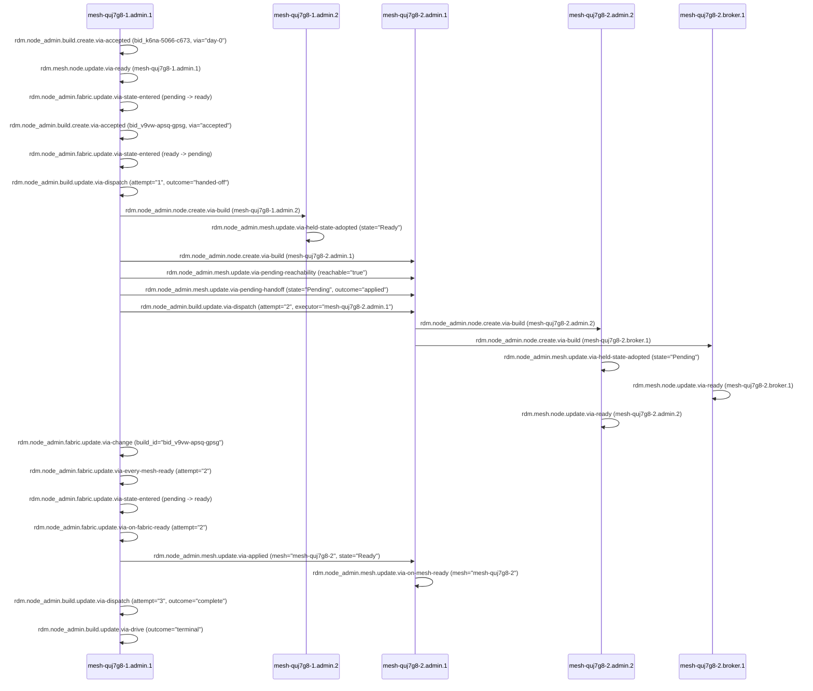
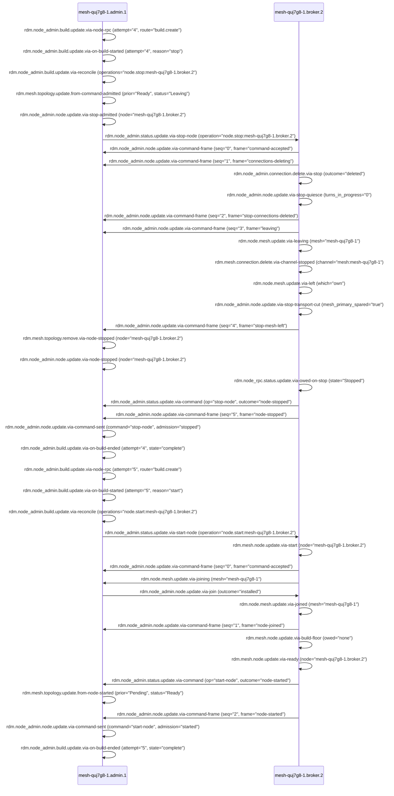
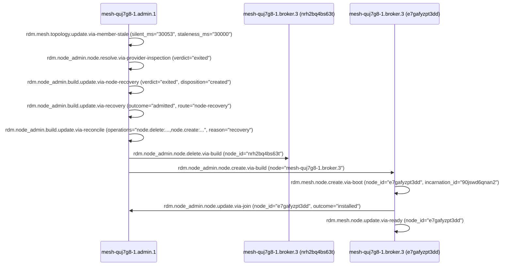
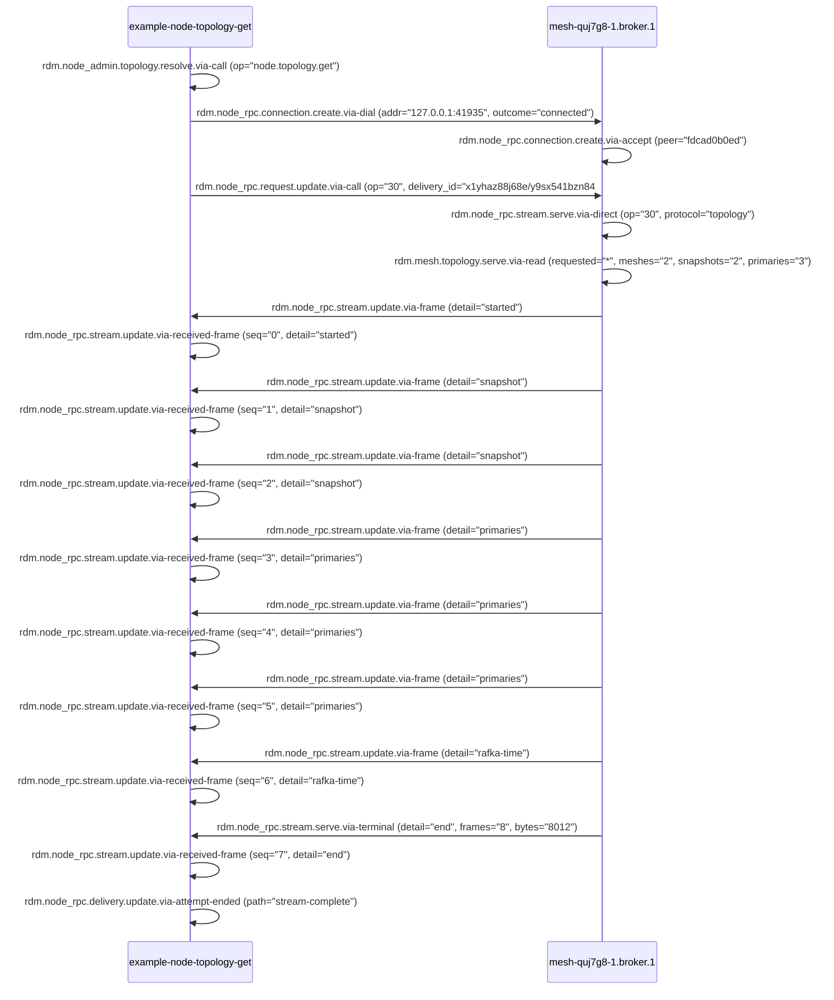

# What happens when

This page traces four workflows on the two-mesh demo estate ([Getting started](../getting-started.md)), told from the OpenTelemetry evidence spans written to `<root>/evidence/*.spans.jsonl` ([Local OTLP and Evidence Capture](test-otlp-capture.md#evidence-jsonl-capture-rdm_evidence_dir), [RDM Spans](../reference/rdm/spans.md)). Each walkthrough gives the architecture page section for every step, the span lines (name and key fields) from a live run of `scripts/demo-estate.sh`, and a `sequenceDiagram` built from those spans.

## 1. Day-0 bring-up (`scripts/demo-estate.sh up`)

Running `scripts/demo-estate.sh up` sets `RDM_EVIDENCE_DIR=$ROOT/evidence`, boots the Day-0 `node-admin` (`mesh-quj7g8-1.admin.1`), and submits the bootstrap Build (`v9vwapsqgpsg`) that creates the two-mesh, 20-node estate ([Local OTLP and Evidence Capture](test-otlp-capture.md#evidence-jsonl-capture-rdm_evidence_dir)):

```bash
RDM_EVIDENCE_DIR=$PWD/target/demo-estate-current/evidence RDM_DEMO_BIN=$PWD/demo/target/debug scripts/demo-estate.sh up
```

### Step 1: Day-0 boot and the bootstrap Build accepted

When the first `node-admin` (`mesh-quj7g8-1.admin.1`) boots in Day-0 mode, it mints the fabric CA, creates `fabric-quj7g8` (`fabric_id="bt828feh1cc6"`) and `mesh-quj7g8-1` (`mesh_id="6jxatzq1vv58"`), accepts its own Day-0 Build (`bid_k6na-5066-c673`, `via="day-0"`), enters `Ready`, and sets both `mesh-quj7g8-1` and `fabric-quj7g8` to `Ready` ([`fabric.create` — Steps](../architecture/lifecycles/fabric-create.md#steps), [`node-admin` lifecycle — Two ways a node-admin starts](../architecture/node-admin-lifecycle.md#two-ways-a-node-admin-starts)). When `scripts/demo-estate.sh up` then submits the 20-node estate specification, the fabric-primary accepts Build `bid_v9vw-apsq-gpsg` (`via="accepted"`, `previous_build_id="k6na5066c673"`) and moves the fabric state from `ready` to `pending` while the Build runs ([Build — 3. The fabric-primary and the mesh-primaries](../architecture/build.md#3-the-fabric-primary-and-the-mesh-primaries), [States — 1. Fabric](../architecture/lifecycles/states.md#1-fabric)):

```json
{"service":"rshape-node-admin","name":"rdm.node_admin.build.create.via-accepted","attributes":{"build_id":"bid_k6na-5066-c673","node":"mesh-quj7g8-1.admin.1","previous_build_id":"","via":"day-0"}}
{"service":"rshape-node-admin","name":"rdm.mesh.node.update.via-ready","attributes":{"build_id":"k6na5066c673","fabric_id":"bt828feh1cc6","incarnation_id":"yw9m94ephg4q","mesh_id":"6jxatzq1vv58","node":"mesh-quj7g8-1.admin.1","node_id":"n6mkmxhqp7s4"}}
{"service":"rshape-node-admin","name":"rdm.node_admin.fabric.update.via-state-entered","attributes":{"fabric_id":"bt828feh1cc6","from":"pending","node":"mesh-quj7g8-1.admin.1","to":"ready"}}
{"service":"rshape-node-admin","name":"rdm.node_admin.build.create.via-accepted","attributes":{"build_id":"bid_v9vw-apsq-gpsg","node":"mesh-quj7g8-1.admin.1","previous_build_id":"k6na5066c673","via":"accepted"}}
{"service":"rshape-node-admin","name":"rdm.node_admin.fabric.update.via-state-entered","attributes":{"fabric_id":"bt828feh1cc6","from":"ready","node":"mesh-quj7g8-1.admin.1","to":"pending"}}
```

### Step 2: Section 1 (`mesh-quj7g8-1`) `node.create` and mesh state hand-off

The fabric-primary (`mesh-quj7g8-1.admin.1`) drives the first section of `bid_v9vw-apsq-gpsg` (`attempt="1"`), executing `node.create` for the remaining nine nodes in `mesh-quj7g8-1` and creating the first `node-admin` of the second mesh (`mesh-quj7g8-2.admin.1`) before handing the Build forward (`outcome="handed-off"`; [Build — 3. The fabric-primary and the mesh-primaries](../architecture/build.md#3-the-fabric-primary-and-the-mesh-primaries), [`node.create` — Steps](../architecture/lifecycles/node-create.md#steps)). Once `mesh-quj7g8-2.admin.1` (`node_id="m2nk0k2styft"`) answers `Ping` (`rdm.node_admin.mesh.update.via-pending-reachability`), the launching `node-admin` (`mesh-quj7g8-1.admin.1`) sends `ApplyMeshState` (`0x1B`) with `state="Pending"` (`rdm.node_admin.mesh.update.via-pending-handoff`), and `mesh-quj7g8-1.admin.2` adopts the held `Ready` state of `mesh-quj7g8-1` (`rdm.node_admin.mesh.update.via-held-state-adopted`; [`mesh.create` — Steps](../architecture/lifecycles/mesh-create.md#steps), [Fabric-primary — Mesh state hand-off](../architecture/fabric-primary.md#mesh-state-hand-off)):

```json
{"service":"rshape-node-admin","name":"rdm.node_admin.build.update.via-dispatch","attributes":{"attempt":"1","build_id":"bid_v9vw-apsq-gpsg","executor":"mesh-quj7g8-1.admin.1","node":"mesh-quj7g8-1.admin.1","outcome":"handed-off"}}
{"service":"rshape-node-admin","name":"rdm.node_admin.node.create.via-build","attributes":{"attempt":"1","build_id":"bid_v9vw-apsq-gpsg","node":"mesh-quj7g8-1.admin.2"}}
{"service":"rshape-node-admin","name":"rdm.node_admin.node.create.via-build","attributes":{"attempt":"1","build_id":"bid_v9vw-apsq-gpsg","node":"mesh-quj7g8-1.broker.1"}}
{"service":"rshape-node-admin","name":"rdm.node_admin.mesh.update.via-held-state-adopted","attributes":{"mesh":"mesh-quj7g8-1","mesh_id":"6jxatzq1vv58","publisher":"mesh-quj7g8-1.admin.1","served_by":"mesh-quj7g8-1.admin.1","state":"Ready"}}
{"service":"rshape-node-admin","name":"rdm.node_admin.node.create.via-build","attributes":{"attempt":"1","build_id":"bid_v9vw-apsq-gpsg","node":"mesh-quj7g8-2.admin.1"}}
{"service":"rshape-node-admin","name":"rdm.node_admin.mesh.update.via-pending-reachability","attributes":{"mesh":"mesh-quj7g8-2","node":"mesh-quj7g8-1.admin.1","pings":"2","reachable":"true","target_node_id":"m2nk0k2styft"}}
{"service":"rshape-node-admin","name":"rdm.node_admin.mesh.update.via-pending-handoff","attributes":{"attempt":"1","mesh":"mesh-quj7g8-2","mesh_id":"hcf9qk2dxxsv","node":"mesh-quj7g8-1.admin.1","outcome":"applied","state":"Pending","target_incarnation":"96scbyb24rm2","target_node_id":"m2nk0k2styft"}}
```

### Step 3: Section 2 (`mesh-quj7g8-2`) `node.create` and every node `Ready`

The fabric-primary dispatches the `mesh-quj7g8-2` section (`attempt="2"`) to `mesh-quj7g8-2.admin.1`, which runs `node.create` for the remaining nine nodes of `mesh-quj7g8-2` and hands the `Pending` mesh state to `mesh-quj7g8-2.admin.2` ([Build — 3. The fabric-primary and the mesh-primaries](../architecture/build.md#3-the-fabric-primary-and-the-mesh-primaries), [`node.create` — Steps](../architecture/lifecycles/node-create.md#steps)). Each created node joins its mesh, passes [`pre_node_ready`](../architecture/fabric-node-hooks.md#pre_node_ready), and emits `rdm.mesh.node.update.via-ready` ([States — 3. Node](../architecture/lifecycles/states.md#3-node)):

```json
{"service":"rshape-node-admin","name":"rdm.node_admin.build.update.via-dispatch","attributes":{"attempt":"2","build_id":"bid_v9vw-apsq-gpsg","executor":"mesh-quj7g8-2.admin.1","node":"mesh-quj7g8-1.admin.1","outcome":"handed-off"}}
{"service":"rshape-node-admin","name":"rdm.node_admin.node.create.via-build","attributes":{"attempt":"2","build_id":"bid_v9vw-apsq-gpsg","node":"mesh-quj7g8-2.admin.2"}}
{"service":"rshape-node-admin","name":"rdm.node_admin.node.create.via-build","attributes":{"attempt":"2","build_id":"bid_v9vw-apsq-gpsg","node":"mesh-quj7g8-2.broker.1"}}
{"service":"rshape-node-admin","name":"rdm.node_admin.mesh.update.via-held-state-adopted","attributes":{"mesh":"mesh-quj7g8-2","mesh_id":"hcf9qk2dxxsv","publisher":"mesh-quj7g8-2.admin.1","served_by":"mesh-quj7g8-2.admin.1","state":"Pending"}}
{"service":"rshape-broker","name":"rdm.mesh.node.update.via-ready","attributes":{"fabric_id":"bt828feh1cc6","incarnation_id":"8gy3tqk32gkp","kind":"broker","mesh_id":"hcf9qk2dxxsv","node":"mesh-quj7g8-2.broker.1","node_id":"esntk95y25j7"}}
{"service":"rshape-node-admin","name":"rdm.mesh.node.update.via-ready","attributes":{"build_id":"v9vwapsqgpsg","fabric_id":"bt828feh1cc6","incarnation_id":"j38n2mvwc805","mesh_id":"hcf9qk2dxxsv","node":"mesh-quj7g8-2.admin.2","node_id":"yka0k0vmrc25"}}
```

### Step 4: Every mesh `Ready`, fabric `Ready`, and Build `Complete`

Once every planned birth in `mesh-quj7g8-1` and `mesh-quj7g8-2` is `Ready` in the fabric-primary's view, `mesh-quj7g8-1.admin.1` records `rdm.node_admin.fabric.update.via-every-mesh-ready`, enters `ready` (`rdm.node_admin.fabric.update.via-state-entered`), fires `on_fabric_ready` (`rdm.node_admin.fabric.update.via-on-fabric-ready`), and sets `mesh-quj7g8-2` to `Ready` (`rdm.node_admin.mesh.update.via-applied`, `rdm.node_admin.mesh.update.via-on-mesh-ready`), after which the final dispatch (`attempt="3"`) marks Build `bid_v9vw-apsq-gpsg` terminal ([States — 1. Fabric](../architecture/lifecycles/states.md#1-fabric), [States — 2. Mesh](../architecture/lifecycles/states.md#2-mesh), [Fabric and node hooks — Notices](../architecture/fabric-node-hooks.md#notices)):

```json
{"service":"rshape-node-admin","name":"rdm.node_admin.fabric.update.via-change","attributes":{"adopted":"false","build_id":"bid_v9vw-apsq-gpsg","fabric_id":"bt828feh1cc6","node":"mesh-quj7g8-1.admin.1"}}
{"service":"rshape-node-admin","name":"rdm.node_admin.fabric.update.via-every-mesh-ready","attributes":{"attempt":"2","build_id":"bid_v9vw-apsq-gpsg","node":"mesh-quj7g8-1.admin.1"}}
{"service":"rshape-node-admin","name":"rdm.node_admin.fabric.update.via-state-entered","attributes":{"fabric_id":"bt828feh1cc6","from":"pending","node":"mesh-quj7g8-1.admin.1","to":"ready"}}
{"service":"rshape-node-admin","name":"rdm.node_admin.fabric.update.via-on-fabric-ready","attributes":{"attempt":"2","bound":"true","build_id":"bid_v9vw-apsq-gpsg","node":"mesh-quj7g8-1.admin.1"}}
{"service":"rshape-node-admin","name":"rdm.node_admin.mesh.update.via-applied","attributes":{"mesh":"mesh-quj7g8-2","mesh_id":"hcf9qk2dxxsv","outcome":"recorded","state":"Ready"}}
{"service":"rshape-node-admin","name":"rdm.node_admin.mesh.update.via-on-mesh-ready","attributes":{"bound":"true","mesh":"mesh-quj7g8-2","mesh_id":"hcf9qk2dxxsv"}}
{"service":"rshape-node-admin","name":"rdm.node_admin.build.update.via-dispatch","attributes":{"attempt":"3","build_id":"bid_v9vw-apsq-gpsg","executor":"mesh-quj7g8-1.admin.1","node":"mesh-quj7g8-1.admin.1","outcome":"complete"}}
{"service":"rshape-node-admin","name":"rdm.node_admin.build.update.via-drive","attributes":{"build_id":"bid_v9vw-apsq-gpsg","dispatches":"1","node":"mesh-quj7g8-1.admin.1","outcome":"terminal"}}
```



---

## 2. One `node.stop` then `node.start` of an RPC node

Calling `Nodes::stop` and `Nodes::start` on `mesh-quj7g8-1.broker.2` (`node_id="a845t0qjfzw7"`, `incarnation_id="h4471hxp31fq"`) stops the node in place and starts the same process and birth back to `Ready` ([`node.stop`](../architecture/lifecycles/node-stop.md), [`node.start`](../architecture/lifecycles/node-start.md)).

### Step 1: `node.stop` admitted and `StopNode` (`0x22`) sent

When `Nodes::stop` submits `BuildChange::Stop` for `mesh-quj7g8-1.broker.2`, the fabric-primary (`mesh-quj7g8-1.admin.1`) opens attempt `4` (`reason="stop"`), fires `on_build_started` (`rdm.node_admin.build.update.via-on-build-started`), reconciles `node.stop:mesh-quj7g8-1.broker.2`, projects `Leaving` in its topology (`rdm.mesh.topology.update.from-command-admitted`, `rdm.node_admin.node.update.via-stop-admitted`), and opens `StopNode` (`0x22`) to `mesh-quj7g8-1.broker.2` ([`node.stop` — Steps](../architecture/lifecycles/node-stop.md#steps), [Fabric and node hooks — Notices](../architecture/fabric-node-hooks.md#notices)):

```json
{"service":"rshape-node-admin","name":"rdm.node_admin.build.update.via-node-rpc","attributes":{"attempt":"4","build_id":"v9vwapsqgpsg","node":"mesh-quj7g8-1.broker.2","route":"build.create"}}
{"service":"rshape-node-admin","name":"rdm.node_admin.build.update.via-on-build-started","attributes":{"attempt":"4","build_id":"bid_v9vw-apsq-gpsg","node":"mesh-quj7g8-1.admin.1","outcome":"sent","reason":"stop"}}
{"service":"rshape-node-admin","name":"rdm.node_admin.build.update.via-reconcile","attributes":{"attempt":"4","build_id":"bid_v9vw-apsq-gpsg","executor":"mesh-quj7g8-1.admin.1","operations":"node.stop:mesh-quj7g8-1.broker.2","outcome":"converged","reason":"stop"}}
{"service":"rshape-node-admin","name":"rdm.mesh.topology.update.from-command-admitted","attributes":{"attempt":"4","build_id":"v9vwapsqgpsg","incarnation_id":"h4471hxp31fq","node":"mesh-quj7g8-1.admin.1","node_id":"a845t0qjfzw7","operation":"node.stop:mesh-quj7g8-1.broker.2","prior":"Ready","status":"Leaving"}}
{"service":"rshape-node-admin","name":"rdm.node_admin.node.update.via-stop-admitted","attributes":{"attempt":"4","build_id":"v9vwapsqgpsg","incarnation_id":"h4471hxp31fq","node":"mesh-quj7g8-1.broker.2","node_id":"a845t0qjfzw7","operation":"node.stop:mesh-quj7g8-1.broker.2"}}
```

### Step 2: The RPC node deletes its connections, leaves the mesh, and stops

On `StopNode`, `mesh-quj7g8-1.broker.2` deletes its application connections (`rdm.node_admin.connection.delete.via-stop`), quiesces in-flight turns (`rdm.node_admin.node.update.via-stop-quiesce`), leaves `mesh-quj7g8-1` and stops its gossip channel (`rdm.node.mesh.update.via-leaving`, `rdm.mesh.connection.delete.via-channel-stopped`, `rdm.node.mesh.update.via-left`), cuts its non-primary transport connections (`rdm.node_admin.node.update.via-stop-transport-cut`), records its owed `Stopped` state (`rdm.node_rpc.status.update.via-owed-on-stop`), and answers `node-stopped` (`rdm.node_admin.status.update.via-stop-node`, `rdm.node_admin.status.update.via-command`; [`node.stop` — Steps](../architecture/lifecycles/node-stop.md#steps)):

```json
{"service":"rshape-broker","name":"rdm.node_admin.status.update.via-stop-node","attributes":{"attempt":"4","build_id":"v9vwapsqgpsg","commander":"n6mkmxhqp7s4","node":"mesh-quj7g8-1.broker.2","operation":"node.stop:mesh-quj7g8-1.broker.2","receipt":"established","state":"Stopped"}}
{"service":"rshape-broker","name":"rdm.node_admin.connection.delete.via-stop","attributes":{"commander":"n6mkmxhqp7s4","node":"mesh-quj7g8-1.broker.2","operation":"node.stop:mesh-quj7g8-1.broker.2","outcome":"deleted"}}
{"service":"rshape-broker","name":"rdm.node_admin.node.update.via-stop-quiesce","attributes":{"node":"mesh-quj7g8-1.broker.2","operation":"node.stop:mesh-quj7g8-1.broker.2","turns_in_progress":"0"}}
{"service":"rshape-broker","name":"rdm.node_admin.node.update.via-stop-transport-cut","attributes":{"accepted":"2","mesh_primary_spared":"true","neighbours":"5","node":"mesh-quj7g8-1.broker.2","operation":"node.stop:mesh-quj7g8-1.broker.2","spared":"1"}}
{"service":"rshape-broker","name":"rdm.node.mesh.update.via-leaving","attributes":{"mesh":"mesh-quj7g8-1","mesh_id":"6jxatzq1vv58","node":"mesh-quj7g8-1.broker.2","node_id":"a845t0qjfzw7","operation":"node.stop:mesh-quj7g8-1.broker.2"}}
{"service":"rshape-broker","name":"rdm.mesh.connection.delete.via-channel-stopped","attributes":{"channel":"mesh:mesh-quj7g8-1","node":"mesh-quj7g8-1.broker.2"}}
{"service":"rshape-broker","name":"rdm.node.mesh.update.via-left","attributes":{"mesh":"mesh-quj7g8-1","mesh_id":"6jxatzq1vv58","node":"mesh-quj7g8-1.broker.2","node_id":"a845t0qjfzw7","which":"own"}}
{"service":"rshape-broker","name":"rdm.node_rpc.status.update.via-owed-on-stop","attributes":{"attempt":"4","build_id":"v9vwapsqgpsg","node":"mesh-quj7g8-1.broker.2","operation":"node.stop:mesh-quj7g8-1.broker.2","state":"Stopped"}}
{"service":"rshape-broker","name":"rdm.node_admin.status.update.via-command","attributes":{"node":"mesh-quj7g8-1.broker.2","op":"stop-node","outcome":"node-stopped","sender":"mesh-quj7g8-1.admin.1"}}
```

### Step 3: Command stream frames (`seq` 0..5) and `Stopped` recorded

As `mesh-quj7g8-1.broker.2` advances through the stop phases, the mesh-primary (`mesh-quj7g8-1.admin.1`) receives the six `NodeCommand` stream frames (`command-accepted`, `connections-deleting`, `stop-connections-deleted`, `leaving`, `stop-mesh-left`, `node-stopped`), removes the stopped node from the live topology (`rdm.mesh.topology.remove.via-node-stopped`), records `Stopped` (`rdm.node_admin.node.update.via-node-stopped`, `rdm.node_admin.node.update.via-command-sent`), and finishes attempt `4` (`rdm.node_admin.build.update.via-on-build-ended`; [`node.stop` — Steps](../architecture/lifecycles/node-stop.md#steps), [`node.stop` — State transitions](../architecture/lifecycles/node-stop.md#state-transitions)):

```json
{"service":"rshape-node-admin","name":"rdm.node_admin.node.update.via-command-frame","attributes":{"frame":"command-accepted","incarnation_id":"h4471hxp31fq","invocation_id":"n6mkmxhqp7s4/yw9m94ephg4q#344","node":"mesh-quj7g8-1.broker.2","node_id":"a845t0qjfzw7","operation":"node.stop:mesh-quj7g8-1.broker.2","seq":"0"}}
{"service":"rshape-node-admin","name":"rdm.node_admin.node.update.via-command-frame","attributes":{"frame":"connections-deleting","incarnation_id":"h4471hxp31fq","invocation_id":"n6mkmxhqp7s4/yw9m94ephg4q#344","node":"mesh-quj7g8-1.broker.2","node_id":"a845t0qjfzw7","operation":"node.stop:mesh-quj7g8-1.broker.2","seq":"1"}}
{"service":"rshape-node-admin","name":"rdm.node_admin.node.update.via-command-frame","attributes":{"frame":"stop-connections-deleted","incarnation_id":"h4471hxp31fq","invocation_id":"n6mkmxhqp7s4/yw9m94ephg4q#344","node":"mesh-quj7g8-1.broker.2","node_id":"a845t0qjfzw7","operation":"node.stop:mesh-quj7g8-1.broker.2","seq":"2"}}
{"service":"rshape-node-admin","name":"rdm.node_admin.node.update.via-command-frame","attributes":{"frame":"leaving","incarnation_id":"h4471hxp31fq","invocation_id":"n6mkmxhqp7s4/yw9m94ephg4q#344","node":"mesh-quj7g8-1.broker.2","node_id":"a845t0qjfzw7","operation":"node.stop:mesh-quj7g8-1.broker.2","seq":"3"}}
{"service":"rshape-node-admin","name":"rdm.node_admin.node.update.via-command-frame","attributes":{"frame":"stop-mesh-left","incarnation_id":"h4471hxp31fq","invocation_id":"n6mkmxhqp7s4/yw9m94ephg4q#344","node":"mesh-quj7g8-1.broker.2","node_id":"a845t0qjfzw7","operation":"node.stop:mesh-quj7g8-1.broker.2","seq":"4"}}
{"service":"rshape-node-admin","name":"rdm.mesh.topology.remove.via-node-stopped","attributes":{"attempt":"4","build_id":"v9vwapsqgpsg","held_status":"Leaving","incarnation_id":"h4471hxp31fq","node":"mesh-quj7g8-1.broker.2","node_id":"a845t0qjfzw7","observer":"mesh-quj7g8-1.admin.1","operation":"node.stop:mesh-quj7g8-1.broker.2"}}
{"service":"rshape-node-admin","name":"rdm.node_admin.node.update.via-node-stopped","attributes":{"attempt":"4","build_id":"v9vwapsqgpsg","incarnation_id":"h4471hxp31fq","node":"mesh-quj7g8-1.broker.2","node_id":"a845t0qjfzw7","operation":"node.stop:mesh-quj7g8-1.broker.2"}}
{"service":"rshape-node-admin","name":"rdm.node_admin.node.update.via-command-frame","attributes":{"frame":"node-stopped","incarnation_id":"h4471hxp31fq","invocation_id":"n6mkmxhqp7s4/yw9m94ephg4q#344","node":"mesh-quj7g8-1.broker.2","node_id":"a845t0qjfzw7","operation":"node.stop:mesh-quj7g8-1.broker.2","seq":"5"}}
{"service":"rshape-node-admin","name":"rdm.node_admin.node.update.via-command-sent","attributes":{"admission":"stopped","attempt":"4","build_id":"v9vwapsqgpsg","code":"OK","command":"stop-node","node":"mesh-quj7g8-1.broker.2","operation":"node.stop:mesh-quj7g8-1.broker.2"}}
{"service":"rshape-node-admin","name":"rdm.node_admin.build.update.via-on-build-ended","attributes":{"attempt":"4","build_id":"bid_v9vw-apsq-gpsg","node":"mesh-quj7g8-1.admin.1","outcome":"sent","reason":"stop","state":"complete"}}
```

### Step 4: `node.start` (`0x22`), mesh rejoin, and `Ready`

When `Nodes::start` submits `BuildChange::Start` for `mesh-quj7g8-1.broker.2`, `mesh-quj7g8-1.admin.1` opens attempt `5` (`reason="start"`) and sends `StartNode` (`0x22`) to the stopped birth (`node_id="a845t0qjfzw7"`, `incarnation_id="h4471hxp31fq"`). The node re-runs `node.mesh.join` (`rdm.node.mesh.update.via-joining`, `rdm.node_admin.node.update.via-join`, `rdm.node.mesh.update.via-joined`), checks its Build floor (`rdm.mesh.node.update.via-build-floor`), enters `Ready` (`rdm.mesh.node.update.via-ready`), and streams `command-accepted` (`seq="0"`), `node-joined` (`seq="1"`), and `node-started` (`seq="2"`) back to `mesh-quj7g8-1.admin.1`, which projects `Ready` (`rdm.mesh.topology.update.from-node-started`) and ends attempt `5` ([`node.start` — Steps](../architecture/lifecycles/node-start.md#steps), [`node.start` — State transitions](../architecture/lifecycles/node-start.md#state-transitions)):

```json
{"service":"rshape-node-admin","name":"rdm.node_admin.build.update.via-node-rpc","attributes":{"attempt":"5","build_id":"v9vwapsqgpsg","node":"mesh-quj7g8-1.broker.2","route":"build.create"}}
{"service":"rshape-node-admin","name":"rdm.node_admin.build.update.via-on-build-started","attributes":{"attempt":"5","build_id":"bid_v9vw-apsq-gpsg","node":"mesh-quj7g8-1.admin.1","outcome":"sent","reason":"start"}}
{"service":"rshape-node-admin","name":"rdm.node_admin.build.update.via-reconcile","attributes":{"attempt":"5","build_id":"bid_v9vw-apsq-gpsg","executor":"mesh-quj7g8-1.admin.1","operations":"node.start:mesh-quj7g8-1.broker.2","outcome":"converged","reason":"start"}}
{"service":"rshape-broker","name":"rdm.node_admin.status.update.via-start-node","attributes":{"attempt":"5","build_id":"v9vwapsqgpsg","commander":"n6mkmxhqp7s4","node":"mesh-quj7g8-1.broker.2","operation":"node.start:mesh-quj7g8-1.broker.2","outcome":"started"}}
{"service":"rshape-broker","name":"rdm.mesh.node.update.via-start","attributes":{"incarnation_id":"h4471hxp31fq","node":"mesh-quj7g8-1.broker.2","node_id":"a845t0qjfzw7"}}
{"service":"rshape-broker","name":"rdm.node.mesh.update.via-joining","attributes":{"mesh":"mesh-quj7g8-1","node":"mesh-quj7g8-1.broker.2","node_id":"a845t0qjfzw7","operation":"node.start:mesh-quj7g8-1.broker.2"}}
{"service":"rshape-node-admin","name":"rdm.node_admin.node.update.via-join","attributes":{"admitted_as":"mesh-quj7g8-1.broker.2","incarnation_id":"h4471hxp31fq","node":"mesh-quj7g8-1.broker.2","node_id":"a845t0qjfzw7","outcome":"installed","served_by":"mesh-quj7g8-1.admin.1"}}
{"service":"rshape-node-admin","name":"rdm.node_admin.node.update.via-command-frame","attributes":{"frame":"command-accepted","incarnation_id":"h4471hxp31fq","invocation_id":"n6mkmxhqp7s4/yw9m94ephg4q#348","node":"mesh-quj7g8-1.broker.2","node_id":"a845t0qjfzw7","operation":"node.start:mesh-quj7g8-1.broker.2","seq":"0"}}
{"service":"rshape-broker","name":"rdm.node.mesh.update.via-joined","attributes":{"mesh":"mesh-quj7g8-1","mesh_id":"6jxatzq1vv58","node":"mesh-quj7g8-1.broker.2","node_id":"a845t0qjfzw7","which":"own"}}
{"service":"rshape-node-admin","name":"rdm.node_admin.node.update.via-command-frame","attributes":{"frame":"node-joined","incarnation_id":"h4471hxp31fq","invocation_id":"n6mkmxhqp7s4/yw9m94ephg4q#348","node":"mesh-quj7g8-1.broker.2","node_id":"a845t0qjfzw7","operation":"node.start:mesh-quj7g8-1.broker.2","seq":"1"}}
{"service":"rshape-broker","name":"rdm.mesh.node.update.via-build-floor","attributes":{"node":"mesh-quj7g8-1.broker.2","owed":"none"}}
{"service":"rshape-broker","name":"rdm.mesh.node.update.via-ready","attributes":{"fabric_id":"bt828feh1cc6","incarnation_id":"h4471hxp31fq","kind":"broker","mesh_id":"6jxatzq1vv58","node":"mesh-quj7g8-1.broker.2","node_id":"a845t0qjfzw7"}}
{"service":"rshape-broker","name":"rdm.node_admin.status.update.via-command","attributes":{"node":"mesh-quj7g8-1.broker.2","op":"start-node","outcome":"node-started","sender":"mesh-quj7g8-1.admin.1"}}
{"service":"rshape-node-admin","name":"rdm.mesh.topology.update.from-node-started","attributes":{"incarnation_id":"h4471hxp31fq","node":"mesh-quj7g8-1.admin.1","node_id":"a845t0qjfzw7","prior":"Pending","status":"Ready"}}
{"service":"rshape-node-admin","name":"rdm.node_admin.node.update.via-command-frame","attributes":{"frame":"node-started","incarnation_id":"h4471hxp31fq","invocation_id":"n6mkmxhqp7s4/yw9m94ephg4q#348","node":"mesh-quj7g8-1.broker.2","node_id":"a845t0qjfzw7","operation":"node.start:mesh-quj7g8-1.broker.2","seq":"2"}}
{"service":"rshape-node-admin","name":"rdm.node_admin.node.update.via-command-sent","attributes":{"admission":"started","attempt":"5","build_id":"v9vwapsqgpsg","code":"OK","command":"start-node","detail":"Started","node":"mesh-quj7g8-1.broker.2","operation":"node.start:mesh-quj7g8-1.broker.2"}}
{"service":"rshape-node-admin","name":"rdm.node_admin.build.update.via-on-build-ended","attributes":{"attempt":"5","build_id":"bid_v9vw-apsq-gpsg","node":"mesh-quj7g8-1.admin.1","outcome":"sent","reason":"start","state":"complete"}}
```



---

## 3. A `SIGKILL` of an RPC node and its recovery

Sending `SIGKILL` (`Immediate` termination) to `mesh-quj7g8-1.broker.3` (`node_id="nrh2bq4bs63t"`, `incarnation_id="0t7njf6wzf0q"`) stops its heartbeats without a leave frame, triggering the staleness window, `node.investigation`, and `node.recovery` ([`node.investigation`](../architecture/lifecycles/node-investigation.md), [`node.recovery`](../architecture/lifecycles/node-recovery.md)):

```bash
RDM_EVIDENCE_DIR="$ROOT/evidence" RDM_NODE_ADMIN_BIRTH="$(cat "$ROOT/birth.json")" \
  demo/target/debug/examples/node_recovery "$M1.broker.3"
```

### Step 1: The 30 s staleness mark

Once `mesh-quj7g8-1.broker.3` (`nrh2bq4bs63t`) has not refreshed its `heartbeat_ms` for the 30 s staleness window (`staleness_ms="30000"`), peers in `mesh-quj7g8-1` and the mesh-primary `mesh-quj7g8-1.admin.1` mark the birth stale in their local topology view (`rdm.mesh.topology.update.via-member-stale`; [Gossip — 2. Failure detection](../architecture/gossip.md#2-failure-detection), [`node.recovery` — Trigger](../architecture/lifecycles/node-recovery.md#trigger)):

```json
{"service":"rshape-node-admin","name":"rdm.mesh.topology.update.via-member-stale","attributes":{"node":"mesh-quj7g8-1.admin.1","silent_ms":"30053","staleness_ms":"30000"}}
```

### Step 2: `node.investigation` (`node.runtime.inspect` first)

The mesh-primary (`mesh-quj7g8-1.admin.1`) runs `node.investigation` on the silent birth `nrh2bq4bs63t` in the order stated by [`node.investigation` — Steps](../architecture/lifecycles/node-investigation.md#steps):

1. It reads its own by-destination connections index for open connections to `nrh2bq4bs63t`.
2. It calls [`node.runtime.inspect`](../architecture/lifecycles/node-runtime-inspect.md) on the `process` deployment provider (`rdm.node_admin.node.resolve.via-provider-inspection`), which returns `verdict="exited"`. `exited` (or `os-stopped`) is the verdict, so no [`node.tickle`](../architecture/lifecycles/node-tickle.md) is sent. On `running` or `unavailable` the tickle would follow, direct and then through up to two `Ready` peers of the birth's mesh.

```json
{"service":"rshape-node-admin","name":"rdm.node_admin.node.resolve.via-provider-inspection","attributes":{"incarnation_id":"0t7njf6wzf0q","inspector":"mesh-quj7g8-1.admin.1","node":"mesh-quj7g8-1.broker.3","node_id":"nrh2bq4bs63t","verdict":"exited"}}
```

### Step 3: Recovery attempt deletes the exited birth and creates a new birth `Ready`

With `verdict="exited"`, `mesh-quj7g8-1.admin.1` opens a recovery attempt on the current Build (`v9vwapsqgpsg`, `rdm.node_admin.build.update.via-node-recovery`, `rdm.node_admin.build.update.via-recovery`) and reconciles `node.delete:mesh-quj7g8-1.broker.3,node.create:mesh-quj7g8-1.broker.3` (`reason="recovery"`): it deletes the exited birth `nrh2bq4bs63t` (`rdm.node_admin.node.delete.via-build`) and creates a new birth at the same `path.name` (`mesh-quj7g8-1.broker.3`) with a new `node.id` (`e7gafyzpt3dd`) and `incarnation_id` (`90jswd6qnan2`) inheriting the prior birth's `data_dir` (`rdm.node_admin.node.create.via-build`), which boots, joins `mesh-quj7g8-1`, and enters `Ready` ([`node.recovery` — Steps](../architecture/lifecycles/node-recovery.md#steps), [`node.recovery` — State transitions](../architecture/lifecycles/node-recovery.md#state-transitions)):

```json
{"service":"rshape-node-admin","name":"rdm.node_admin.build.update.via-node-recovery","attributes":{"attempt":"1","build_id":"v9vwapsqgpsg","disposition":"created","incarnation_id":"0t7njf6wzf0q","mesh":"mesh-quj7g8-1","node":"mesh-quj7g8-1.broker.3","node_id":"nrh2bq4bs63t","outcome":"complete: attempt 1","submitter":"mesh-quj7g8-1.admin.1","verdict":"exited"}}
{"service":"rshape-node-admin","name":"rdm.node_admin.build.update.via-recovery","attributes":{"attempt":"1","build_id":"v9vwapsqgpsg","executor":"mesh-quj7g8-1.admin.1","incarnation_id":"0t7njf6wzf0q","mesh":"mesh-quj7g8-1","node":"mesh-quj7g8-1.broker.3","node_id":"nrh2bq4bs63t","open_attempt":"opened-here","outcome":"admitted","route":"node-recovery"}}
{"service":"rshape-node-admin","name":"rdm.node_admin.build.update.via-reconcile","attributes":{"attempt":"1","build_id":"bid_v9vw-apsq-gpsg","executor":"mesh-quj7g8-1.admin.1","operations":"node.delete:mesh-quj7g8-1.broker.3,node.create:mesh-quj7g8-1.broker.3","outcome":"converged","reason":"recovery"}}
{"service":"rshape-node-admin","name":"rdm.node_admin.node.delete.via-build","attributes":{"attempt":"1","build_id":"bid_v9vw-apsq-gpsg","incarnation_id":"0t7njf6wzf0q","node":"mesh-quj7g8-1.broker.3","node_id":"nrh2bq4bs63t"}}
{"service":"rshape-node-admin","name":"rdm.node_admin.node.create.via-build","attributes":{"attempt":"1","build_id":"bid_v9vw-apsq-gpsg","incarnation_id":"0t7njf6wzf0q","node":"mesh-quj7g8-1.broker.3","node_id":"nrh2bq4bs63t"}}
{"service":"rshape-broker","name":"rdm.mesh.node.create.via-boot","attributes":{"incarnation_id":"90jswd6qnan2","kind":"broker","node":"mesh-quj7g8-1.broker.3","node_id":"e7gafyzpt3dd"}}
{"service":"rshape-node-admin","name":"rdm.node_admin.node.update.via-join","attributes":{"admitted_as":"mesh-quj7g8-1.broker.3","incarnation_id":"90jswd6qnan2","node":"mesh-quj7g8-1.broker.3","node_id":"e7gafyzpt3dd","outcome":"installed","served_by":"mesh-quj7g8-1.admin.1"}}
{"service":"rshape-broker","name":"rdm.mesh.node.update.via-ready","attributes":{"fabric_id":"bt828feh1cc6","incarnation_id":"90jswd6qnan2","kind":"broker","mesh_id":"6jxatzq1vv58","node":"mesh-quj7g8-1.broker.3","node_id":"e7gafyzpt3dd"}}
```



---

## 4. A Node RPC call with its frames and acks (`node.topology.get`)

Running `demo/examples/node_topology_get` calls `NodeRpc::topology_get` (`GetTopology`, op `0x1E` / `30`, protocol `"topology"`) on `mesh-quj7g8-1.broker.1` (`node_id="xkg2p0dgmsvd"`, `incarnation_id="549g6mjnvsyf"`; [`node.topology.get`](../architecture/lifecycles/node-topology-get.md), [Node RPC envelope — The op ledger](../architecture/node-rpc-envelope.md#the-op-ledger)):

```bash
RDM_EVIDENCE_DIR="$ROOT/evidence" RDM_NODE_ADMIN_BIRTH="$(cat "$ROOT/birth.json")" \
  demo/target/debug/examples/node_topology_get "$M1.broker.1"
```

### Step 1: Dialing the target and opening the request stream

The caller (`example-node-topology-get`) opens `rdm.node_admin.topology.resolve.via-call` (`op="node.topology.get"`) and `rdm.node_rpc.request.update.via-call` (`op="30"`, `delivery_id="x1yhaz88j68e/y9sx541bzn84#2"`), dials `mesh-quj7g8-1.broker.1` (`rdm.node_rpc.connection.create.via-dial`), and opens a bidirectional QUIC request stream, which `mesh-quj7g8-1.broker.1` accepts (`rdm.node_rpc.connection.create.via-accept`, `rdm.node_rpc.stream.serve.via-direct`; [Node RPC runtime — 2. Connection pool](../architecture/node-rpc.md#2-connection-pool), [Node RPC envelope — 1. Wire envelope](../architecture/node-rpc-envelope.md#1-wire-envelope)):

```json
{"service":"example-node-topology-get","name":"rdm.node_admin.topology.resolve.via-call","attributes":{"op":"node.topology.get","outcome":"read"}}
{"service":"example-node-topology-get","name":"rdm.node_rpc.request.update.via-call","attributes":{"code":"OK","delivery_id":"x1yhaz88j68e/y9sx541bzn84#2","detail":"end","elapsed_ms":"15","op":"30","outcome":"stream-open","reused":"false"}}
{"service":"example-node-topology-get","name":"rdm.node_rpc.connection.create.via-dial","attributes":{"addr":"127.0.0.1:41935","elapsed_ms":"6","incarnation_id":"549g6mjnvsyf","outcome":"connected","peer":"d01fa0835c"}}
{"service":"rshape-broker","name":"rdm.node_rpc.connection.create.via-accept","attributes":{"connection":"255069249398896","peer":"fdcad0b0ed"}}
{"service":"rshape-broker","name":"rdm.node_rpc.stream.serve.via-direct","attributes":{"caller_system":"rdm","code":"OK","detail":"end","op":"30","protocol":"topology"}}
```

### Step 2: Serving the stream frames (`Started`, `Data`, `End`)

On `mesh-quj7g8-1.broker.1`, the `GetTopology` handler reads its held topology for both meshes (`rdm.mesh.topology.serve.via-read`, `meshes="2"`, `snapshots="2"`, `primaries="3"`) and writes the server-streaming reply frames on the stream (`rdm.node_rpc.stream.update.via-frame`): `started` (`seq` 0), two `snapshot` frames (`seq` 1..2), three `primaries` frames (`seq` 3..5), one `rafka-time` frame (`seq` 6), and the terminal `end` frame (`seq` 7, `rdm.node_rpc.stream.serve.via-terminal`, `frames="8"`, `bytes="8012"`; [`node.topology.get` — Steps](../architecture/lifecycles/node-topology-get.md#steps), [Node RPC envelope — 3. Server-streaming envelope](../architecture/node-rpc-envelope.md#3-server-streaming-envelope)):

```json
{"service":"rshape-broker","name":"rdm.mesh.topology.serve.via-read","attributes":{"bytes":"7596","meshes":"2","node":"mesh-quj7g8-1.broker.1","outcome":"served","primaries":"3","requested":"*","snapshots":"2","unchanged":"0"}}
{"service":"rshape-broker","name":"rdm.node_rpc.stream.update.via-frame","attributes":{"code":"OK","detail":"started","protocol":"topology"}}
{"service":"rshape-broker","name":"rdm.node_rpc.stream.update.via-frame","attributes":{"code":"OK","detail":"snapshot","protocol":"topology"}}
{"service":"rshape-broker","name":"rdm.node_rpc.stream.update.via-frame","attributes":{"code":"OK","detail":"snapshot","protocol":"topology"}}
{"service":"rshape-broker","name":"rdm.node_rpc.stream.update.via-frame","attributes":{"code":"OK","detail":"primaries","protocol":"topology"}}
{"service":"rshape-broker","name":"rdm.node_rpc.stream.update.via-frame","attributes":{"code":"OK","detail":"primaries","protocol":"topology"}}
{"service":"rshape-broker","name":"rdm.node_rpc.stream.update.via-frame","attributes":{"code":"OK","detail":"primaries","protocol":"topology"}}
{"service":"rshape-broker","name":"rdm.node_rpc.stream.update.via-frame","attributes":{"code":"OK","detail":"rafka-time","protocol":"topology"}}
{"service":"rshape-broker","name":"rdm.node_rpc.stream.serve.via-terminal","attributes":{"bytes":"8012","caller_cancelled":"false","code":"OK","detail":"end","frames":"8"}}
```

### Step 3: Receiving frames (`seq` 0..7) and acknowledging completion

As each frame arrives on `invocation_id="x1yhaz88j68e/y9sx541bzn84#2"`, the caller classifies and records it (`rdm.node_rpc.stream.update.via-received-frame`, `seq="0"` through `seq="7"`). The initial `started` frame (`seq="0"`) acknowledges acceptance of the invocation on the stream, and when the terminal `end` frame (`seq="7"`) is received, the caller closes the delivery attempt (`rdm.node_rpc.delivery.update.via-attempt-ended`, `path="stream-complete"`; [Node RPC envelope — 3. Server-streaming envelope](../architecture/node-rpc-envelope.md#3-server-streaming-envelope), [Node RPC runtime — 3. Delivery and retries](../architecture/node-rpc.md#3-delivery-and-retries)):

```json
{"service":"example-node-topology-get","name":"rdm.node_rpc.stream.update.via-received-frame","attributes":{"code":"OK","detail":"started","invocation_id":"x1yhaz88j68e/y9sx541bzn84#2","protocol":"topology","seq":"0"}}
{"service":"example-node-topology-get","name":"rdm.node_rpc.stream.update.via-received-frame","attributes":{"code":"OK","detail":"snapshot","invocation_id":"x1yhaz88j68e/y9sx541bzn84#2","protocol":"topology","seq":"1"}}
{"service":"example-node-topology-get","name":"rdm.node_rpc.stream.update.via-received-frame","attributes":{"code":"OK","detail":"snapshot","invocation_id":"x1yhaz88j68e/y9sx541bzn84#2","protocol":"topology","seq":"2"}}
{"service":"example-node-topology-get","name":"rdm.node_rpc.stream.update.via-received-frame","attributes":{"code":"OK","detail":"primaries","invocation_id":"x1yhaz88j68e/y9sx541bzn84#2","protocol":"topology","seq":"3"}}
{"service":"example-node-topology-get","name":"rdm.node_rpc.stream.update.via-received-frame","attributes":{"code":"OK","detail":"primaries","invocation_id":"x1yhaz88j68e/y9sx541bzn84#2","protocol":"topology","seq":"4"}}
{"service":"example-node-topology-get","name":"rdm.node_rpc.stream.update.via-received-frame","attributes":{"code":"OK","detail":"primaries","invocation_id":"x1yhaz88j68e/y9sx541bzn84#2","protocol":"topology","seq":"5"}}
{"service":"example-node-topology-get","name":"rdm.node_rpc.stream.update.via-received-frame","attributes":{"code":"OK","detail":"rafka-time","invocation_id":"x1yhaz88j68e/y9sx541bzn84#2","protocol":"topology","seq":"6"}}
{"service":"example-node-topology-get","name":"rdm.node_rpc.stream.update.via-received-frame","attributes":{"code":"OK","detail":"end","invocation_id":"x1yhaz88j68e/y9sx541bzn84#2","protocol":"topology","seq":"7"}}
{"service":"example-node-topology-get","name":"rdm.node_rpc.delivery.update.via-attempt-ended","attributes":{"attempts":"1","delivery_id":"x1yhaz88j68e/y9sx541bzn84#2","path":"stream-complete"}}
```


