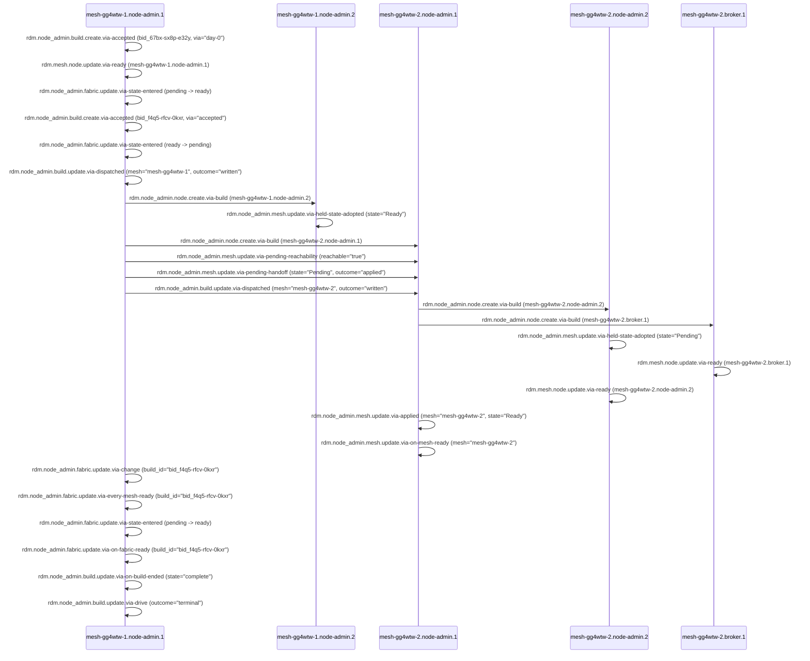
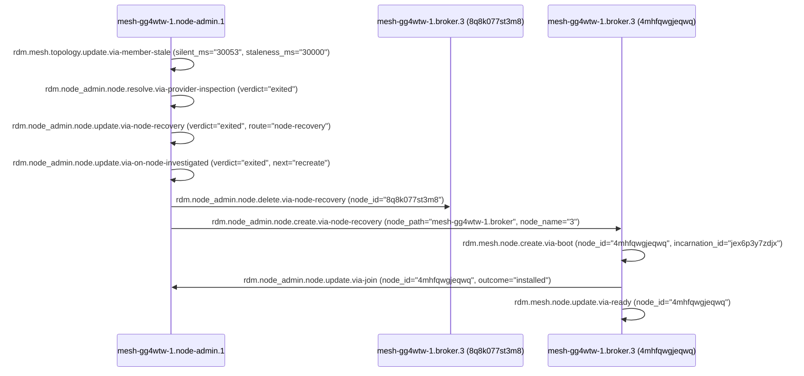
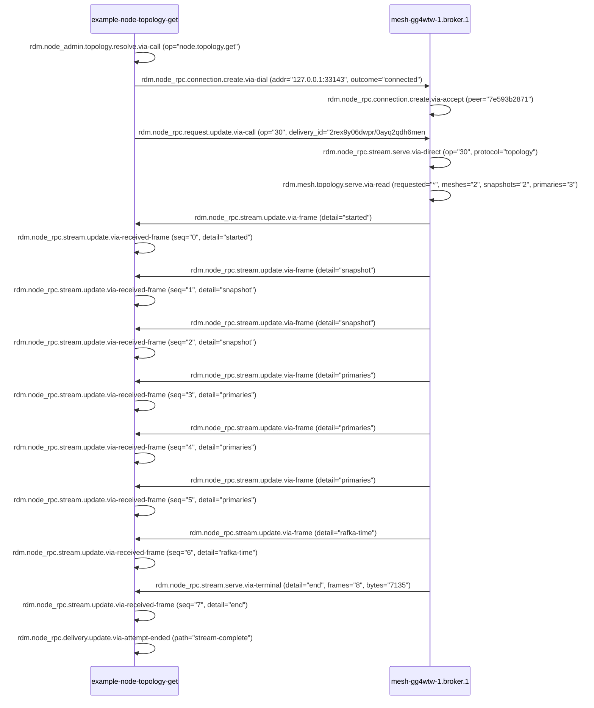

# What happens when

This page traces four workflows on the two-mesh demo estate ([Getting started](../getting-started.md)), told from the OpenTelemetry evidence spans written to `<root>/evidence/*.spans.jsonl` ([Test trace capture](test-otlp-capture.md#4-estate-cells-one-file-per-process), [RDM Spans](../reference/rdm/spans.md)). Each walkthrough gives the architecture page section for every step, the span lines (name and key fields) from a live run of `scripts/demo-estate.sh`, and a `sequenceDiagram` built from those spans.

## 1. Day-0 bring-up (`scripts/demo-estate.sh up`)

Running `scripts/demo-estate.sh up` sets `RDM_EVIDENCE_DIR=$ROOT/evidence`, boots the Day-0 `node-admin` (`mesh-gg4wtw-1.node-admin.1`), and submits the bootstrap Build (`f4q5rfcv0kxr`) that creates the two-mesh, 20-node estate ([Test trace capture](test-otlp-capture.md#4-estate-cells-one-file-per-process)):

```bash
RDM_DEMO_BIN=$PWD/demo/target/debug scripts/demo-estate.sh up
ROOT="$(cat target/demo-estate.current)"; . "$ROOT/names"
```

### Step 1: Day-0 boot and the bootstrap Build accepted

When the first `node-admin` (`mesh-gg4wtw-1.node-admin.1`) boots in Day-0 mode, it mints the fabric CA, creates `fabric-gg4wtw` (`fabric_id="ckd47m83fg0e"`) and `mesh-gg4wtw-1` (`mesh_id="nhfek2nszk43"`), accepts its own Day-0 Build (`bid_67bx-sx8p-e32y`, `via="day-0"`), enters `Ready`, and sets both `mesh-gg4wtw-1` and `fabric-gg4wtw` to `Ready` ([`fabric.create` — Sequence](../architecture/lifecycles/fabric-create.md#numbered-end-to-end-sequence), [`node-admin` lifecycle — 3. Start modes](../architecture/node-admin-lifecycle.md#3-start-modes)). When `scripts/demo-estate.sh up` then submits the 20-node estate specification, the fabric-primary accepts Build `bid_f4q5-rfcv-0kxr` (`via="accepted"`, `previous_build_id="67bxsx8pe32y"`) and moves the fabric state from `ready` to `pending` while the Build runs ([Build — 4. The accepted topology](../architecture/build.md#4-the-accepted-topology-is-the-fabric-primarys-current-build), [States — The fabric's ready](../architecture/lifecycles/states.md#the-fabrics-ready)):

```json
{"service":"rshape-node-admin","name":"rdm.node_admin.build.create.via-accepted","attributes":{"build_id":"bid_67bx-sx8p-e32y","previous_build_id":"","via":"day-0"}}
{"service":"rshape-node-admin","name":"rdm.mesh.node.update.via-ready","attributes":{"build_id":"67bxsx8pe32y","fabric_id":"ckd47m83fg0e","incarnation_id":"xebe6a7n3ah5","mesh_id":"nhfek2nszk43","node_id":"h38q5jqafmd8","node_path":"mesh-gg4wtw-1.node-admin","node_name":"1"}}
{"service":"rshape-node-admin","name":"rdm.node_admin.fabric.update.via-state-entered","attributes":{"fabric_id":"ckd47m83fg0e","from":"pending","to":"ready","node_path":"mesh-gg4wtw-1.node-admin","node_name":"1"}}
{"service":"rshape-node-admin","name":"rdm.node_admin.build.create.via-accepted","attributes":{"build_id":"bid_f4q5-rfcv-0kxr","previous_build_id":"67bxsx8pe32y","via":"accepted"}}
{"service":"rshape-node-admin","name":"rdm.node_admin.fabric.update.via-state-entered","attributes":{"fabric_id":"ckd47m83fg0e","from":"ready","to":"pending","node_path":"mesh-gg4wtw-1.node-admin","node_name":"1"}}
```

### Step 2: Section 1 (`mesh-gg4wtw-1`) `node.create` and mesh state hand-off

The fabric-primary (`mesh-gg4wtw-1.node-admin.1`) writes the dispatch of the first section of `bid_f4q5-rfcv-0kxr` (`rdm.node_admin.build.update.via-dispatched`, `mesh="mesh-gg4wtw-1"`) and runs `node.create` for the remaining nine nodes in `mesh-gg4wtw-1` and for the first `node-admin` of the second mesh (`mesh-gg4wtw-2.node-admin.1`) ([Build — 4. The accepted topology](../architecture/build.md#4-the-accepted-topology-is-the-fabric-primarys-current-build), [`node.create` — Sequence](../architecture/lifecycles/node-create.md#numbered-end-to-end-sequence)). Once `mesh-gg4wtw-2.node-admin.1` (`node_id="23txb8wyzp6g"`) answers `Ping` (`rdm.node_admin.mesh.update.via-pending-reachability`), the launching `node-admin` (`mesh-gg4wtw-1.node-admin.1`) sends `ApplyMeshState` (`0x1B`) with `state="Pending"` (`rdm.node_admin.mesh.update.via-pending-handoff`), and `mesh-gg4wtw-1.node-admin.2` adopts the held `Ready` state of `mesh-gg4wtw-1` (`rdm.node_admin.mesh.update.via-held-state-adopted`; [`mesh.create` — Sequence](../architecture/lifecycles/mesh-create.md#numbered-end-to-end-sequence), [Fabric primary — 6. Mesh status dissemination](../architecture/fabric-primary.md#6-mesh-status-dissemination)):

```json
{"service":"rshape-node-admin","name":"rdm.node_admin.build.update.via-dispatched","attributes":{"build_id":"bid_f4q5-rfcv-0kxr","node_path":"mesh-gg4wtw-1.node-admin","node_name":"1","outcome":"written","mesh":"mesh-gg4wtw-1"}}
{"service":"rshape-node-admin","name":"rdm.node_admin.node.create.via-build","attributes":{"build_id":"bid_f4q5-rfcv-0kxr","node_path":"mesh-gg4wtw-1.node-admin","node_name":"2"}}
{"service":"rshape-node-admin","name":"rdm.node_admin.node.create.via-build","attributes":{"build_id":"bid_f4q5-rfcv-0kxr","node_path":"mesh-gg4wtw-1.broker","node_name":"1"}}
{"service":"rshape-node-admin","name":"rdm.node_admin.mesh.update.via-held-state-adopted","attributes":{"mesh":"mesh-gg4wtw-1","mesh_id":"nhfek2nszk43","publisher":"h38q5jqafmd8","served_by":"h38q5jqafmd8","state":"Ready"}}
{"service":"rshape-node-admin","name":"rdm.node_admin.node.create.via-build","attributes":{"build_id":"bid_f4q5-rfcv-0kxr","node_path":"mesh-gg4wtw-1.broker","node_name":"2"}}
{"service":"rshape-node-admin","name":"rdm.node_admin.mesh.update.via-pending-reachability","attributes":{"mesh":"mesh-gg4wtw-2","pings":"2","reachable":"true","target_node_id":"23txb8wyzp6g","node_path":"mesh-gg4wtw-1.node-admin","node_name":"1"}}
{"service":"rshape-node-admin","name":"rdm.node_admin.mesh.update.via-pending-handoff","attributes":{"mesh":"mesh-gg4wtw-2","mesh_id":"njar82sck6xk","outcome":"applied","state":"Pending","target_incarnation":"eac2zx13jaz5","target_node_id":"23txb8wyzp6g","node_path":"mesh-gg4wtw-1.node-admin","node_name":"1"}}
```

### Step 3: Section 2 (`mesh-gg4wtw-2`) `node.create` and every node `Ready`

The fabric-primary writes the dispatch of the `mesh-gg4wtw-2` section (`rdm.node_admin.build.update.via-dispatched`, `mesh="mesh-gg4wtw-2"`) to `mesh-gg4wtw-2.node-admin.1`, which runs `node.create` for the remaining nine nodes of `mesh-gg4wtw-2` and hands the `Pending` mesh state to `mesh-gg4wtw-2.node-admin.2` ([Build — 4. The accepted topology](../architecture/build.md#4-the-accepted-topology-is-the-fabric-primarys-current-build), [`node.create` — Sequence](../architecture/lifecycles/node-create.md#numbered-end-to-end-sequence)). Each created node joins its mesh, passes [`pre_node_ready`](../architecture/fabric-node-hooks.md#pre_node_ready), and emits `rdm.mesh.node.update.via-ready` ([States — Who sets each state](../architecture/lifecycles/states.md#who-sets-each-state)):

```json
{"service":"rshape-node-admin","name":"rdm.node_admin.build.update.via-dispatched","attributes":{"build_id":"bid_f4q5-rfcv-0kxr","node_path":"mesh-gg4wtw-1.node-admin","node_name":"1","outcome":"written","mesh":"mesh-gg4wtw-2"}}
{"service":"rshape-node-admin","name":"rdm.node_admin.node.create.via-build","attributes":{"build_id":"bid_f4q5-rfcv-0kxr","node_path":"mesh-gg4wtw-1.broker","node_name":"3"}}
{"service":"rshape-node-admin","name":"rdm.node_admin.node.create.via-build","attributes":{"build_id":"bid_f4q5-rfcv-0kxr","node_path":"mesh-gg4wtw-1.compute","node_name":"1"}}
{"service":"rshape-node-admin","name":"rdm.node_admin.mesh.update.via-held-state-adopted","attributes":{"mesh":"mesh-gg4wtw-2","mesh_id":"njar82sck6xk","publisher":"23txb8wyzp6g","served_by":"23txb8wyzp6g","state":"Pending"}}
{"service":"rshape-compute","name":"rdm.mesh.node.update.via-ready","attributes":{"fabric_id":"ckd47m83fg0e","incarnation_id":"mzty3e8qxbn7","type":"compute","mesh_id":"nhfek2nszk43","node_id":"tqhn82jxkdx1"}}
{"service":"rshape-node-admin","name":"rdm.mesh.node.update.via-ready","attributes":{"build_id":"f4q5rfcv0kxr","fabric_id":"ckd47m83fg0e","incarnation_id":"bfxtknq1xmd5","mesh_id":"nhfek2nszk43","node_id":"y9c0z0d1gfyp","node_path":"mesh-gg4wtw-1.node-admin","node_name":"2"}}
```

### Step 4: Every mesh `Ready`, fabric `Ready`, and Build `Complete`

Once every planned birth in `mesh-gg4wtw-2` is `Ready`, its mesh-primary declares the mesh `Ready`, the fabric-primary answers `Applied`, and the mesh-primary records it on the mesh's record (`rdm.node_admin.mesh.update.via-applied`, `rdm.node_admin.mesh.update.via-on-mesh-ready`). With every mesh `Ready`, `mesh-gg4wtw-1.node-admin.1` records `rdm.node_admin.fabric.update.via-every-mesh-ready`, enters `ready` (`rdm.node_admin.fabric.update.via-state-entered`) and fires `on_fabric_ready` (`rdm.node_admin.fabric.update.via-on-fabric-ready`), and Build `bid_f4q5-rfcv-0kxr` ends `Complete` (`rdm.node_admin.build.update.via-on-build-ended`, `rdm.node_admin.build.update.via-drive`) ([States — The fabric's ready](../architecture/lifecycles/states.md#the-fabrics-ready), [States — Who sets each state](../architecture/lifecycles/states.md#who-sets-each-state), [Fabric and node hooks — on_fabric_ready](../architecture/fabric-node-hooks.md#on_fabric_ready)):

```json
{"service":"rshape-node-admin","name":"rdm.node_admin.mesh.update.via-applied","attributes":{"mesh":"mesh-gg4wtw-2","mesh_id":"njar82sck6xk","outcome":"recorded","state":"Ready"}}
{"service":"rshape-node-admin","name":"rdm.node_admin.mesh.update.via-on-mesh-ready","attributes":{"bound":"true","mesh":"mesh-gg4wtw-2","mesh_id":"njar82sck6xk"}}
{"service":"rshape-node-admin","name":"rdm.node_admin.fabric.update.via-change","attributes":{"adopted":"false","build_id":"bid_f4q5-rfcv-0kxr","fabric_id":"ckd47m83fg0e","node_path":"mesh-gg4wtw-1.node-admin","node_name":"1"}}
{"service":"rshape-node-admin","name":"rdm.node_admin.fabric.update.via-every-mesh-ready","attributes":{"build_id":"bid_67bx-sx8p-e32y","node_path":"mesh-gg4wtw-1.node-admin","node_name":"1"}}
{"service":"rshape-node-admin","name":"rdm.node_admin.fabric.update.via-state-entered","attributes":{"fabric_id":"ckd47m83fg0e","from":"pending","to":"ready","node_path":"mesh-gg4wtw-1.node-admin","node_name":"1"}}
{"service":"rshape-node-admin","name":"rdm.node_admin.fabric.update.via-on-fabric-ready","attributes":{"bound":"true","build_id":"bid_67bx-sx8p-e32y","node_path":"mesh-gg4wtw-1.node-admin","node_name":"1"}}
{"service":"rshape-node-admin","name":"rdm.node_admin.build.update.via-on-build-ended","attributes":{"build_id":"bid_f4q5-rfcv-0kxr","node_path":"mesh-gg4wtw-1.node-admin","node_name":"1","outcome":"sent","state":"complete"}}
{"service":"rshape-node-admin","name":"rdm.node_admin.build.update.via-drive","attributes":{"build_id":"bid_f4q5-rfcv-0kxr","dispatches":"2","outcome":"terminal","node_path":"mesh-gg4wtw-1.node-admin","node_name":"1"}}
```



---

## 2. One `node.stop` then `node.start` of an RPC node

Calling `Nodes::stop` and `Nodes::start` on `mesh-gg4wtw-1.broker.2`, here through the demo UI's own calls, (`node_id="6mfag8ebn67w"`, `incarnation_id="cntn7jc8mnvn"`) stops the node in place and starts the same process and birth back to `Ready` ([`node.stop`](../architecture/lifecycles/node-stop.md), [`node.start`](../architecture/lifecycles/node-start.md)). Each is a node command, never a Build: the caller sends NodeCommand `0x22` `StopNode` (then `StartNode`) to the node's mesh-primary, `mesh-gg4wtw-1.node-admin.1` (`h38q5jqafmd8`), which admits it and runs it as its own workflow, recording each step on the node record. Nothing is opened in the Build store.

```bash
curl -X POST "http://$(cat "$ROOT/ui_bind")/api/nodes/$M1.broker/2/stop"
curl -X POST "http://$(cat "$ROOT/ui_bind")/api/nodes/$M1.broker/2/start"
```

### Step 1: The mesh-primary admits the stop and sends `StopNode` (`0x22`) to the node

`mesh-gg4wtw-1.node-admin.1` admits the caller's command (`rdm.node_admin.node.update.via-node-command`), projects `Leaving` in its topology (`rdm.mesh.topology.update.from-command-admitted`, `rdm.node_admin.node.update.via-stop-admitted`) and sends `StopNode` to the exact birth ([`node.stop` — Sequence](../architecture/lifecycles/node-stop.md#numbered-end-to-end-sequence)):

```json
{"service":"rshape-node-admin","name":"rdm.node_admin.node.update.via-node-command","attributes":{"command":"stop-node","incarnation_id":"cntn7jc8mnvn","node_name":"1","node_path":"mesh-gg4wtw-1.node-admin","operation":"node.stop","operation_occurrence":"Some(OperationOccurrenceId(\"afmft61v00jw\"))","outcome":"node-stopped","subject_id":"6mfag8ebn67w","subject_name":"2","subject_path":"mesh-gg4wtw-1.broker"}}
{"service":"rshape-node-admin","name":"rdm.mesh.topology.update.from-command-admitted","attributes":{"incarnation_id":"cntn7jc8mnvn","member_name":"2","member_path":"mesh-gg4wtw-1.broker","node_id":"6mfag8ebn67w","operation":"node.stop","operation_subject":"Some(Node(NodeId(\"6mfag8ebn67w\")))","prior":"Ready","status":"Leaving"}}
{"service":"rshape-node-admin","name":"rdm.node_admin.node.update.via-stop-admitted","attributes":{"incarnation_id":"cntn7jc8mnvn","node_id":"6mfag8ebn67w","node_name":"2","node_path":"mesh-gg4wtw-1.broker","operation":"node.stop","operation_subject":"Some(Node(NodeId(\"6mfag8ebn67w\")))"}}
```

### Step 2: The RPC node deletes its connections, leaves the mesh, and stops

On `StopNode`, `mesh-gg4wtw-1.broker.2` deletes its application connections (`rdm.node_admin.connection.delete.via-stop`), quiesces in-flight turns (`rdm.node_admin.node.update.via-stop-quiesce`), cuts its non-primary transport connections (`rdm.node_admin.node.update.via-stop-transport-cut`), leaves `mesh-gg4wtw-1` (`rdm.node.mesh.update.via-leaving`, `rdm.node.mesh.update.via-left`), records its owed `Stopped` state (`rdm.node_rpc.status.update.via-owed-on-stop`), and answers `node-stopped` (`rdm.node_admin.status.update.via-stop-node`, `rdm.node_admin.status.update.via-command`; [`node.stop` — Sequence](../architecture/lifecycles/node-stop.md#numbered-end-to-end-sequence)):

```json
{"service":"rshape-broker","name":"rdm.node_admin.status.update.via-stop-node","attributes":{"commander":"h38q5jqafmd8","operation":"node.stop","operation_subject":"Some(Node(NodeId(\"6mfag8ebn67w\")))","receipt":"established","state":"Stopped"}}
{"service":"rshape-broker","name":"rdm.node_admin.connection.delete.via-stop","attributes":{"commander":"h38q5jqafmd8","operation":"node.stop","outcome":"deleted"}}
{"service":"rshape-broker","name":"rdm.node_admin.node.update.via-stop-quiesce","attributes":{"operation":"node.stop","turns_in_progress":"0"}}
{"service":"rshape-broker","name":"rdm.node_admin.node.update.via-stop-transport-cut","attributes":{"accepted":"3","mesh_primary_spared":"true","neighbours":"4","operation":"node.stop","pooled":"1","spared":"1","turns_in_progress":"0"}}
{"service":"rshape-broker","name":"rdm.node.mesh.update.via-leaving","attributes":{"mesh":"mesh-gg4wtw-1","mesh_id":"nhfek2nszk43","node_id":"6mfag8ebn67w","operation":"node.stop"}}
{"service":"rshape-broker","name":"rdm.node.mesh.update.via-left","attributes":{"mesh":"mesh-gg4wtw-1","mesh_id":"nhfek2nszk43","node_id":"6mfag8ebn67w","which":"own"}}
{"service":"rshape-broker","name":"rdm.node_rpc.status.update.via-owed-on-stop","attributes":{"operation":"node.stop","operation_occurrence":"Some(OperationOccurrenceId(\"afmft61v00jw\"))","operation_subject":"Some(Node(NodeId(\"6mfag8ebn67w\")))","state":"Stopped"}}
{"service":"rshape-broker","name":"rdm.node_admin.status.update.via-command","attributes":{"op":"stop-node","outcome":"node-stopped","sender":"h38q5jqafmd8"}}
```

### Step 3: Command stream frames (`seq` 0..5) and `Stopped` recorded

As `mesh-gg4wtw-1.broker.2` advances through the stop, it writes each state on its own record ([`node.stop` — States written](../architecture/lifecycles/node-stop.md#states-written)), and the mesh-primary receives the six `NodeCommand` stream frames (`command-accepted`, `connections-deleting`, `stop-connections-deleted`, `leaving`, `stop-mesh-left`, `node-stopped`), publishes `NodeStopped` (`rdm.node_admin.node.update.via-node-stopped`), removes the stopped node from the live topology (`rdm.mesh.topology.remove.via-node-stopped`) and ends the command (`rdm.node_admin.node.update.via-command-sent`; [`node.stop` — States written](../architecture/lifecycles/node-stop.md#states-written)):

```json
{"service":"rshape-node-admin","name":"rdm.node_admin.node.update.via-command-frame","attributes":{"code":"OK","detail":"command-accepted","frame":"command-accepted","incarnation_id":"cntn7jc8mnvn","node_id":"6mfag8ebn67w","node_name":"2","node_path":"mesh-gg4wtw-1.broker","operation":"node.stop","operation_subject":"Some(Node(NodeId(\"6mfag8ebn67w\")))","recorder_node_id":"h38q5jqafmd8","seq":"0"}}
{"service":"rshape-node-admin","name":"rdm.node_admin.node.update.via-command-frame","attributes":{"code":"OK","detail":"connections-deleting","frame":"connections-deleting","incarnation_id":"cntn7jc8mnvn","node_id":"6mfag8ebn67w","node_name":"2","node_path":"mesh-gg4wtw-1.broker","operation":"node.stop","operation_subject":"Some(Node(NodeId(\"6mfag8ebn67w\")))","recorder_node_id":"h38q5jqafmd8","seq":"1"}}
{"service":"rshape-node-admin","name":"rdm.node_admin.node.update.via-command-frame","attributes":{"code":"OK","detail":"stop-connections-deleted","frame":"stop-connections-deleted","incarnation_id":"cntn7jc8mnvn","node_id":"6mfag8ebn67w","node_name":"2","node_path":"mesh-gg4wtw-1.broker","operation":"node.stop","operation_subject":"Some(Node(NodeId(\"6mfag8ebn67w\")))","recorder_node_id":"h38q5jqafmd8","seq":"2"}}
{"service":"rshape-node-admin","name":"rdm.node_admin.node.update.via-command-frame","attributes":{"code":"OK","detail":"leaving","frame":"leaving","incarnation_id":"cntn7jc8mnvn","node_id":"6mfag8ebn67w","node_name":"2","node_path":"mesh-gg4wtw-1.broker","operation":"node.stop","operation_subject":"Some(Node(NodeId(\"6mfag8ebn67w\")))","recorder_node_id":"h38q5jqafmd8","seq":"3"}}
{"service":"rshape-node-admin","name":"rdm.node_admin.node.update.via-command-frame","attributes":{"code":"OK","detail":"stop-mesh-left","frame":"stop-mesh-left","incarnation_id":"cntn7jc8mnvn","node_id":"6mfag8ebn67w","node_name":"2","node_path":"mesh-gg4wtw-1.broker","operation":"node.stop","operation_subject":"Some(Node(NodeId(\"6mfag8ebn67w\")))","recorder_node_id":"h38q5jqafmd8","seq":"4"}}
{"service":"rshape-node-admin","name":"rdm.node_admin.node.update.via-command-frame","attributes":{"code":"OK","detail":"node-stopped","frame":"node-stopped","incarnation_id":"cntn7jc8mnvn","node_id":"6mfag8ebn67w","node_name":"2","node_path":"mesh-gg4wtw-1.broker","operation":"node.stop","operation_subject":"Some(Node(NodeId(\"6mfag8ebn67w\")))","recorder_node_id":"h38q5jqafmd8","seq":"5"}}
{"service":"rshape-node-admin","name":"rdm.node_admin.node.update.via-node-stopped","attributes":{"incarnation_id":"cntn7jc8mnvn","node_id":"6mfag8ebn67w","node_name":"2","node_path":"mesh-gg4wtw-1.broker","operation":"node.stop","operation_subject":"Some(Node(NodeId(\"6mfag8ebn67w\")))"}}
{"service":"rshape-node-admin","name":"rdm.mesh.topology.remove.via-node-stopped","attributes":{"held_digest_seq":"8","held_status":"Leaving","incarnation_id":"cntn7jc8mnvn","node_id":"6mfag8ebn67w","node_name":"2","node_path":"mesh-gg4wtw-1.broker","observer":"h38q5jqafmd8","operation":"node.stop","operation_subject":"Some(Node(NodeId(\"6mfag8ebn67w\")))","topology_version":"-1","was_held":"true"}}
{"service":"rshape-node-admin","name":"rdm.node_admin.node.update.via-command-sent","attributes":{"admission":"stopped","code":"OK","command":"stop-node","detail":"Stopped { receipt: Established { in_flight: 0, closed: [] } }","node_name":"2","node_path":"mesh-gg4wtw-1.broker","operation":"node.stop","operation_subject":"Some(Node(NodeId(\"6mfag8ebn67w\")))"}}
```

### Step 4: `node.start` (`0x22`), mesh rejoin, and `Ready`

`Nodes::start` sends `StartNode` the same way: `mesh-gg4wtw-1.node-admin.1` admits it (`rdm.node_admin.node.update.via-node-command`) and sends `StartNode` to the stopped birth. The node re-runs `node.mesh.join` (`rdm.node.mesh.update.via-joining`, `rdm.node.mesh.update.via-joined`), enters `Ready` (`rdm.mesh.node.update.via-ready`), and streams `command-accepted` (`seq="0"`), `node-joined` (`seq="1"`) and `node-started` (`seq="2"`) back to `mesh-gg4wtw-1.node-admin.1`, which projects `Ready` (`rdm.mesh.topology.update.from-node-started`) and ends the command ([`node.start` — Sequence](../architecture/lifecycles/node-start.md#end-to-end-sequence), [`node.start` — States written](../architecture/lifecycles/node-start.md#states-written)):

```json
{"service":"rshape-node-admin","name":"rdm.node_admin.node.update.via-node-command","attributes":{"command":"start-node","incarnation_id":"cntn7jc8mnvn","node_name":"1","node_path":"mesh-gg4wtw-1.node-admin","operation":"node.start","operation_occurrence":"Some(OperationOccurrenceId(\"56kpg6tz4vzs\"))","outcome":"node-started","subject_id":"6mfag8ebn67w","subject_name":"2","subject_path":"mesh-gg4wtw-1.broker"}}
{"service":"rshape-broker","name":"rdm.node_admin.status.update.via-start-node","attributes":{"commander":"h38q5jqafmd8","operation":"node.start","operation_subject":"Some(Node(NodeId(\"6mfag8ebn67w\")))","outcome":"started"}}
{"service":"rshape-broker","name":"rdm.mesh.node.update.via-start","attributes":{"incarnation_id":"cntn7jc8mnvn","node_id":"6mfag8ebn67w"}}
{"service":"rshape-broker","name":"rdm.node.mesh.update.via-joining","attributes":{"mesh":"mesh-gg4wtw-1","node_id":"6mfag8ebn67w","node_name":"6mfag8ebn67w","node_path":"mesh-gg4wtw-1.broker","operation":"node.start","operation_step":"None","operation_subject":"Some(Node(NodeId(\"6mfag8ebn67w\")))","primary":"60412fedef"}}
{"service":"rshape-broker","name":"rdm.node.mesh.update.via-joined","attributes":{"mesh":"mesh-gg4wtw-1","mesh_id":"nhfek2nszk43","node_id":"6mfag8ebn67w","which":"own"}}
{"service":"rshape-broker","name":"rdm.mesh.node.update.via-ready","attributes":{"deployment_id":"ka5g7cdtvpv4","fabric_id":"ckd47m83fg0e","id_format":"crockford60","incarnation_id":"cntn7jc8mnvn","type":"broker","mesh_id":"nhfek2nszk43","meshes":"2","node_id":"6mfag8ebn67w","provider":"process","provider_control_domain_fingerprint":"7a59b85b0929","runtime_locator_fingerprint":"62a438de96f5","runtime_locator_kind":"process-pid-start","source":"self-published-topology"}}
{"service":"rshape-broker","name":"rdm.node_admin.status.update.via-command","attributes":{"op":"start-node","outcome":"node-started","sender":"h38q5jqafmd8"}}
{"service":"rshape-node-admin","name":"rdm.mesh.topology.update.from-node-started","attributes":{"incarnation_id":"cntn7jc8mnvn","member_name":"2","member_path":"mesh-gg4wtw-1.broker","node_id":"6mfag8ebn67w","prior":"Pending","status":"Ready"}}
{"service":"rshape-node-admin","name":"rdm.node_admin.node.update.via-command-frame","attributes":{"code":"OK","detail":"command-accepted","frame":"command-accepted","incarnation_id":"cntn7jc8mnvn","node_id":"6mfag8ebn67w","node_name":"2","node_path":"mesh-gg4wtw-1.broker","operation":"node.start","operation_subject":"Some(Node(NodeId(\"6mfag8ebn67w\")))","recorder_node_id":"h38q5jqafmd8","seq":"0"}}
{"service":"rshape-node-admin","name":"rdm.node_admin.node.update.via-command-frame","attributes":{"code":"OK","detail":"node-joined","frame":"node-joined","incarnation_id":"cntn7jc8mnvn","node_id":"6mfag8ebn67w","node_name":"2","node_path":"mesh-gg4wtw-1.broker","operation":"node.start","operation_subject":"Some(Node(NodeId(\"6mfag8ebn67w\")))","outcome":"already-applied","recorder_node_id":"h38q5jqafmd8","seq":"1"}}
{"service":"rshape-node-admin","name":"rdm.node_admin.node.update.via-command-frame","attributes":{"code":"OK","detail":"node-started","frame":"node-started","incarnation_id":"cntn7jc8mnvn","node_id":"6mfag8ebn67w","node_name":"2","node_path":"mesh-gg4wtw-1.broker","operation":"node.start","operation_subject":"Some(Node(NodeId(\"6mfag8ebn67w\")))","recorder_node_id":"h38q5jqafmd8","seq":"2"}}
{"service":"rshape-node-admin","name":"rdm.node_admin.node.update.via-command-sent","attributes":{"admission":"started","code":"OK","command":"start-node","detail":"Started","node_name":"2","node_path":"mesh-gg4wtw-1.broker","operation":"node.start","operation_subject":"Some(Node(NodeId(\"6mfag8ebn67w\")))"}}
```

---

## 3. A `SIGKILL` of an RPC node and its recovery

Sending `SIGKILL` (`Immediate` termination) to `mesh-gg4wtw-1.broker.3` (`node_id="8q8k077st3m8"`, `incarnation_id="1a3cmcacf4tv"`) stops its heartbeats without a leave frame, triggering the staleness window, `node.investigation`, and `node.recovery` ([`node.investigation`](../architecture/lifecycles/node-investigation.md), [`node.recovery`](../architecture/lifecycles/node-recovery.md)):

```bash
RDM_EVIDENCE_DIR="$ROOT/evidence" RDM_NODE_ADMIN_BIRTH="$(cat "$ROOT/birth.json")" \
  demo/target/debug/examples/node_recovery "$M1.broker" 3
```

### Step 1: The 30 s staleness mark

Once `mesh-gg4wtw-1.broker.3` (`8q8k077st3m8`) has not refreshed its `heartbeat_ms` for the 30 s staleness window (`staleness_ms="30000"`), peers in `mesh-gg4wtw-1` and the mesh-primary `mesh-gg4wtw-1.node-admin.1` mark the birth stale in their local topology view (`rdm.mesh.topology.update.via-member-stale`; [Node recovery — Detection and the verdict](../architecture/lifecycles/node-recovery.md#detection-and-the-verdict), [Gossip — 3.2 Cadence](../architecture/gossip.md#32-cadence-timers-only-for-heartbeat-and-anti-entropy)):

```json
{"service":"rshape-gateway","name":"rdm.mesh.topology.update.via-member-stale","attributes":{"silent_ms":"30107","staleness_ms":"30000"}}
```

### Step 2: `node.investigation` (`node.runtime.inspect` first)

The mesh-primary (`mesh-gg4wtw-1.node-admin.1`) runs `node.investigation` on the silent birth `8q8k077st3m8` in the order stated by [`node.investigation` — Operation contract](../architecture/lifecycles/node-investigation.md#operation-contract):

1. It reads its own by-destination connections index for open connections to `8q8k077st3m8`.
2. It calls [`node.runtime.inspect`](../architecture/lifecycles/node-runtime-inspect.md) on the `process` deployment provider (`rdm.node_admin.node.resolve.via-provider-inspection`), which returns `verdict="exited"`. `exited` (or `os-stopped`) is the verdict, so no [`node.tickle`](../architecture/lifecycles/node-tickle.md) is sent. On `running` or `unavailable` the tickle would follow, direct and then through up to two `Ready` peers of the birth's mesh.

```json
{"service":"rshape-node-admin","name":"rdm.node_admin.node.resolve.via-provider-inspection","attributes":{"incarnation_id":"1a3cmcacf4tv","inspector":"h38q5jqafmd8","node_id":"8q8k077st3m8","verdict":"exited","node_path":"mesh-gg4wtw-1.broker","node_name":"3"}}
```

### Step 3: The mesh-primary's recovery deletes the exited birth and creates a new birth `Ready`

With `verdict="exited"`, `mesh-gg4wtw-1.node-admin.1`, the mesh-primary, recovers the birth itself, its own workflow and never a Build: no `build.create`, no Build record, nothing claimed. It writes the verdict as its `rdm.node.investigated` event (`rdm.node_admin.node.update.via-on-node-investigated`, `next="recreate"`), then runs the recovery on the node's work turn (`rdm.node_admin.node.update.via-node-recovery`, `route="node-recovery"`). The recovery deletes the exited birth `8q8k077st3m8` (`rdm.node_admin.node.delete.via-node-recovery`) and creates a new birth at the same path and name (`mesh-gg4wtw-1.broker.3`) with a new `node.id` (`4mhfqwgjeqwq`) and `incarnation_id` (`jex6p3y7zdjx`), inheriting the prior birth's `data_dir` (`rdm.node_admin.node.create.via-node-recovery`). Each step is recorded on the node record. The new birth boots, joins `mesh-gg4wtw-1` and enters `Ready` ([`node.recovery` — Sequence](../architecture/lifecycles/node-recovery.md#numbered-end-to-end-sequence), [`node.recovery` — States written](../architecture/lifecycles/node-recovery.md#states-written)):

```json
{"service":"rshape-node-admin","name":"rdm.node_admin.node.update.via-node-recovery","attributes":{"incarnation_id":"1a3cmcacf4tv","mesh":"mesh-gg4wtw-1","node_path":"mesh-gg4wtw-1.broker","node_name":"3","node_id":"8q8k077st3m8","outcome":"complete","route":"node-recovery","submitter":"h38q5jqafmd8","verdict":"exited"}}
{"service":"rshape-node-admin","name":"rdm.node_admin.node.update.via-on-node-investigated","attributes":{"incarnation_id":"1a3cmcacf4tv","mesh":"mesh-gg4wtw-1","next":"recreate","node_path":"mesh-gg4wtw-1.broker","node_name":"3","node_id":"8q8k077st3m8","verdict":"exited"}}
{"service":"rshape-node-admin","name":"rdm.node_admin.node.delete.via-node-recovery","attributes":{"incarnation_id":"1a3cmcacf4tv","node_path":"mesh-gg4wtw-1.broker","node_name":"3","node_id":"8q8k077st3m8"}}
{"service":"rshape-node-admin","name":"rdm.node_admin.node.create.via-node-recovery","attributes":{"incarnation_id":"1a3cmcacf4tv","node_path":"mesh-gg4wtw-1.broker","node_name":"3","node_id":"8q8k077st3m8"}}
{"service":"rshape-broker","name":"rdm.mesh.node.create.via-boot","attributes":{"incarnation_id":"jex6p3y7zdjx","type":"broker","node_id":"4mhfqwgjeqwq","node_path":"mesh-gg4wtw-1.broker","node_name":"3"}}
{"service":"rshape-node-admin","name":"rdm.node_admin.node.update.via-join","attributes":{"incarnation_id":"jex6p3y7zdjx","node_id":"4mhfqwgjeqwq","outcome":"installed","node_path":"mesh-gg4wtw-1.broker","node_name":"3"}}
{"service":"rshape-broker","name":"rdm.mesh.node.update.via-ready","attributes":{"fabric_id":"ckd47m83fg0e","incarnation_id":"jex6p3y7zdjx","type":"broker","mesh_id":"nhfek2nszk43","node_id":"4mhfqwgjeqwq"}}
```

A lost mesh-primary is investigated and recovered the same way by the successor its election names, as any member of its mesh, once the successor has published its mesh's aggregate on the backbone naming itself mesh-primary (`rdm.mesh.backbone.update.via-primary-aggregate`). The fabric-primary investigates and recovers it only when that mesh's aggregate stays unheard for twice the staleness floor (60 s at the default floor), so no successor took the role (Q349).



---

## 4. A Node RPC call with its frames and acks (`node.topology.get`)

Running `demo/examples/node_topology_get` calls `NodeRpc::topology_get` (`GetTopology`, op `0x1E` / `30`, protocol `"topology"`) on `mesh-gg4wtw-1.broker.1` (`node_id="8pfnyyygas63"`, `incarnation_id="svkjd0ddvwgz"`; [`node.topology.get`](../architecture/lifecycles/node-topology-get.md), [Node RPC envelope — The op ledger](../architecture/node-rpc-envelope.md#the-op-ledger)):

```bash
RDM_EVIDENCE_DIR="$ROOT/evidence" RDM_NODE_ADMIN_BIRTH="$(cat "$ROOT/birth.json")" \
  demo/target/debug/examples/node_topology_get "$M1.broker" 1
```

### Step 1: Dialing the target and opening the request stream

The caller (`example-node-topology-get`) opens `rdm.node_admin.topology.resolve.via-call` (`op="node.topology.get"`) and `rdm.node_rpc.request.update.via-call` (`op="30"`, `delivery_id="2rex9y06dwpr/0ayq2qdh6men#2"`), dials `mesh-gg4wtw-1.broker.1` (`rdm.node_rpc.connection.create.via-dial`), and opens a bidirectional QUIC request stream, which `mesh-gg4wtw-1.broker.1` accepts (`rdm.node_rpc.connection.create.via-accept`, `rdm.node_rpc.stream.serve.via-direct`; [Node RPC runtime — 3.5 Connections and domains](../architecture/node-rpc.md#35-connections-and-domains), [Node RPC envelope — Transport frames](../architecture/node-rpc-envelope.md#transport-frames-delivery-below-the-protocol)):

```json
{"service":"example-node-topology-get","name":"rdm.node_admin.topology.resolve.via-call","attributes":{"op":"node.topology.get","outcome":"read"}}
{"service":"example-node-topology-get","name":"rdm.node_rpc.request.update.via-call","attributes":{"code":"OK","delivery_id":"2rex9y06dwpr/0ayq2qdh6men#2","detail":"end","elapsed_ms":"11","op":"30","outcome":"stream-open","reused":"false"}}
{"service":"example-node-topology-get","name":"rdm.node_rpc.connection.create.via-dial","attributes":{"addr":"127.0.0.1:33143","elapsed_ms":"4","incarnation_id":"svkjd0ddvwgz","outcome":"connected","peer":"2ac5d033d7"}}
{"service":"rshape-broker","name":"rdm.node_rpc.connection.create.via-accept","attributes":{"connection":"263794274433840","peer":"7e593b2871"}}
{"service":"rshape-broker","name":"rdm.node_rpc.stream.serve.via-direct","attributes":{"caller_system":"rdm","code":"OK","detail":"end","op":"30","protocol":"topology"}}
```

### Step 2: Serving the stream frames (`Started`, `Data`, `End`)

On `mesh-gg4wtw-1.broker.1`, the `GetTopology` handler reads its held topology for both meshes (`rdm.mesh.topology.serve.via-read`, `meshes="2"`, `snapshots="2"`, `primaries="3"`) and writes the server-streaming reply frames on the stream (`rdm.node_rpc.stream.update.via-frame`): `started` (`seq` 0), two `snapshot` frames (`seq` 1..2), three `primaries` frames (`seq` 3..5), one `rafka-time` frame (`seq` 6), and the terminal `end` frame (`seq` 7, `rdm.node_rpc.stream.serve.via-terminal`, `frames="8"`, `bytes="7135"`; [`node.topology.get` — Typed read contract](../architecture/lifecycles/node-topology-get.md#typed-read-contract), [Node RPC envelope — Transport frames](../architecture/node-rpc-envelope.md#transport-frames-delivery-below-the-protocol)):

```json
{"service":"rshape-broker","name":"rdm.mesh.topology.serve.via-read","attributes":{"bytes":"6719","meshes":"2","outcome":"served","primaries":"3","requested":"*","snapshots":"2","unchanged":"0","node_path":"mesh-gg4wtw-1.broker","node_name":"1"}}
{"service":"rshape-broker","name":"rdm.node_rpc.stream.update.via-frame","attributes":{"code":"OK","detail":"started","protocol":"topology"}}
{"service":"rshape-broker","name":"rdm.node_rpc.stream.update.via-frame","attributes":{"code":"OK","detail":"snapshot","protocol":"topology"}}
{"service":"rshape-broker","name":"rdm.node_rpc.stream.update.via-frame","attributes":{"code":"OK","detail":"snapshot","protocol":"topology"}}
{"service":"rshape-broker","name":"rdm.node_rpc.stream.update.via-frame","attributes":{"code":"OK","detail":"primaries","protocol":"topology"}}
{"service":"rshape-broker","name":"rdm.node_rpc.stream.update.via-frame","attributes":{"code":"OK","detail":"primaries","protocol":"topology"}}
{"service":"rshape-broker","name":"rdm.node_rpc.stream.update.via-frame","attributes":{"code":"OK","detail":"primaries","protocol":"topology"}}
{"service":"rshape-broker","name":"rdm.node_rpc.stream.update.via-frame","attributes":{"code":"OK","detail":"rafka-time","protocol":"topology"}}
{"service":"rshape-broker","name":"rdm.node_rpc.stream.serve.via-terminal","attributes":{"bytes":"7135","caller_cancelled":"false","code":"OK","detail":"end","frames":"8"}}
```

### Step 3: Receiving frames (`seq` 0..7) and acknowledging completion

As each frame arrives on `invocation_id="2rex9y06dwpr/0ayq2qdh6men#2"`, the caller classifies and records it (`rdm.node_rpc.stream.update.via-received-frame`, `seq="0"` through `seq="7"`). The initial `started` frame (`seq="0"`) acknowledges acceptance of the invocation on the stream, and when the terminal `end` frame (`seq="7"`) is received, the caller closes the delivery attempt (`rdm.node_rpc.delivery.update.via-attempt-ended`, `path="stream-complete"`; [Node RPC envelope — Transport frames](../architecture/node-rpc-envelope.md#transport-frames-delivery-below-the-protocol), [Node RPC runtime — 43. Send](../architecture/node-rpc.md#43-send-delivery-is-the-runtimes)):

```json
{"service":"example-node-topology-get","name":"rdm.node_rpc.stream.update.via-received-frame","attributes":{"code":"OK","detail":"started","invocation_id":"2rex9y06dwpr/0ayq2qdh6men#2","protocol":"topology","seq":"0"}}
{"service":"example-node-topology-get","name":"rdm.node_rpc.stream.update.via-received-frame","attributes":{"code":"OK","detail":"snapshot","invocation_id":"2rex9y06dwpr/0ayq2qdh6men#2","protocol":"topology","seq":"1"}}
{"service":"example-node-topology-get","name":"rdm.node_rpc.stream.update.via-received-frame","attributes":{"code":"OK","detail":"snapshot","invocation_id":"2rex9y06dwpr/0ayq2qdh6men#2","protocol":"topology","seq":"2"}}
{"service":"example-node-topology-get","name":"rdm.node_rpc.stream.update.via-received-frame","attributes":{"code":"OK","detail":"primaries","invocation_id":"2rex9y06dwpr/0ayq2qdh6men#2","protocol":"topology","seq":"3"}}
{"service":"example-node-topology-get","name":"rdm.node_rpc.stream.update.via-received-frame","attributes":{"code":"OK","detail":"primaries","invocation_id":"2rex9y06dwpr/0ayq2qdh6men#2","protocol":"topology","seq":"4"}}
{"service":"example-node-topology-get","name":"rdm.node_rpc.stream.update.via-received-frame","attributes":{"code":"OK","detail":"primaries","invocation_id":"2rex9y06dwpr/0ayq2qdh6men#2","protocol":"topology","seq":"5"}}
{"service":"example-node-topology-get","name":"rdm.node_rpc.stream.update.via-received-frame","attributes":{"code":"OK","detail":"rafka-time","invocation_id":"2rex9y06dwpr/0ayq2qdh6men#2","protocol":"topology","seq":"6"}}
{"service":"example-node-topology-get","name":"rdm.node_rpc.stream.update.via-received-frame","attributes":{"code":"OK","detail":"end","invocation_id":"2rex9y06dwpr/0ayq2qdh6men#2","protocol":"topology","seq":"7"}}
{"service":"example-node-topology-get","name":"rdm.node_rpc.delivery.update.via-attempt-ended","attributes":{"attempts":"1","delivery_id":"2rex9y06dwpr/0ayq2qdh6men#2","path":"stream-complete"}}
```


